# Pizzería La Fornace — Backend seguro completo

Evaluación Unidad 2 · Desarrollo Web y Móvil (NRC 8481) · Universidad Andrés Bello
Integrantes: Alejandro Suarez y Alvaro Asencios · Docente: Ernesto Vivanco · Entrega: 09 de noviembre de 2026

Backend del **Caso 19 "Sistema de Ventas On-line"**, adaptado a la Pizzería La Fornace (Maipú). Los clientes compran por la web, pagan por una plataforma externa, reciben su boleta por correo y el local despacha los pedidos en orden de llegada.

Este README sirve como informe del proyecto: explica cómo está hecho el backend y enlaza el código, las pruebas y los resultados. El informe completo, con las matrices y diagramas de los 10 módulos de la guía, está en [`INFORME.pdf`](INFORME.pdf) y en los archivos [`modulo-01.md`](modulo-01.md) a [`modulo-10.md`](modulo-10.md).

> **Qué entregamos.** El profesor indicó que *la entrega de backend es con datos de frontend, no con el frontend integrado*. Por eso probamos el backend por su API con los datos y los flujos del frontend de la Evaluación 1: los 12 productos de `js/data.js` están cargados tal cual en `inventory`. La carpeta [`impl/frontend/`](impl/frontend/) es una demostración opcional que usa la misma API.
>
> **Cómo se ejecuta.** También indicó que basta con ejecutarlo en local y que, si se usa Docker, se comparta el `docker-compose` para replicarlo. Entregamos las dos formas.

---

## Contenido

1. [Resultados](#resultados)
2. [Cómo ejecutarlo](#cómo-ejecutarlo)
3. [Arquitectura](#arquitectura)
4. [Diagramas](#diagramas)
5. [Recorrido por el código](#recorrido-por-el-código)
6. [Cómo resolvimos la seguridad](#cómo-resolvimos-la-seguridad)
7. [Pruebas](#pruebas)
8. [Evidencia con capturas](#evidencia-con-capturas)
9. [Informe por módulo](#informe-por-módulo)
10. [Decisiones y limitaciones](#decisiones-y-limitaciones)
11. [Estructura del repositorio](#estructura-del-repositorio)

---

## Resultados

Una sola ejecución de `python probar_todo.py` en Windows, el 8 de noviembre de 2026, dio **221 de 221 pruebas en OK**. Todas corren contra MongoDB, Vault y ActiveMQ reales; ninguna respuesta es fija ni está simulada en memoria.

| Suite | OK | Qué cubre | Código | Resultado |
| --- | --- | --- | --- | --- |
| Seguridad | 32/32 | Autorización por rol y por dueño del recurso, protección de datos, sesiones, acceso directo rechazado, pago alterado | [`suite_seguridad.py`](impl/tests/suite_seguridad.py) | [`seguridad.json`](impl/tests/resultados/seguridad.json) |
| Negocio | 73/73 | Los 35 servicios con un caso válido y uno inválido, y 5 flujos completos | [`suite_negocio.py`](impl/tests/suite_negocio.py) | [`negocio.json`](impl/tests/resultados/negocio.json) |
| GraphQL | 16/16 | Agregación, profundidad, costo, alias, introspección, acceso solo a lo propio | [`suite_graphql.py`](impl/tests/suite_graphql.py) | [`graphql.json`](impl/tests/resultados/graphql.json) |
| API Gateway | 13/13 | Límites de solicitudes, cuerpo máximo, CORS, cabeceras, CSP, TLS, health, registros | [`suite_gateway.py`](impl/tests/suite_gateway.py) | [`gateway.json`](impl/tests/resultados/gateway.json) |
| Retención | 14/14 | Borrado y anonimización de datos según los plazos del Módulo 7 | [`suite_retencion.py`](impl/tests/suite_retencion.py) | [`retencion.json`](impl/tests/resultados/retencion.json) |
| Frontend (demostración) | 27/27 | Navegador real sobre el frontend integrado, con 5 pruebas en vista de teléfono | [`e2e_frontend.py`](impl/tests/e2e_frontend.py) | [`e2e_frontend.json`](impl/tests/resultados/e2e_frontend.json) |
| Carga | 11/11 | C1 a C9: catálogo, pedidos, stock concurrente, avisos de pago, reporte, GraphQL, cola | [`carga.py`](impl/carga/carga.py) | [`carga.json`](impl/tests/resultados/carga.json) |
| Fallos | 7/7 | F1 a F7: caída de inventory, broker, orders, Vault, pasarela y correo | [`fallos.py`](impl/carga/fallos.py) | [`fallos_F1_…json`](impl/tests/resultados/fallos_F1_F2_F3_F4_F6_F7.json), [`fallos_F5.json`](impl/tests/resultados/fallos_F5.json) |
| **Local** | **193/193** | | | |
| Compose: redes | 10/10 | Solo 3 puertos publicados, red privada sin salida a Internet, MongoDB con usuario por sistema | [`suite_compose.py`](impl/tests/suite_compose.py) | [`compose_red.json`](impl/tests/resultados/compose_red.json) |
| Compose: red privada | 18/18 | Acceso directo rechazado, cada sistema solo entra a su base, compra completa dentro de la red | [`prueba_compose_interna.py`](impl/tests/prueba_compose_interna.py) | [`compose_interna.json`](impl/tests/resultados/compose_interna.json) |
| **Docker Compose** | **28/28** | | | |

Versiones del entorno de la ejecución: [`entorno.txt`](impl/tests/resultados/entorno.txt). Capturas y salidas: [`impl/tests/evidencia/`](impl/tests/evidencia/). Las tablas caso por caso están en el [Módulo 10, sección 10.9](modulo-10.md#109-resultados-de-las-pruebas).

---

## Cómo ejecutarlo

Las dos formas usan los mismos motores (MongoDB 7, Vault 1.18 y ActiveMQ 6.2.0) y los mismos puertos del equipo (8443, 8080 y 9201), así que hay que usar una a la vez.

### Opción A: Docker Compose

Requiere Docker Desktop y Python 3. No hace falta configurar secretos: `up` crea el `.env` con valores al azar.

```bash
cd impl
python scripts/compose.py up        # construye y levanta todo (la primera vez tarda unos minutos)
python scripts/compose.py semilla   # carga los datos de ejemplo
python scripts/compose.py estado    # estado de cada contenedor
python scripts/compose.py probar    # 28 pruebas de redes, puertos, bases y compra completa
python scripts/compose.py down      # detiene (down --borrar elimina también los datos)
```

### Opción B: local, sin Docker

Requiere MongoDB 7 como servicio, Vault 1.18.5 y ActiveMQ 6.2.0 descomprimidos, Java 17, Python y Node. La instalación paso a paso está en [`impl/README.md`](impl/README.md).

```bash
cd impl
python scripts/stack.py up          # inicia Vault, ActiveMQ y los 11 procesos
python scripts/seed.py              # datos de ejemplo
python scripts/run_tests.py         # las 193 pruebas desde cero (unos 25 min; --sin-carga las acorta)
python scripts/stack.py down --todo
```

### Todo con un comando

```bash
cd impl
python probar_todo.py               # batería local y Docker Compose; deja ENVIAR-RESULTADOS.zip
```

Para probar a mano por API (registro, catálogo, pedido, pago firmado, boleta y consulta de un pedido propio y uno ajeno), los comandos `curl` están en [`impl/GUIA-DE-PRUEBA.md`](impl/GUIA-DE-PRUEBA.md).

---

## Arquitectura

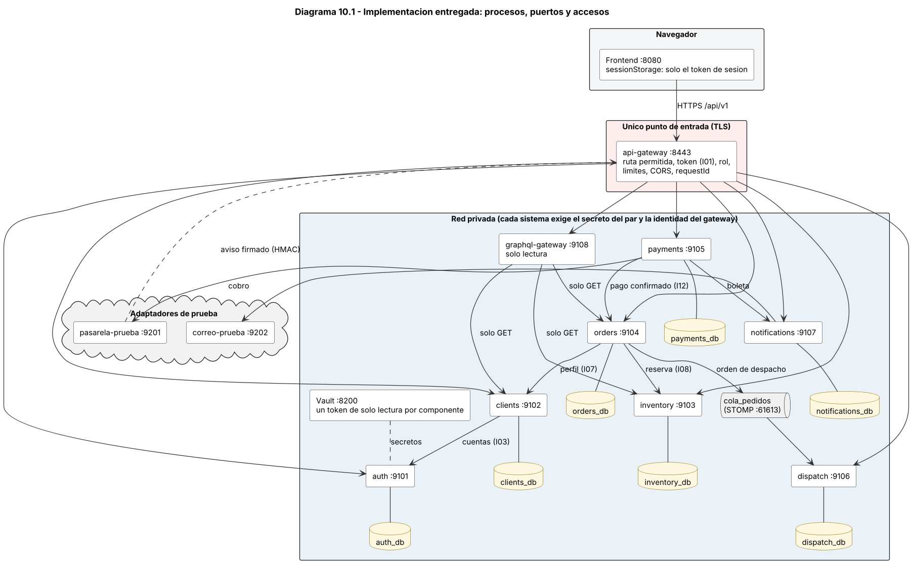

- **Un único punto de entrada.** Todo lo que viene de Internet entra por el **API Gateway** (`https://127.0.0.1:8443`). Ahí se valida el token, se aplica la política de la ruta y se reenvía solo a destinos declarados.
- **Siete sistemas privados**, cada uno con su propia base de datos:
  - `auth`: cuentas, contraseñas, sesiones y personal.
  - `clients`: perfil y domicilio del cliente.
  - `inventory`: catálogo, precio y stock.
  - `orders`: pedidos y su estado oficial.
  - `payments`: cobro, aviso de pago, venta, boleta y reporte.
  - `dispatch`: órdenes de despacho.
  - `notifications`: correos y mensajes de contacto.
- **GraphQL Gateway privado.** Junta en una sola consulta datos de `orders`, `inventory` y `clients` (detalle de pedido y "Mi cuenta"). Solo lee, y solo se llega a él a través del API Gateway.
- **Vault** guarda todos los secretos. Cada componente tiene un token propio de solo lectura, limitado a sus rutas.
- **ActiveMQ** lleva las órdenes de despacho de `orders` a `dispatch` en una cola persistente. Si el broker cae, el pedido igual queda pagado y la orden se envía cuando vuelve.
- **Adaptadores de prueba** de la plataforma de pago y del correo. Conservan el contrato, la autenticación por clave y la firma del aviso. Usamos adaptadores porque Servipag no tiene un entorno de prueba público.

En Docker Compose hay dos redes. La red `publica` tiene solo el gateway, el frontend y la pasarela de prueba. La red `privada` es `internal: true`, sin salida a Internet, y contiene todo lo demás. Mapa de componentes: [Módulo 3](modulo-03.md). Fronteras de confianza: [Módulo 5](modulo-05.md).

---

## Diagramas

Cada diagrama se explica en su módulo. Aquí están los principales. Los demás, con su fuente editable (`.puml`) y en `.svg`, están en [`diagramas/`](diagramas/).

### Componentes y red

Los sistemas, el API Gateway, Vault y el broker, y qué se conecta con qué ([Módulo 3](modulo-03.md)).

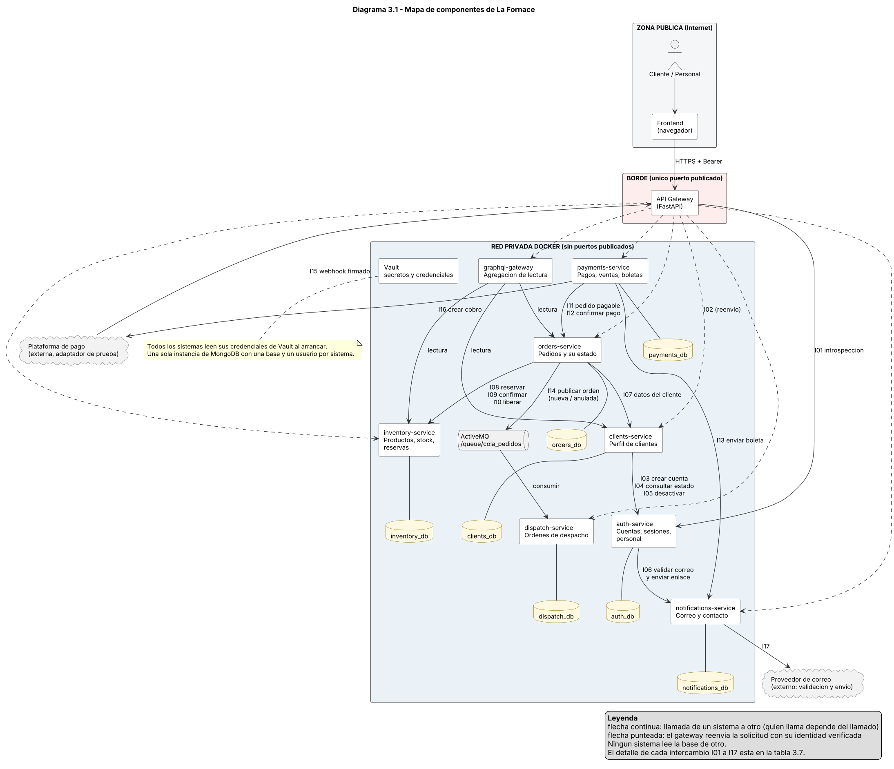

Fronteras de confianza: qué zona confía en cuál y dónde se valida ([Módulo 5](modulo-05.md)).

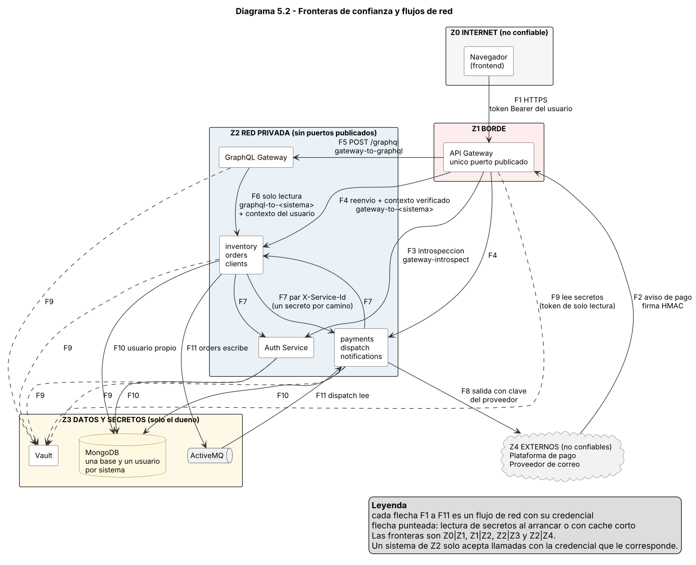

### Flujos principales

Cómo se crea un pedido, de la validación del token a la orden de despacho ([Módulo 3](modulo-03.md)).

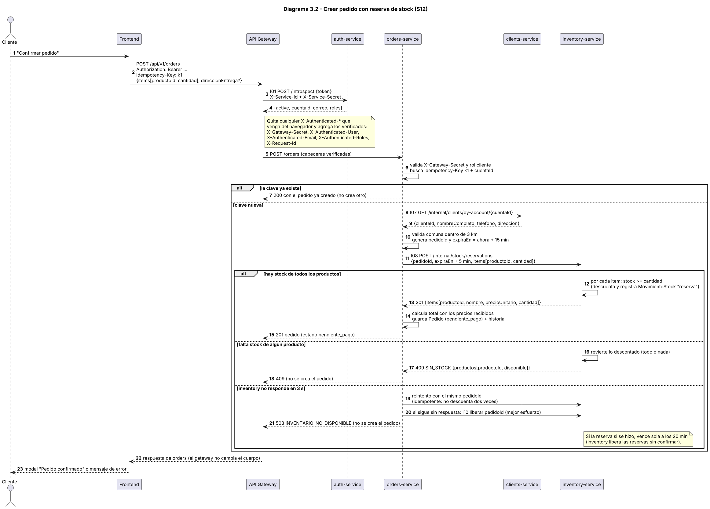

Cómo se paga: redirección a la pasarela, aviso firmado y confirmación de la venta ([Módulo 3](modulo-03.md)).

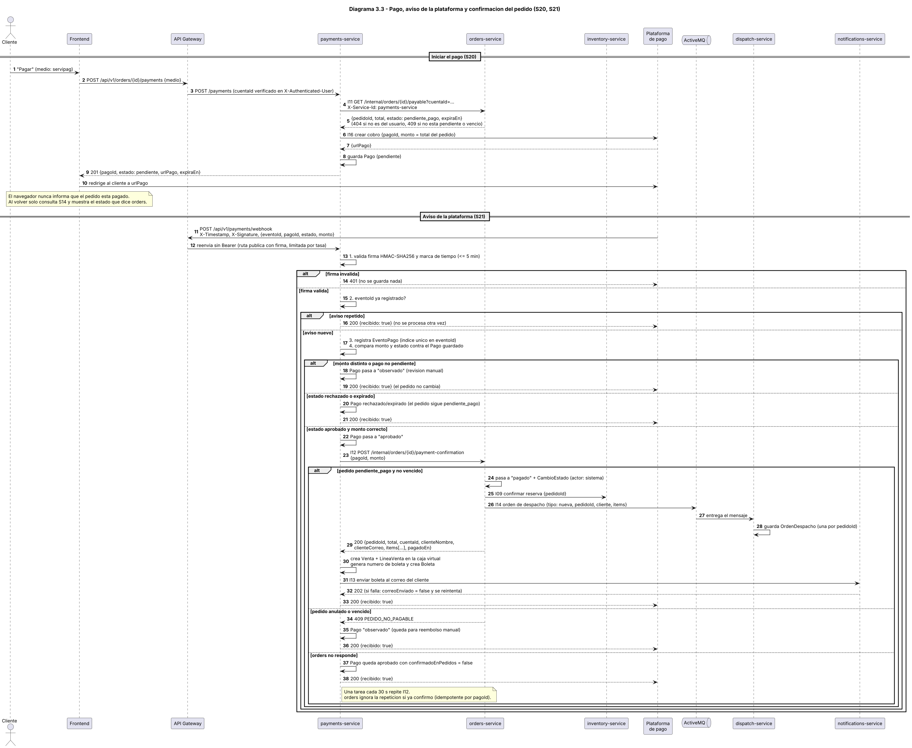

Cómo se decide el acceso a un recurso, con los casos permitido y denegado ([Módulo 5](modulo-05.md)).

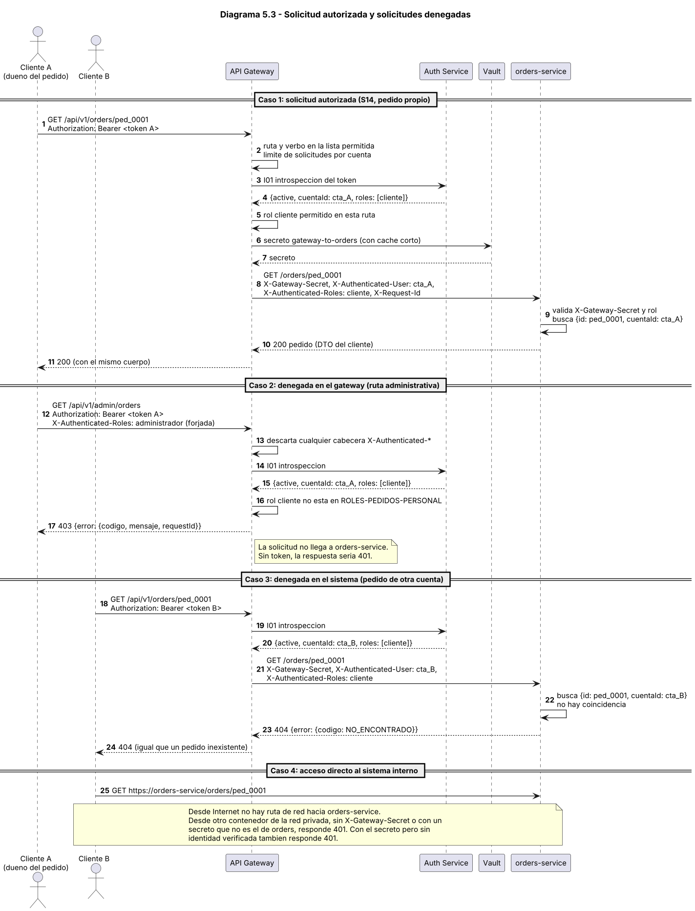

Consulta de un pedido por GraphQL, con la política por rol y por campo ([Módulo 8](modulo-08.md)).

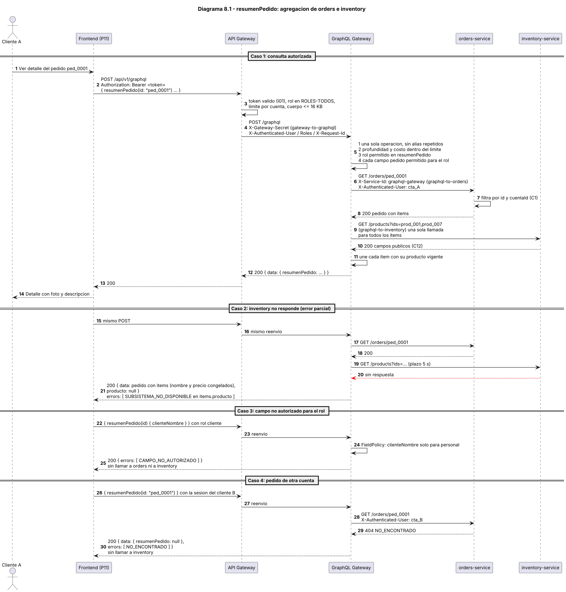

### Datos y credenciales

Dominio y entidades del negocio ([Módulo 2](modulo-02.md)).

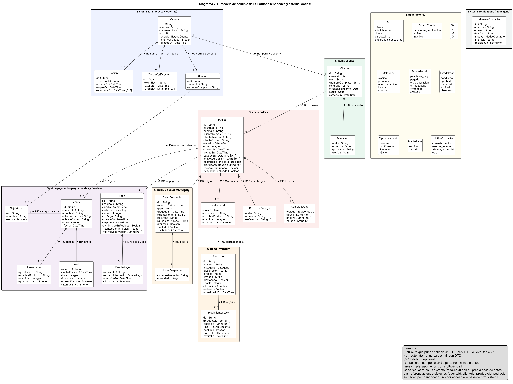

Qué sistema es dueño de cada dato ([Módulo 2](modulo-02.md)).

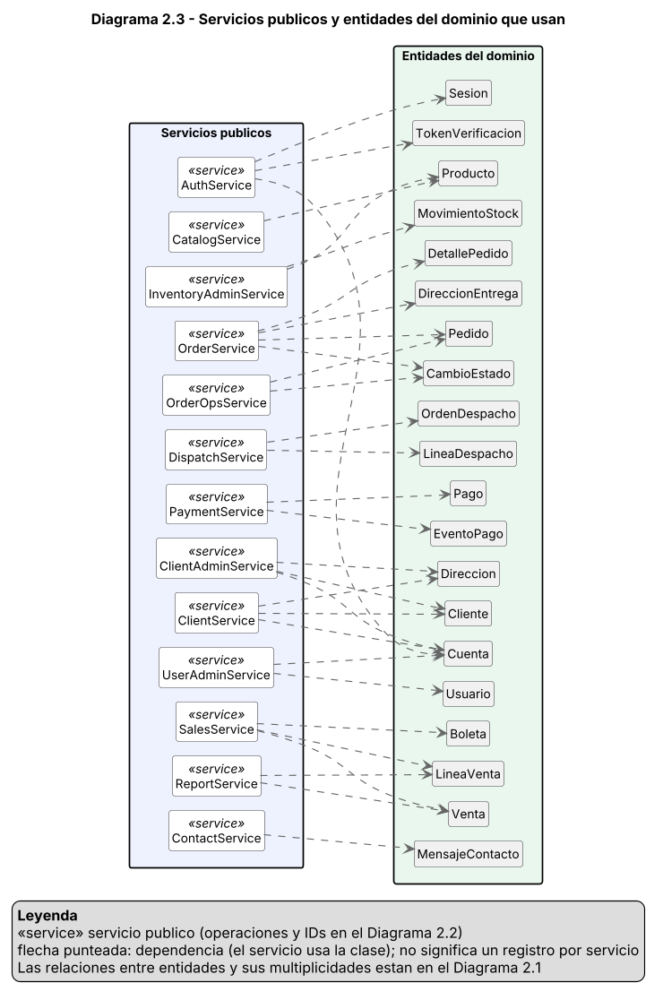

Quién puede leer cada secreto en Vault ([Módulo 6](modulo-06.md)).

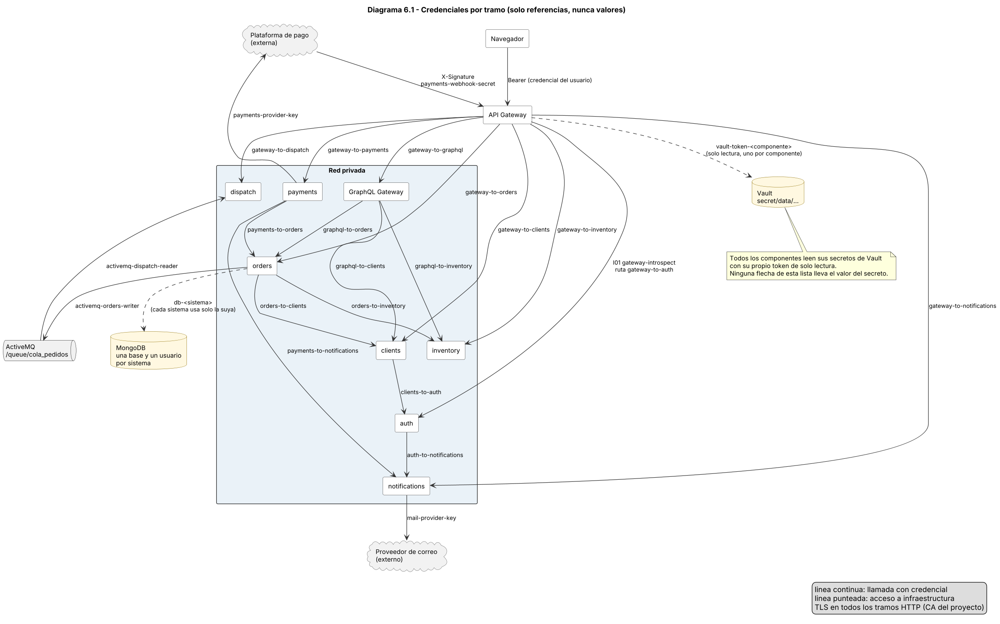

---

## Recorrido por el código

Todo el código está en [`impl/`](impl/). Los 7 sistemas y el API Gateway están en Python (FastAPI) y el GraphQL Gateway en Node (Apollo Server).

| Pieza | Código | Qué hace | Servicios del Módulo 1 |
| --- | --- | --- | --- |
| API Gateway | [`services/api_gateway/main.py`](impl/services/api_gateway/main.py) | Valida el token con `auth`, borra las cabeceras de identidad que mande el navegador, aplica límites y plazos, y reenvía según la tabla de rutas. | Los 35 |
| Tabla de rutas | [`common/fornace/routes.json`](impl/common/fornace/routes.json) | Las 36 rutas R01 a R36 del Módulo 6: verbo, ruta externa, sistema y ruta interna, roles, límite y plazo. Una ruta que no esté aquí responde 404. | — |
| auth | [`services/auth/main.py`](impl/services/auth/main.py) | Cuentas, bcrypt con costo 12, sesiones de 900 s, bloqueo por intentos, verificación de correo, personal. | S01, S02, S04, S05, S30–S33 |
| clients | [`services/clients/main.py`](impl/services/clients/main.py) | Registro y perfil del cliente. Es la autoridad de los datos personales. | S03, S24–S29 |
| inventory | [`services/inventory/main.py`](impl/services/inventory/main.py) | Catálogo, precio y stock. Reserva todo o nada y nunca deja stock negativo. | S06–S11 |
| orders | [`services/orders/main.py`](impl/services/orders/main.py) | Pedidos y transiciones de estado, vencimiento con devolución de stock, publicación de la orden de despacho. | S12–S17 |
| payments | [`services/payments/main.py`](impl/services/payments/main.py) | Inicia el cobro, verifica el aviso firmado (HMAC), evita duplicados por `eventoId`, registra la venta, emite la boleta y arma el reporte. | S20–S23, S34 |
| dispatch | [`services/dispatch/main.py`](impl/services/dispatch/main.py) | Consume la cola y entrega las órdenes para imprimir, sin precios ni RUN. | S18, S19 |
| notifications | [`services/notifications/main.py`](impl/services/notifications/main.py) | Correos del sistema y formulario de contacto. | S35 |
| GraphQL Gateway | [`schema.js`](impl/services/graphql_gateway/schema.js), [`policy.js`](impl/services/graphql_gateway/policy.js), [`clientes.js`](impl/services/graphql_gateway/clientes.js) | Schema de solo lectura. Antes de llamar a ningún sistema revisa rol, campo, profundidad (5), costo (600) y paginación, y agrupa las llamadas por ítem. | `resumenPedido`, `miCuenta` |
| Control de acceso interno | [`common/fornace/guard.py`](impl/common/fornace/guard.py) | Cada sistema comprueba quién lo llama (el gateway u otro sistema permitido, con su secreto) y qué usuario originó la llamada. | — |
| Quién llama a quién | [`common/fornace/topology.py`](impl/common/fornace/topology.py) | Pares permitidos entre sistemas y nombre simbólico de cada secreto. | — |
| Secretos | [`common/fornace/vault.py`](impl/common/fornace/vault.py) | Lee de Vault con caché. Si Vault no responde, usa el valor en memoria durante una ventana y después responde 503. | — |
| Base de datos | [`common/fornace/db.py`](impl/common/fornace/db.py) | Una base por sistema. En Compose cada sistema entra con su propio usuario, con clave sacada de Vault. | — |
| Retención | [`common/fornace/retencion.py`](impl/common/fornace/retencion.py) | Plazos del Módulo 7. Cada sistema borra o anonimiza sus propios datos con una tarea periódica. | — |
| Registros y errores | [`common/fornace/base.py`](impl/common/fornace/base.py) | Una línea JSON por evento, con `requestId` y sin contraseñas, tokens ni datos personales. Los errores tienen formato controlado. | — |
| Despliegue | [`docker-compose.yml`](impl/docker-compose.yml), [`scripts/compose.py`](impl/scripts/compose.py), [`scripts/stack.py`](impl/scripts/stack.py) | Compose con redes pública y privada, o procesos locales. | — |
| Preparación | [`scripts/vault_init.py`](impl/scripts/vault_init.py), [`scripts/mongo_usuarios.py`](impl/scripts/mongo_usuarios.py), [`scripts/certs.sh`](impl/scripts/certs.sh), [`scripts/seed.py`](impl/scripts/seed.py) | Secretos al azar en Vault con una política por componente, usuarios de MongoDB, CA y certificados TLS propios, y datos ficticios. | — |

Qué había en el material del curso, qué agregamos y por qué: [`EXPLICACION-DEL-CODIGO.md`](EXPLICACION-DEL-CODIGO.md).

---

## Cómo resolvimos la seguridad

| Riesgo | Cómo lo resolvimos | Dónde está | Prueba |
| --- | --- | --- | --- |
| Un cliente lee el pedido de otro | `orders` verifica el dueño. Un pedido ajeno responde 404, igual que uno que no existe. | `orders/main.py` | T-AUT, CMP-08 |
| El navegador manda precios, totales o estado falsos | El servidor fija precio, total y estado, e ignora lo que venga del navegador. | `orders/main.py`, `inventory/main.py` | T-DAT-06f |
| Alguien confirma un pago falso | Solo vale un aviso firmado (HMAC), reciente y con el monto exacto. Un aviso repetido no duplica la venta. | `payments/main.py` | T-AUT-08, T-DAT-06, C4 |
| Llamar directo a un sistema interno | Cada sistema exige el secreto del gateway o de un par permitido. En Compose, además, los sistemas no tienen puerto publicado. | `guard.py`, `docker-compose.yml` | T-DAT-05, CMP-RED, CMP-NET |
| Pedir campos de más por GraphQL | Política por rol y por campo, más límites de profundidad, costo y alias. | `policy.js` | T-GQL |
| Secretos en el código | No hay ninguno: los valores se generan al azar y viven en Vault. El repositorio solo tiene nombres simbólicos. | `vault_init.py`, `topology.py` | T-DAT-09, T-DAT-11 |
| Un sistema entra a la base de otro | En Compose, cada usuario de MongoDB tiene `readWrite` solo sobre su base. | `mongo_usuarios.py` | CMP-DB |
| Fuerza bruta | 5 intentos fallidos bloquean la cuenta 15 minutos, más límites por IP en el gateway. | `auth/main.py`, `api_gateway/main.py` | GW-RL |
| Datos personales en los registros | Las líneas de registro no llevan cuerpos, cabeceras, tokens ni datos personales. | `base.py` | CMP-12, T-DAT |

Matriz completa de datos sensibles: [Módulo 7](modulo-07.md). Inventario de secretos: [Módulo 6](modulo-06.md).

---

## Pruebas

Las suites están en [`impl/tests/`](impl/tests/) y la carga en [`impl/carga/`](impl/carga/). Cada suite escribe lo que realmente observó en `impl/tests/resultados/<suite>.json`. Las pruebas no se marcan como OK a mano.

Ejemplo de la regla que pide la guía: un cliente consulta su pedido y obtiene 200; otra cuenta consulta el mismo pedido y obtiene 404, sin datos. La secuencia está en el [diagrama 10.2](diagramas/diagrama-10-2-consulta-pedido.png) y la transcripción con `requestId` en [`demo-flujos.md`](impl/tests/evidencia/demo-flujos.md).

En Compose también probamos a mano la caída de `dispatch` y la del broker. El pedido sigue quedando pagado y la orden llega cuando el servicio vuelve. Las capturas son `compose-00` a `compose-06` en [`impl/tests/evidencia/`](impl/tests/evidencia/).

---

## Evidencia con capturas

Capturas tomadas por las pruebas contra el sistema en ejecución. Están en [`impl/tests/evidencia/`](impl/tests/evidencia/).

### Frontend (prueba e2e con navegador real)

| Captura | Qué muestra |
| --- | --- |
| 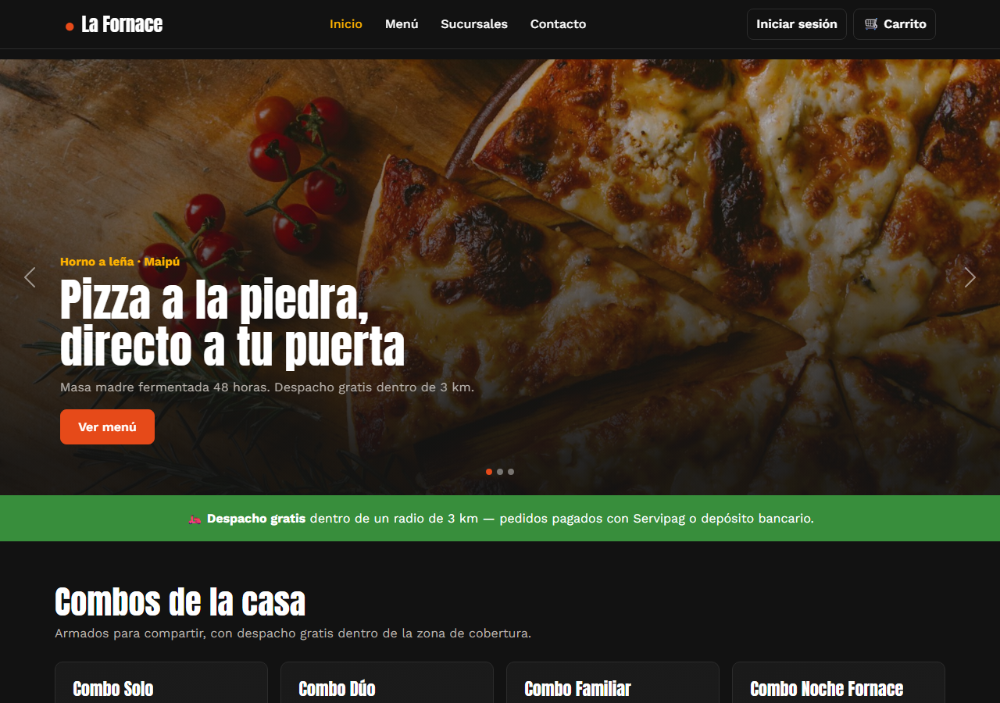 | Página de inicio. |
| 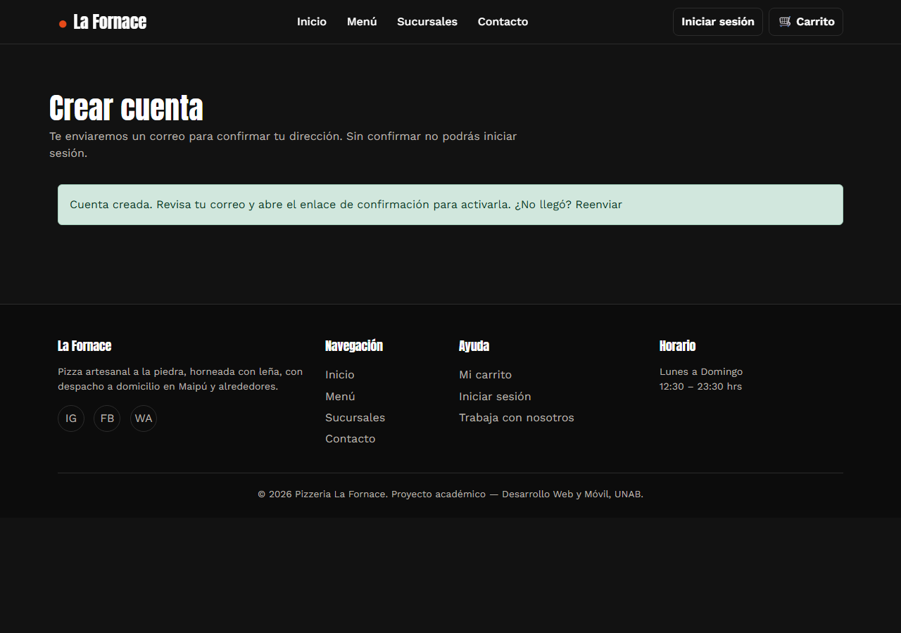 | Registro de una cuenta. |
| 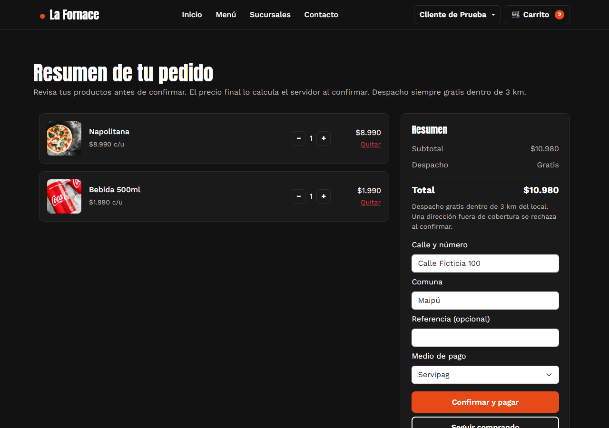 | Carrito antes de pagar. El total lo fija el servidor. |
| 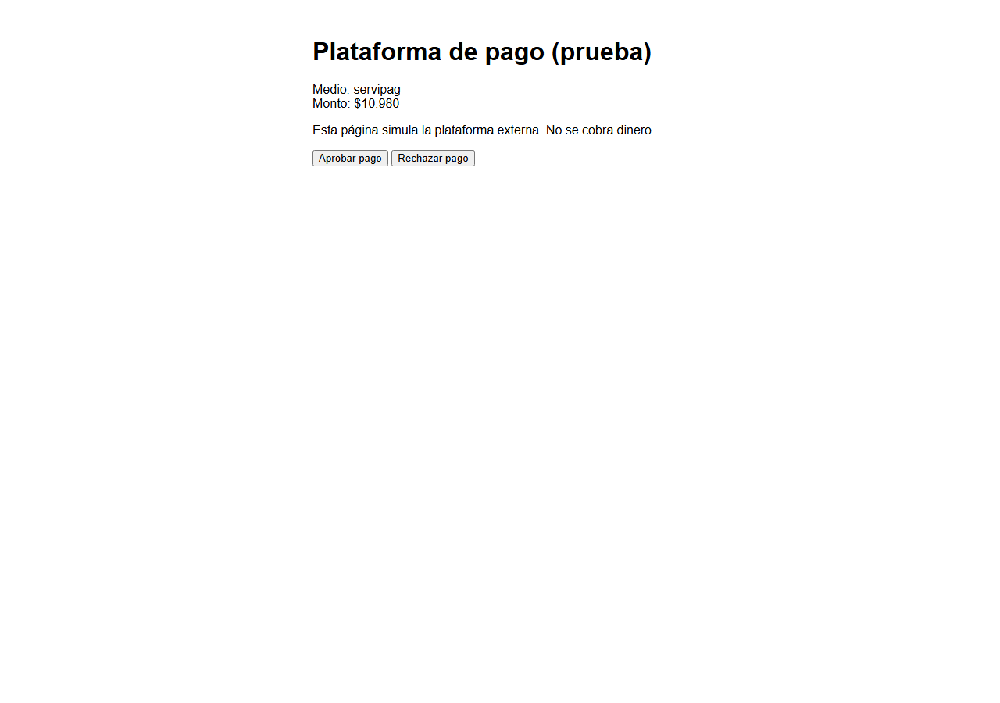 | Pasarela de pago de prueba. |
| 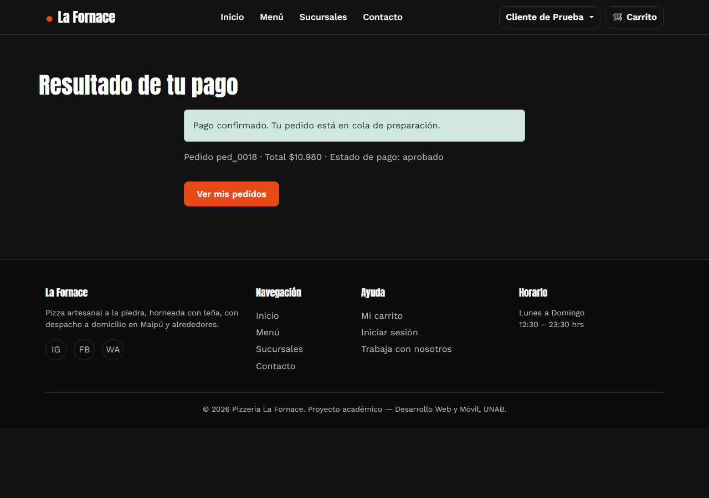 | Retorno tras el pago, con el pedido pagado. |
| 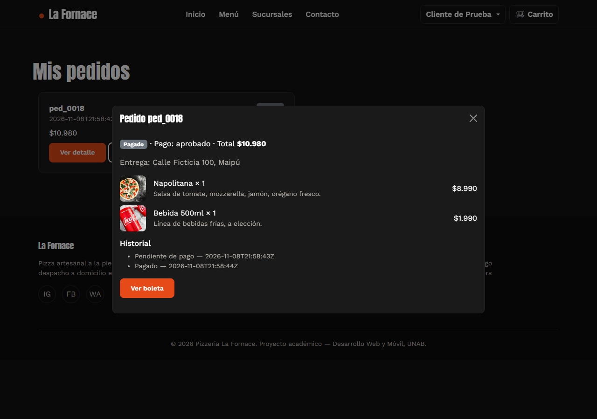 | Detalle del pedido, armado por el GraphQL Gateway. |
| 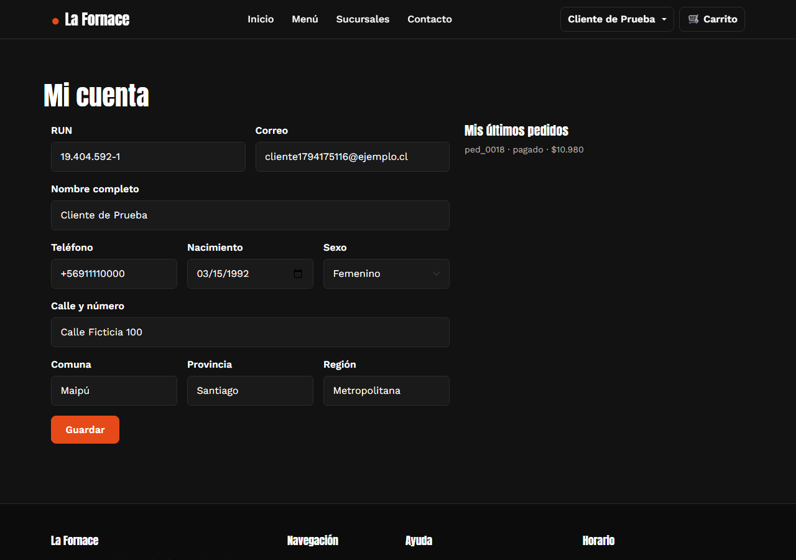 | Mi cuenta: perfil y domicilio. |
| 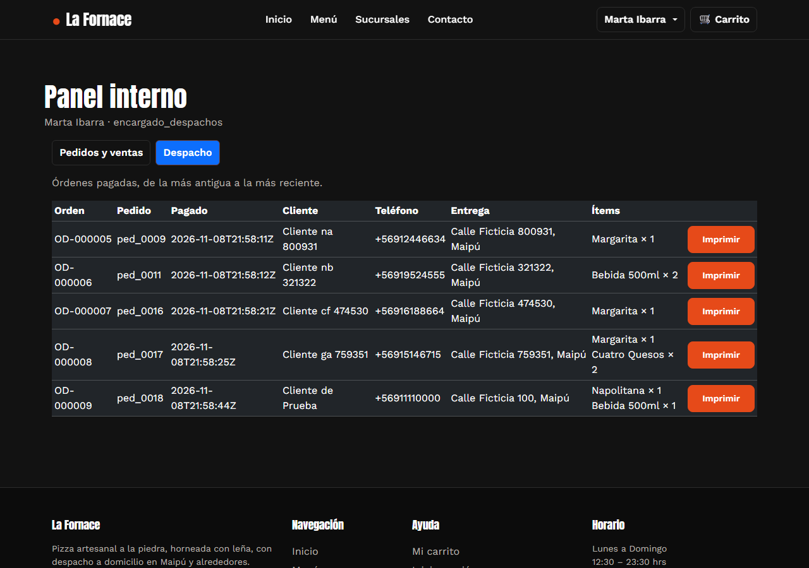 | Panel del personal: orden de despacho recibida. |
| 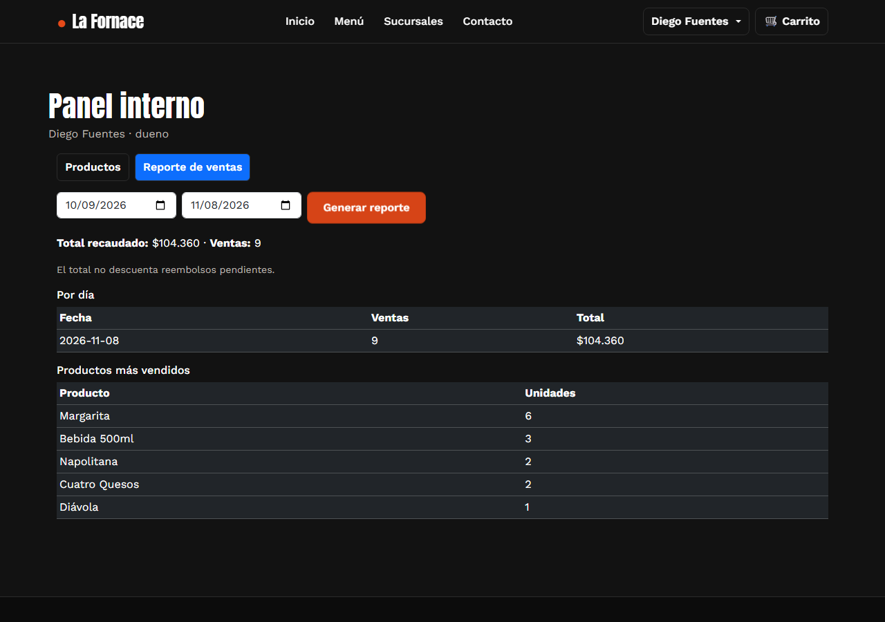 | Reporte de ventas. |
|  | Inicio en pantalla de móvil. |
|  | Menú en pantalla de móvil. |

### Resiliencia en Docker Compose

| Captura | Qué muestra |
| --- | --- |
| 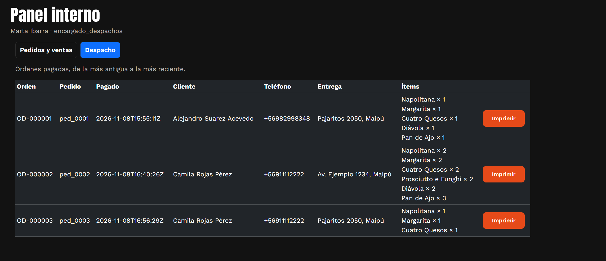 | Despacho antes de la falla. |
| 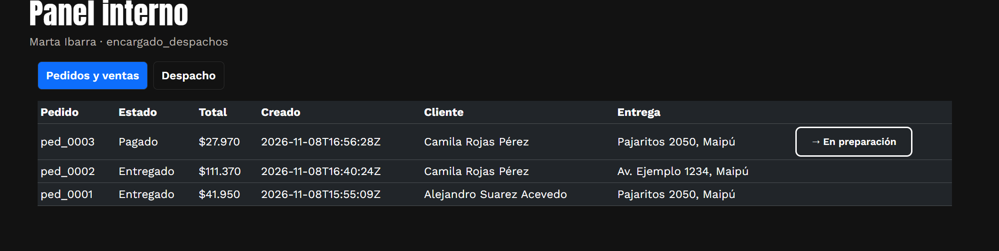 | Pedidos antes de la falla. |
| 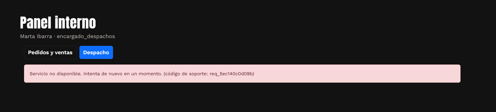 | `dispatch` detenido: el gateway responde 503. |
| 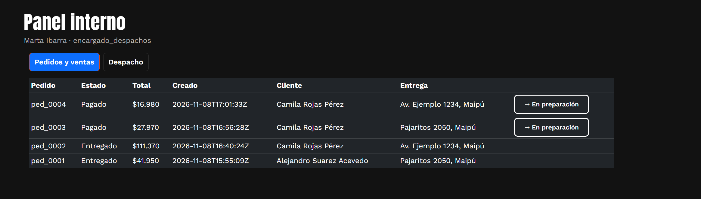 | El pedido queda pagado aunque `dispatch` esté caído. |
| 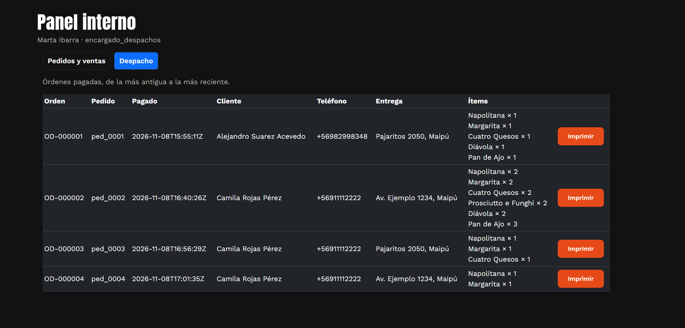 | `dispatch` vuelve y recibe la orden pendiente. |
| 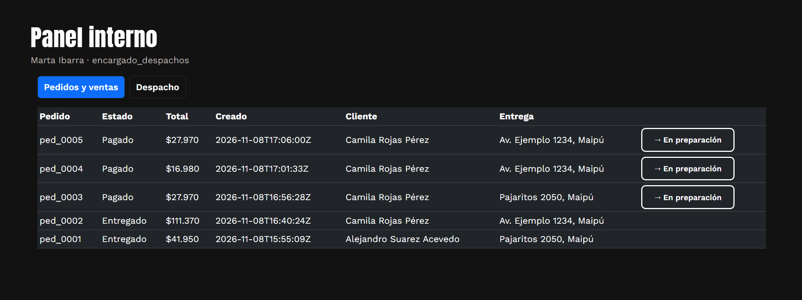 | El pedido queda pagado con el broker caído. |
| 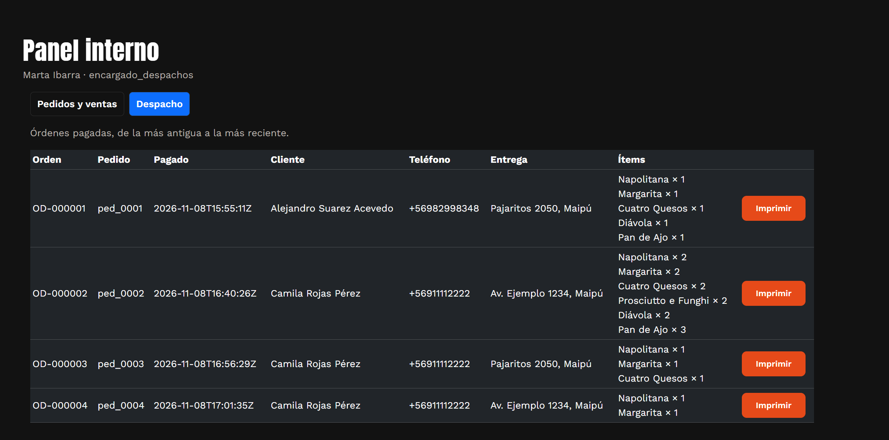 | Sin broker, la orden aún no llega a `dispatch`. |
| 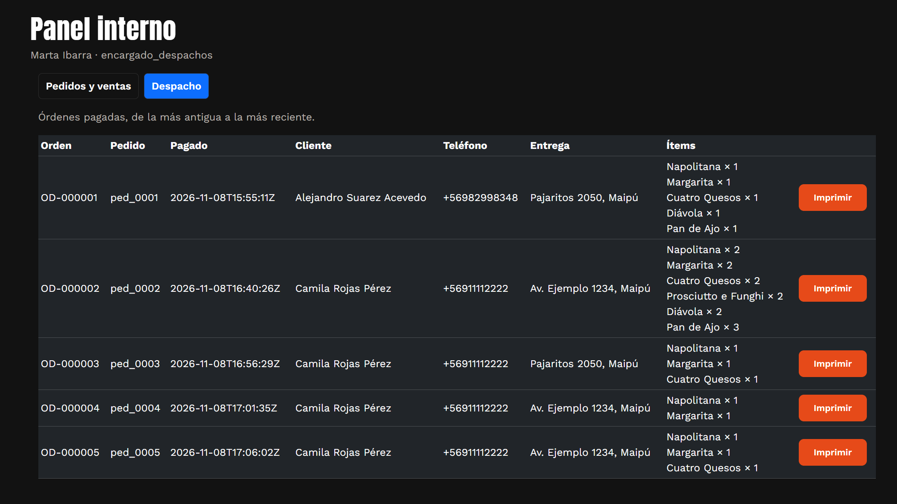 | Al reiniciar el broker, la orden llega. |

La transcripción completa de los flujos, con `requestId`, está en [`demo-flujos.md`](impl/tests/evidencia/demo-flujos.md). La salida de `probar_todo` en Compose está en [`compose-probar-salida.txt`](impl/tests/evidencia/compose-probar-salida.txt).

---

## Informe por módulo

| Módulo | Contenido |
| --- | --- |
| [1. Servicios derivados del frontend](modulo-01.md) | Portada, pantallas, brechas, los 35 servicios con contrato y ejemplo JSON |
| [2. Clases y cardinalidades](modulo-02.md) | UML del dominio, servicios y DTO, y la regla detrás de cada multiplicidad |
| [3. Sistemas e integraciones](modulo-03.md) | Matriz de sistemas, intercambios, mapa de componentes y secuencias |
| [4. Stakeholders y permisos HTTP](modulo-04.md) | Stakeholders y matriz de permisos por ruta, verbo y condición |
| [5. Clases del API Gateway](modulo-05.md) | UML del gateway, políticas, fronteras de confianza |
| [6. Rutas y secretos](modulo-06.md) | Las 36 rutas e inventario simbólico de secretos |
| [7. Datos sensibles](modulo-07.md) | Clasificación, protección, sesiones, retención |
| [8. GraphQL](modulo-08.md) | Schema, resolvers, autorización por campo, límites |
| [9. Analítica y gRPC](modulo-09.md) | ADR de no aplicabilidad y mediciones de carga |
| [10. Backend completo](modulo-10.md) | Implementación, ejecución, resultados, defectos corregidos y limitaciones |

Diagramas editables (`.puml`) y en imagen (`.svg`, `.png`): [`diagramas/`](diagramas/).

---

## Decisiones y limitaciones

- **Sin servicio de analítica ni gRPC.** El caso es un solo local, con un reporte de ventas de 1 a 2 consultas al día. Medimos la alternativa implementada: el reporte de 92 días responde en p95 de unos 40 ms con 13.800 ventas, y en el mismo orden con 138.000 (C5 y C6). La decisión está en los ADR del [Módulo 9](modulo-09.md).
- **Stack del curso en vez de Oracle y .NET.** El Caso 19 pide Oracle y .NET o J2EE. Usamos el stack de los laboratorios del curso (FastAPI, Node, MongoDB). Lo declaramos en el [Módulo 1](modulo-01.md).
- **Pago y correo con adaptadores de prueba.** Para pasar a un proveedor real basta cambiar la URL y la clave en Vault.
- **Token en `sessionStorage`** en el frontend de demostración, con una CSP que limita adónde puede enviar datos un script inyectado.
- **MongoDB con usuarios solo en Compose.** En modo local corre sin autenticación.
- **Vault en modo desarrollo.**

Lista completa, con el efecto de cada una: [Módulo 10, sección 10.11](modulo-10.md#1011-diferencias-con-el-diseño-y-limitaciones). Defectos que encontraron las pruebas y corregimos: [sección 10.10](modulo-10.md#1010-defectos-que-encontraron-las-pruebas-y-se-corrigieron).

---

## Estructura del repositorio

```
.
├── README.md                    este archivo
├── INFORME.pdf                  informe completo (portada, índice y 10 módulos)
├── modulo-01.md … modulo-10.md  el informe por módulo
├── EXPLICACION-DEL-CODIGO.md    qué había, qué agregamos y por qué
├── diagramas/                   13 diagramas en .puml, .svg y .png
└── impl/
    ├── README.md                instalación de las dos formas de ejecución
    ├── GUIA-DE-PRUEBA.md        recorrido por API con curl
    ├── docker-compose.yml       despliegue con redes pública y privada
    ├── Dockerfile.*             imágenes de servicios, broker, frontend y herramientas
    ├── probar_todo.py           todas las pruebas con un comando
    ├── common/fornace/          librería común: rutas, acceso, Vault, base, retención, registros
    ├── services/                api_gateway, graphql_gateway, auth, clients, inventory,
    │                            orders, payments, dispatch, notifications y adaptadores
    ├── scripts/                 arranque local y Compose, Vault, MongoDB, certificados, datos
    ├── carga/                   pruebas de carga (C1–C9) y de fallos (F1–F7)
    ├── frontend/                frontend de la Evaluación 1 integrado (demostración)
    └── tests/                   suites, resultados/ y evidencia/
```

El repositorio no incluye secretos. `.env`, `.run/` y `.venv/` se generan al ejecutar y están en `.gitignore`.
