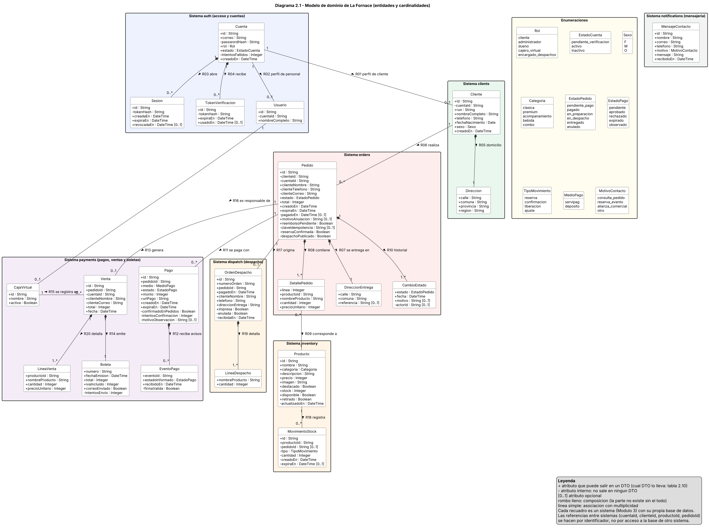
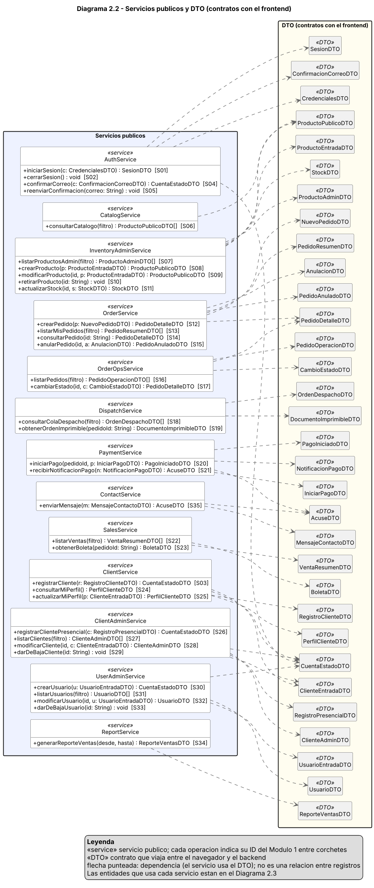
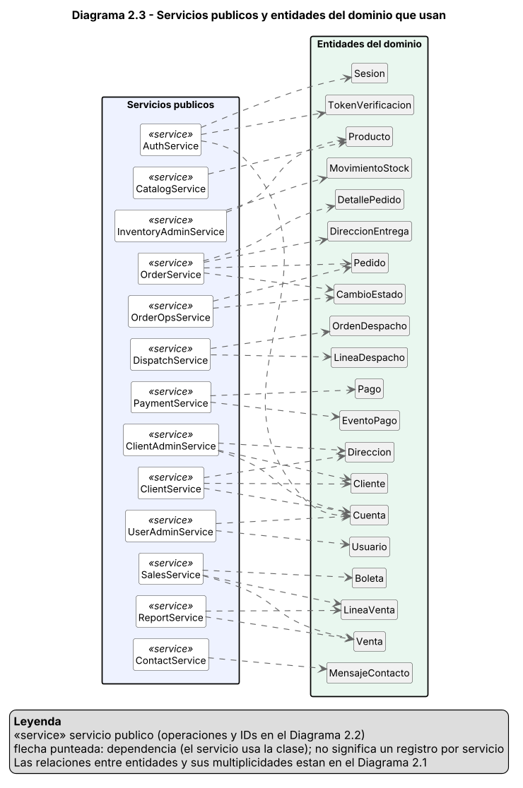

# Evaluación Unidad 2 — Backend seguro completo
## Pizzería La Fornace (derivado del Caso 19)

---

# Módulo 2 — Clases y cardinalidades del dominio

Los diagramas se entregan en formato editable (PlantUML, archivos `.puml`) y legible (`.svg` y `.png`). Están en la carpeta `diagramas/`.

## 2.1 Cumplimiento de los pasos a seguir de la guía

| Paso de la guía | Dónde está en este documento |
| --- | --- |
| 1. Identificar las clases del dominio, con atributos, tipos e identificadores. | Diagrama 2.1 (2.4) y catálogo de clases (2.5). |
| 2. Representar los servicios públicos como «service», con las operaciones de los IDs del Módulo 1. | Diagrama 2.2 (2.7) y correspondencia operación–ID (2.8). |
| 3. Relacionar entidades con asociaciones o composiciones, con multiplicidades en ambos extremos. | Diagrama 2.1 (2.4) y tabla de relaciones R01–R17 (2.6). |
| 4. Relacionar servicios y entidades con dependencias UML, sin interpretarlas como relaciones entre registros. | Diagrama 2.3 (2.9). |
| 5. Explicar las reglas de cada cardinalidad y separar el modelo interno de los DTO. | Columna "Regla" de 2.6 y tabla de DTO (2.10). |

## 2.2 Decisiones de modelado

| Decisión pendiente de la guía | Resolución |
| --- | --- |
| ¿El carrito y el pedido son clases distintas? | **Sí.** El carrito existe solo en el navegador (`localStorage`, con `id` y `cantidad`). El backend no tiene clase `Carrito`: el `Pedido` nace al confirmar (S12) y se crea siempre con al menos un ítem. Por eso no hay borrador vacío y la relación `Pedido` 1 – 1..* `DetallePedido` no necesita excepciones. |
| ¿Qué ocurre con el historial si un producto deja de estar disponible? | El producto no se borra: S10 lo marca `retirado` (baja lógica). Además, cada `DetallePedido` guarda una copia del nombre y del precio al momento de la compra. Los pedidos antiguos, las boletas y los reportes siguen mostrando los mismos datos aunque el producto cambie de precio o se retire. |
| ¿Qué atributos se conservan internamente y cuáles salen en cada respuesta? | En el diagrama 2.1 los atributos con `-` son internos y no salen en ningún DTO (`passwordHash`, `tokenHash`, `intentosFallidos`, `actorId`, `firmaValida`, `intentosEnvio`, `actualizadoEn`, `claveIdempotencia`, `cuentaId`, `clienteId` del pedido, `anulada`, `recibidaEn`, y las banderas de reintento `reservaConfirmada`, `despachoPublicado`, `confirmadoEnPedidos`, `intentosConfirmacion`). Los atributos con `+` pueden salir, pero solo en el DTO del rol que los necesita. Por ejemplo, `stock` y `retirado` salen en `ProductoAdminDTO` y `StockDTO` (administración) y nunca en `ProductoPublicoDTO` (catálogo público). La tabla 2.10 indica, por DTO, qué sale y qué queda dentro. |
| ¿Dónde viven el correo, el rol y la contraseña? | En `Cuenta` (acceso). `Cliente` y `Usuario` guardan solo los datos personales. Las listas de administración (S27 y S31) combinan perfil y cuenta. Por esta razón la búsqueda `q` de S27 es por nombre o RUN. |
| ¿Por qué hay dos clases de dirección? | `Direccion` es el domicilio del cliente (cambia con el perfil). `DireccionEntrega` es una copia fija en el pedido (no cambia aunque el perfil cambie). Cada una es composición de un solo dueño. |
| ¿`MensajeContacto` se relaciona con `Cliente`? | No. Lo envía un visitante anónimo y no se vincula con ninguna cuenta. |
| ¿Cómo se relacionan clases de sistemas distintos? | Por identificador (`cuentaId`, `clienteId`, `productoId`, `pedidoId`), nunca por acceso a la base de otro sistema. Las asociaciones del diagrama expresan la relación de negocio; la columna "Alcance" de la tabla 2.6 indica cuáles cruzan sistemas, y la forma de integrarlas se define en el Módulo 3. |
| ¿Por qué `Pedido`, `Venta` y `OrdenDespacho` guardan nombre del cliente y otros datos que ya existen en `Cliente`? | Son copias congeladas al momento del hecho. La autoridad de esos datos sigue siendo `Cliente` (clients). La copia evita que un pedido, una boleta o una orden de despacho dependan de otro sistema para mostrarse, y conserva lo que el cliente tenía al comprar. Nunca se usa para modificar al cliente. |
| ¿Dónde se guarda que un pedido está pagado? | Solo en `Pedido.estado` (orders). `Pago` (payments) guarda el resultado del cobro. `estadoPago` y `boletaDisponible` se deducen del estado del pedido, para que no existan dos fuentes de la verdad sobre lo mismo. |
| ¿Qué hace la clase `CajaVirtual`? | El caso asocia las ventas web a una caja de un cajero virtual y el dueño consulta lo recaudado. Se modela una caja con un cajero responsable. |
| ¿Y la cobertura de 3 km? | Es una regla de configuración que valida S12 sobre `DireccionEntrega.comuna`. No necesita una clase propia. |

## 2.3 Leyenda de notación

| Símbolo | Significado |
| --- | --- |
| `+ atributo` | Atributo que puede salir en un DTO. Qué DTO lo lleva está en la tabla 2.10. |
| `- atributo` | Atributo interno. No sale en ningún DTO. |
| `[0..1]` junto a un atributo | Atributo opcional. |
| Línea simple con números en los extremos | Asociación. Los números son las multiplicidades: `1`, `0..1`, `0..*` o `1..*`. |
| Línea con rombo lleno | Composición. La parte no existe sin el todo. |
| Flecha punteada | Dependencia UML: el servicio usa esa clase o ese DTO. **No** es una relación entre registros del negocio. |
| `«service»` | Servicio público. Cada operación lleva su ID del Módulo 1 entre corchetes. |
| `«DTO»` | Contrato que viaja entre el navegador y el backend. |
| `«enumeration»` | Lista fija de valores. Se usa como tipo de atributo y no se dibujan líneas hacia ella. |
| Recuadros de colores | Cada recuadro es un sistema con su propia base de datos (Módulo 3). |

## 2.4 Diagrama 2.1 — Dominio

Fuente editable: `diagramas/diagrama-2-1-dominio.puml`. Versión vectorial: `diagramas/diagrama-2-1-dominio.svg`.

## 2.5 Catálogo de clases

| Clase | Sistema | Qué representa | Identificador | Origen (requisito · pantalla) |
| --- | --- | --- | --- | --- |
| `Cuenta` | auth | Credencial de acceso de una persona: correo, contraseña con hash, rol y estado. | `id` | RF5, RF11, RF12 · P06, P08, P09 |
| `Sesion` | auth | Sesión activa asociada a un token. Permite el control y la revocación de sesiones. | `id` | RF12 (RNF 7) · S01, S02 |
| `TokenVerificacion` | auth | Token de un solo uso para confirmar el correo o definir la contraseña. | `id` | RF11 · P09 |
| `Usuario` | auth | Perfil del personal del restaurante (administrador, dueño, cajero virtual, encargado de despachos). | `id` | RF10, RF12 · P17 |
| `Cliente` | clients | Datos personales del cliente registrado. | `id` | RF5, RF6 · P08, P12, P16 |
| `Direccion` | clients | Domicilio del cliente (calle, comuna, provincia, región). Objeto de valor. | Sin id propio (parte del Cliente) | RF5 · P08, P12 |
| `Producto` | inventory | Ítem del menú, incluidos los combos, con precio, stock y disponibilidad. | `id` | RF1, RF7, RF10 · P01, P02, P13 |
| `MovimientoStock` | inventory | Registro de cada reserva, confirmación, liberación o ajuste de stock. Permite repetir una reserva sin descontar dos veces. | `id` | RF1, RF7 · P13 |
| `Pedido` | orders | Pedido de un cliente. Su estado sigue el ciclo de vida del Módulo 1. | `id` | RF1, RF2, RF3 · P03, P11 |
| `DetallePedido` | orders | Línea del pedido. Congela nombre y precio del producto al momento de la compra. | `pedido` + `linea` | RF1 · P03, P11 |
| `DireccionEntrega` | orders | Copia de la dirección de entrega al crear el pedido, con referencia opcional. | Sin id propio (parte del Pedido) | RF1 (radio de 3 km) · P03 |
| `CambioEstado` | orders | Registro de cada cambio de estado del pedido (historial). | `pedido` + `fecha` | RF2, RF3 · P11, P14 |
| `OrdenDespacho` | dispatch | Orden que se imprime y va a cocina en orden de llegada. Es una copia que recibe el sistema de despacho cuando el pago se confirma. | `id`, `numeroOrden` | RF13 · P15 |
| `LineaDespacho` | dispatch | Producto y cantidad de una orden de despacho. Sin precios. | `orden` + `linea` | RF13 · P15 |
| `Pago` | payments | Intento de pago de un pedido en la plataforma externa. | `id` | RF2 · P10 |
| `EventoPago` | payments | Aviso recibido de la plataforma de pago. Su `eventoId` evita procesar dos veces el mismo aviso. | `eventoId` | RF2 · S21 |
| `Venta` | payments | Venta registrada en la caja virtual cuando el pago se aprueba. Guarda copia del nombre y el correo del cliente. | `id` | RF4 · P14 |
| `LineaVenta` | payments | Producto, cantidad y precio de una venta. Copia congelada del pedido pagado. | `venta` + `producto` | RF4, RF8, RF9 · P14, P18 |
| `Boleta` | payments | Boleta digital de una venta, enviada por correo. | `numero` | RF8 · P11, P14 |
| `CajaVirtual` | payments | Caja de las ventas web. Pertenece a un cajero virtual. | `id` | RF4 · P14 |
| `MensajeContacto` | notifications | Mensaje enviado por un visitante desde la página de contacto. | `id` | RF14 · P05 |

Enumeraciones: `Rol` (cliente, administrador, dueno, cajero_virtual, encargado_despachos), `EstadoCuenta` (pendiente_verificacion, activo, inactivo), `Sexo`, `Categoria`, `EstadoPedido`, `EstadoPago`, `MedioPago` y `MotivoContacto`. Sus valores están en el diagrama.

## 2.6 Tabla de relaciones

La multiplicidad de origen es la que está junto a la clase de origen. La de destino, junto a la clase de destino.

| ID | Clase origen | Clase destino | Mult. origen | Mult. destino | Tipo | Nombre | Alcance | Regla de negocio que la origina |
| --- | --- | --- | --- | --- | --- | --- | --- | --- |
| R01 | `Cuenta` | `Cliente` | 1 | 0..1 | Asociación | perfil de cliente | auth → clients (por `cuentaId`) | Toda cuenta con rol `cliente` tiene exactamente un perfil de cliente (RF5). Las cuentas del personal no tienen perfil de cliente, por eso el extremo del cliente es 0..1. Un cliente pertenece a una sola cuenta: el correo es único. |
| R02 | `Cuenta` | `Usuario` | 1 | 0..1 | Asociación | perfil de personal | dentro de auth | Toda cuenta con rol distinto de `cliente` tiene un perfil de usuario (RF10, RF12). Las cuentas de clientes no lo tienen. Una cuenta tiene un perfil de cliente **o** uno de personal, nunca ambos. |
| R03 | `Cuenta` | `Sesion` | 1 | 0..* | Composición | abre | dentro de auth | Una cuenta puede tener varias sesiones a la vez (varios dispositivos) o ninguna. Una sesión pertenece a una sola cuenta y se invalida si la cuenta se da de baja (RNF 7). |
| R04 | `Cuenta` | `TokenVerificacion` | 1 | 0..* | Composición | recibe | dentro de auth | Cada reenvío del correo (S05) genera un token nuevo y deja inválido el anterior. Una cuenta recién creada ya tiene uno; después puede tener varios o ninguno vigente. Un token pertenece a una sola cuenta. |
| R05 | `Cliente` | `Direccion` | 1 | 1 | Composición | domicilio | dentro de clients | El caso exige dirección, comuna, provincia y región al registrar a un cliente (RF5), así que siempre hay exactamente un domicilio. No se comparte entre clientes. |
| R06 | `Cliente` | `Pedido` | 1 | 0..* | Asociación | realiza | clients → orders (por `clienteId`) | Las ventas se hacen solo a pedidos de clientes registrados (RF4), por eso un pedido tiene exactamente un cliente. Un cliente recién registrado aún no tiene pedidos. Con la baja lógica del cliente (S29) sus pedidos se conservan. |
| R07 | `Pedido` | `DireccionEntrega` | 1 | 1 | Composición | se entrega en | dentro de orders | Cada pedido guarda una copia de la dirección donde se entrega, validada dentro de los 3 km. Si el cliente cambia su domicilio después, el pedido conserva la dirección original. |
| R08 | `Pedido` | `DetallePedido` | 1 | 1..* | Composición | contiene | dentro de orders | Un pedido se crea con al menos un ítem (RF1) y no existe en el servidor un pedido vacío. Cada línea pertenece a un solo pedido. |
| R09 | `DetallePedido` | `Producto` | 0..* | 1 | Asociación | corresponde a | orders → inventory (por `productoId`) | Cada línea corresponde a exactamente un producto del menú. Un producto puede estar en muchas líneas o en ninguna (por ejemplo, uno recién creado). La línea guarda nombre y precio congelados, y el producto retirado (S10) no se borra, así que el historial queda intacto. |
| R10 | `Pedido` | `CambioEstado` | 1 | 1..* | Composición | historial | dentro de orders | Al crear un pedido se registra el estado inicial `pendiente_pago`, así que siempre hay al menos un cambio. Cada transición agrega uno más. El historial permite conservar el registro de una anulación (RF3). |
| R11 | `Pedido` | `Pago` | 1 | 0..* | Asociación | se paga con | orders → payments (por `pedidoId`) | Un pedido recién creado aún no tiene pagos. Puede acumular varios intentos (rechazado, expirado), pero solo uno puede quedar aprobado. Cada pago pertenece a un solo pedido. |
| R12 | `Pago` | `EventoPago` | 1 | 0..* | Composición | recibe avisos | dentro de payments | La plataforma puede avisar más de una vez el resultado de un mismo pago. Se guarda cada `eventoId` para no procesar dos veces el mismo aviso. Un pago sin avisos aún está pendiente. |
| R13 | `Pedido` | `Venta` | 1 | 0..1 | Asociación | genera | orders → payments (por `pedidoId`) | La venta existe solo cuando el pago está aprobado (RF2, RF4). Un pedido no pagado o anulado no tiene venta. Un pedido genera a lo más una venta, y toda venta corresponde a un pedido. |
| R14 | `Venta` | `Boleta` | 1 | 1 | Composición | emite | dentro de payments | Para cada venta se genera su boleta (RF8). La boleta no existe sin su venta y cada venta tiene una sola. |
| R15 | `Venta` | `CajaVirtual` | 0..* | 1 | Asociación | se registra en | dentro de payments | Las ventas web se asocian a una caja (RF4). Cada venta se registra en exactamente una caja. Una caja acumula muchas ventas, y el dueño consulta el monto recaudado (RF9). Una caja nueva aún no tiene ventas. |
| R16 | `Usuario` | `CajaVirtual` | 1 | 0..1 | Asociación | es responsable de | auth → payments (por `usuarioId`) | La caja pertenece a un cajero virtual (RF4). Un usuario cajero virtual tiene a lo más una caja, y toda caja tiene exactamente un cajero responsable. Otros usuarios (por ejemplo, el administrador) no tienen caja. |
| R17 | `Pedido` | `OrdenDespacho` | 1 | 0..1 | Asociación | origina | orders → dispatch (por `pedidoId`) | La orden de despacho se genera solo cuando el pago está confirmado (RF2, RF13), por eso un pedido pendiente o anulado no la tiene. Cada pedido pagado genera una sola orden. |
| R18 | `Producto` | `MovimientoStock` | 1 | 0..* | Asociación | registra | dentro de inventory | Cada cambio de stock queda como un movimiento (reserva, confirmación, liberación o ajuste). Un producto nuevo aún no tiene movimientos. Un movimiento pertenece a un solo producto. Como el movimiento de un pedido se identifica por `pedidoId` y tipo, repetir una reserva no descuenta dos veces. |
| R19 | `OrdenDespacho` | `LineaDespacho` | 1 | 1..* | Composición | detalla | dentro de dispatch | Una orden de despacho lleva al menos un producto (viene de un pedido que tiene al menos un ítem, R08). Cada línea pertenece a una sola orden y no existe sin ella. |
| R20 | `Venta` | `LineaVenta` | 1 | 1..* | Composición | detalla | dentro de payments | La venta guarda una copia congelada de las líneas del pedido pagado, así la boleta y el reporte no dependen del pedido ni del precio actual del producto. Al menos una línea por venta; cada línea pertenece a una sola venta. |

## 2.7 Diagrama 2.2 — Servicios públicos y DTO

Fuente editable: `diagramas/diagrama-2-2-servicios.puml`. Versión vectorial: `diagramas/diagrama-2-2-servicios.svg`.

Los 13 servicios agrupan las operaciones por tema. En el Módulo 3 cada servicio se asigna a un sistema. Una excepción a tener presente: S03 (registrar cliente) se agrupa con los servicios de clientes porque crea el perfil del cliente y pide la cuenta al sistema de autenticación.

## 2.8 Correspondencia entre operación UML e ID de servicio

| ID | Servicio «service» | Operación UML | Verbo y ruta (Módulo 1) |
| --- | --- | --- | --- |
| S01 | `AuthService` | `iniciarSesion(c: CredencialesDTO) : SesionDTO` | `POST /api/v1/auth/login` |
| S02 | `AuthService` | `cerrarSesion() : void` | `POST /api/v1/auth/logout` |
| S03 | `ClientService` | `registrarCliente(r: RegistroClienteDTO) : CuentaEstadoDTO` | `POST /api/v1/auth/register` |
| S04 | `AuthService` | `confirmarCorreo(c: ConfirmacionCorreoDTO) : CuentaEstadoDTO` | `POST /api/v1/auth/verify-email` |
| S05 | `AuthService` | `reenviarConfirmacion(correo: String) : void` | `POST /api/v1/auth/resend-verification` |
| S06 | `CatalogService` | `consultarCatalogo(filtro) : ProductoPublicoDTO[]` | `GET /api/v1/products` |
| S07 | `InventoryAdminService` | `listarProductosAdmin(filtro) : ProductoAdminDTO[]` | `GET /api/v1/admin/products` |
| S08 | `InventoryAdminService` | `crearProducto(p: ProductoEntradaDTO) : ProductoPublicoDTO` | `POST /api/v1/products` |
| S09 | `InventoryAdminService` | `modificarProducto(id, p: ProductoEntradaDTO) : ProductoPublicoDTO` | `PUT /api/v1/products/{id}` |
| S10 | `InventoryAdminService` | `retirarProducto(id: String) : void` | `DELETE /api/v1/products/{id}` |
| S11 | `InventoryAdminService` | `actualizarStock(id, s: StockDTO) : StockDTO` | `PUT /api/v1/products/{id}/stock` |
| S12 | `OrderService` | `crearPedido(p: NuevoPedidoDTO) : PedidoDetalleDTO` | `POST /api/v1/orders` |
| S13 | `OrderService` | `listarMisPedidos(filtro) : PedidoResumenDTO[]` | `GET /api/v1/orders` |
| S14 | `OrderService` | `consultarPedido(id: String) : PedidoDetalleDTO` | `GET /api/v1/orders/{id}` |
| S15 | `OrderService` | `anularPedido(id, a: AnulacionDTO) : PedidoAnuladoDTO` | `POST /api/v1/orders/{id}/cancel` |
| S16 | `OrderOpsService` | `listarPedidos(filtro) : PedidoOperacionDTO[]` | `GET /api/v1/admin/orders` |
| S17 | `OrderOpsService` | `cambiarEstado(id, c: CambioEstadoDTO) : PedidoDetalleDTO` | `PATCH /api/v1/admin/orders/{id}/status` |
| S18 | `DispatchService` | `consultarColaDespacho(filtro) : OrdenDespachoDTO[]` | `GET /api/v1/admin/dispatch-orders` |
| S19 | `DispatchService` | `obtenerOrdenImprimible(pedidoId: String) : DocumentoImprimibleDTO` | `GET /api/v1/admin/dispatch-orders/{pedidoId}/print` |
| S20 | `PaymentService` | `iniciarPago(pedidoId, p: IniciarPagoDTO) : PagoIniciadoDTO` | `POST /api/v1/orders/{id}/payments` |
| S21 | `PaymentService` | `recibirNotificacionPago(n: NotificacionPagoDTO) : AcuseDTO` | `POST /api/v1/payments/webhook` |
| S22 | `SalesService` | `listarVentas(filtro) : VentaResumenDTO[]` | `GET /api/v1/admin/sales` |
| S23 | `SalesService` | `obtenerBoleta(pedidoId: String) : BoletaDTO` | `GET /api/v1/orders/{id}/receipt` |
| S24 | `ClientService` | `consultarMiPerfil() : PerfilClienteDTO` | `GET /api/v1/clients/me` |
| S25 | `ClientService` | `actualizarMiPerfil(p: ClienteEntradaDTO) : PerfilClienteDTO` | `PUT /api/v1/clients/me` |
| S26 | `ClientAdminService` | `registrarClientePresencial(c: RegistroPresencialDTO) : CuentaEstadoDTO` | `POST /api/v1/admin/clients` |
| S27 | `ClientAdminService` | `listarClientes(filtro) : ClienteAdminDTO[]` | `GET /api/v1/admin/clients` |
| S28 | `ClientAdminService` | `modificarCliente(id, c: ClienteEntradaDTO) : ClienteAdminDTO` | `PUT /api/v1/admin/clients/{id}` |
| S29 | `ClientAdminService` | `darDeBajaCliente(id: String) : void` | `DELETE /api/v1/admin/clients/{id}` |
| S30 | `UserAdminService` | `crearUsuario(u: UsuarioEntradaDTO) : CuentaEstadoDTO` | `POST /api/v1/admin/users` |
| S31 | `UserAdminService` | `listarUsuarios(filtro) : UsuarioDTO[]` | `GET /api/v1/admin/users` |
| S32 | `UserAdminService` | `modificarUsuario(id, u: UsuarioEntradaDTO) : UsuarioDTO` | `PUT /api/v1/admin/users/{id}` |
| S33 | `UserAdminService` | `darDeBajaUsuario(id: String) : void` | `DELETE /api/v1/admin/users/{id}` |
| S34 | `ReportService` | `generarReporteVentas(desde, hasta) : ReporteVentasDTO` | `GET /api/v1/admin/reports/sales` |
| S35 | `ContactService` | `enviarMensaje(m: MensajeContactoDTO) : AcuseDTO` | `POST /api/v1/contact-messages` |

Los 35 servicios del Módulo 1 están representados. La operación interna "realizar venta" y las demás internas no se muestran porque no son servicios públicos.

## 2.9 Diagrama 2.3 — Servicios y entidades que usan

Fuente editable: `diagramas/diagrama-2-3-servicios-entidades.puml`. Versión vectorial: `diagramas/diagrama-2-3-servicios-entidades.svg`.

| Servicio | Entidades que usa | IDs |
| --- | --- | --- |
| `AuthService` | Cuenta, Sesion, TokenVerificacion | S01, S02, S04, S05 |
| `CatalogService` | Producto | S06 |
| `InventoryAdminService` | Producto, MovimientoStock | S07–S11 |
| `OrderService` | Pedido, DetallePedido, DireccionEntrega, CambioEstado | S12–S15 |
| `OrderOpsService` | Pedido, CambioEstado | S16, S17 |
| `DispatchService` | OrdenDespacho, LineaDespacho | S18, S19 |
| `PaymentService` | Pago, EventoPago | S20, S21 |
| `SalesService` | Venta, LineaVenta, Boleta | S22, S23 |
| `ClientService` | Cliente, Direccion, Cuenta | S03, S24, S25 |
| `ClientAdminService` | Cliente, Direccion, Cuenta | S26–S29 |
| `UserAdminService` | Usuario, Cuenta | S30–S33 |
| `ReportService` | Venta, LineaVenta | S34 |
| `ContactService` | MensajeContacto | S35 |

Estas dependencias indican que el servicio usa la clase para cumplir sus operaciones. No significan que exista un registro de esa clase por cada instancia del servicio.

## 2.10 Modelo interno y DTO

El modelo interno (diagrama 2.1) nunca se envía completo. Cada servicio recibe y devuelve un DTO con los campos mínimos que necesita su pantalla.

| DTO | Sentido | Servicios | Entidades de origen | Campos que viajan | Campos que quedan dentro |
| --- | --- | --- | --- | --- | --- |
| `CredencialesDTO` | Entrada | S01 | Cuenta | `correo`, `password` | — |
| `SesionDTO` | Salida | S01 | Cuenta, Sesion | `access_token`, `token_type`, `expires_in`, `rol`, `nombre` | `tokenHash`, `intentosFallidos`, `passwordHash` |
| `RegistroClienteDTO` | Entrada | S03 | Cuenta, Cliente, Direccion | `run`, `nombreCompleto`, `correo`, `password`, `telefono`, `fechaNacimiento`, `sexo`, `direccion` | `id`, `rol`, `estado` (los asigna el servidor) |
| `RegistroPresencialDTO` | Entrada | S26 | Cuenta, Cliente, Direccion | Igual a `RegistroClienteDTO` sin `password` | `id`, `rol`, `estado` |
| `CuentaEstadoDTO` | Salida | S03, S04, S26, S30 | Cuenta | `id`, `correo` o `rol` (según el servicio), `estado` | `passwordHash`, `intentosFallidos` |
| `ConfirmacionCorreoDTO` | Entrada | S04 | TokenVerificacion, Cuenta | `token`, `password` (solo si la cuenta aún no tiene) | `tokenHash`, `expiraEn`, `usadoEn` |
| `ProductoPublicoDTO` | Salida | S06, S08, S09 | Producto | `id`, `nombre`, `categoria`, `descripcion`, `precio`, `imagen`, `destacado`, `disponible` | `stock`, `retirado`, `actualizadoEn` |
| `ProductoAdminDTO` | Salida | S07 | Producto | `id`, `nombre`, `categoria`, `precio`, `stock`, `disponible`, `retirado` | `actualizadoEn` |
| `ProductoEntradaDTO` | Entrada | S08, S09 | Producto | `nombre`, `categoria`, `descripcion`, `precio`, `imagen`, `destacado` (y `stock` solo en S08) | `id`, `disponible`, `retirado` (los calcula el servidor) |
| `StockDTO` | Entrada y salida | S11 | Producto, MovimientoStock | `stock`, `disponible` (y `id` en la salida) | `retirado`; el cambio queda como `MovimientoStock` de tipo `ajuste` |
| `NuevoPedidoDTO` | Entrada | S12 | Pedido, DetallePedido, DireccionEntrega | `items[productoId, cantidad]`, `direccionEntrega` (opcional) | Precios, `total`, `estado`, ids y fechas: los calcula el servidor |
| `PedidoResumenDTO` | Salida | S13 | Pedido | `id`, `estado`, `total`, `creadoEn` | `clienteId`, `reembolsoPendiente` |
| `PedidoDetalleDTO` | Salida | S12, S14, S17 | Pedido, DetallePedido, DireccionEntrega, CambioEstado | `id`, `estado`, `estadoPago`, `items[productoId, nombre, cantidad, precioUnitario]`, `total`, `direccionEntrega`, `historialEstados[estado, fecha]`, `boletaDisponible`, `creadoEn`, `expiraEn`. Solo si lo pide el personal (S14): también `clienteNombre` | `clienteId`, `cuentaId`, `actorId` de cada cambio, banderas de reintento. `estadoPago` y `boletaDisponible` se deducen del `estado` del pedido; el pedido no guarda datos del pago |
| `AnulacionDTO` | Entrada | S15 | Pedido | `motivo` | — |
| `PedidoAnuladoDTO` | Salida | S15 | Pedido | `id`, `estado`, `motivo`, `reembolsoPendiente` | `clienteId`, `historial` |
| `PedidoOperacionDTO` | Salida | S16 | Pedido, DireccionEntrega | `id`, `estado`, `total`, `creadoEn`, `clienteNombre`, `direccionEntrega` | `clienteId`, `cuentaId`, `clienteTelefono`, `clienteCorreo` |
| `CambioEstadoDTO` | Entrada | S17 | CambioEstado | `estado`, `motivo` (obligatorio si es `anulado`) | `actorId` (lo toma del token) |
| `OrdenDespachoDTO` | Salida | S18 | OrdenDespacho, LineaDespacho | `numeroOrden`, `pedidoId`, `pagadoEn`, `clienteNombre`, `telefono`, `direccionEntrega`, `items[nombre, cantidad]`, `impresa` | Precios, `total`, `run`, `correo` (la orden de despacho nunca los recibe), `anulada`, `recibidaEn` |
| `DocumentoImprimibleDTO` | Salida | S19 | OrdenDespacho, LineaDespacho | Documento HTML con número de orden, ítems y dirección | Todo lo que no necesita cocina |
| `IniciarPagoDTO` | Entrada | S20 | Pago | `medio` | `monto` (lo toma el servidor del pedido) |
| `PagoIniciadoDTO` | Salida | S20 | Pago | `pagoId`, `estado`, `urlPago`, `expiraEn` | `pedidoId`, `monto`, banderas de confirmación |
| `NotificacionPagoDTO` | Entrada | S21 | Pago, EventoPago | `eventoId`, `pagoId`, `estado`, `monto` (la firma va en una cabecera) | `firmaValida` (la calcula el servidor) |
| `VentaResumenDTO` | Salida | S22 | Venta, Boleta | `ventaId`, `pedidoId`, `numeroBoleta`, `total`, `fecha`, `correoEnviado` | `intentosEnvio`, `cuentaId`, `clienteCorreo`, caja interna |
| `BoletaDTO` | Salida | S23 | Boleta, Venta, LineaVenta | `numeroBoleta`, `fechaEmision`, `pedidoId`, `clienteNombre`, `items`, `total`, `ivaIncluido` | `cuentaId`, `clienteCorreo`, `intentosEnvio` |
| `PerfilClienteDTO` | Salida | S24, S25 | Cliente, Direccion, Cuenta | `id`, `run`, `nombreCompleto`, `correo`, `telefono`, `fechaNacimiento`, `sexo`, `direccion` | `cuentaId`, `passwordHash`, `rol`, `intentosFallidos` |
| `ClienteEntradaDTO` | Entrada | S25, S28 | Cliente, Direccion | `nombreCompleto`, `telefono`, `fechaNacimiento`, `sexo`, `direccion` | `run`, `correo`, `id` (no se modifican por aquí) |
| `ClienteAdminDTO` | Salida | S27, S28 | Cliente, Direccion, Cuenta | Los de `PerfilClienteDTO` más `estado` | `cuentaId`, `passwordHash`, `intentosFallidos` |
| `UsuarioEntradaDTO` | Entrada | S30, S32 | Usuario, Cuenta | `nombreCompleto`, `rol`; `correo` solo en S30; `activo` solo en S32 | `id`, `passwordHash` |
| `UsuarioDTO` | Salida | S31, S32 | Usuario, Cuenta | `id`, `nombreCompleto`, `correo`, `rol`, `estado` | `passwordHash`, `cuentaId`, `intentosFallidos` |
| `ReporteVentasDTO` | Salida | S34 | Venta, LineaVenta | `desde`, `hasta`, `totalVentas`, `cantidadVentas`, `porDia[]`, `topProductos[]` | Datos de clientes individuales (`cuentaId`, `clienteNombre`, `clienteCorreo`) |
| `MensajeContactoDTO` | Entrada | S35 | MensajeContacto | `nombre`, `correo`, `telefono`, `motivo`, `mensaje` | `id`, `recibidoEn` |
| `AcuseDTO` | Salida | S21, S35 | — | `recibido` (y `id` en S35) | — |

Notas de lectura:
- `PedidoDetalleDTO` es el contrato completo de un pedido. S12 solo llena los campos que existen al crear el pedido (sin `estadoPago` ni `boletaDisponible`, que aparecen cuando hay pago o venta), tal como indica el ejemplo del Módulo 1.
- `Pedido.claveIdempotencia` guarda la cabecera `Idempotency-Key` de S12. Si llega la misma clave del mismo cliente, se devuelve el pedido ya creado. Nunca sale en un DTO.

## 2.11 Control antes de avanzar

| Pregunta | Respuesta |
| --- | --- |
| ¿Todas las operaciones del Módulo 1 están representadas? | Sí. Los 35 IDs (S01 a S35) aparecen como operaciones en el diagrama 2.2 y en la tabla 2.8. |
| ¿Cada asociación tiene ambas multiplicidades y una regla que la respalda? | Sí. Las 20 relaciones (R01 a R20) tienen ambos extremos en el diagrama 2.1 y su regla en la tabla 2.6. |
| ¿El diagrama evita exponer datos internos solo porque forman parte de una clase? | Sí. Los atributos internos llevan `-` y cada DTO lista qué campos salen y cuáles no (2.10). |
