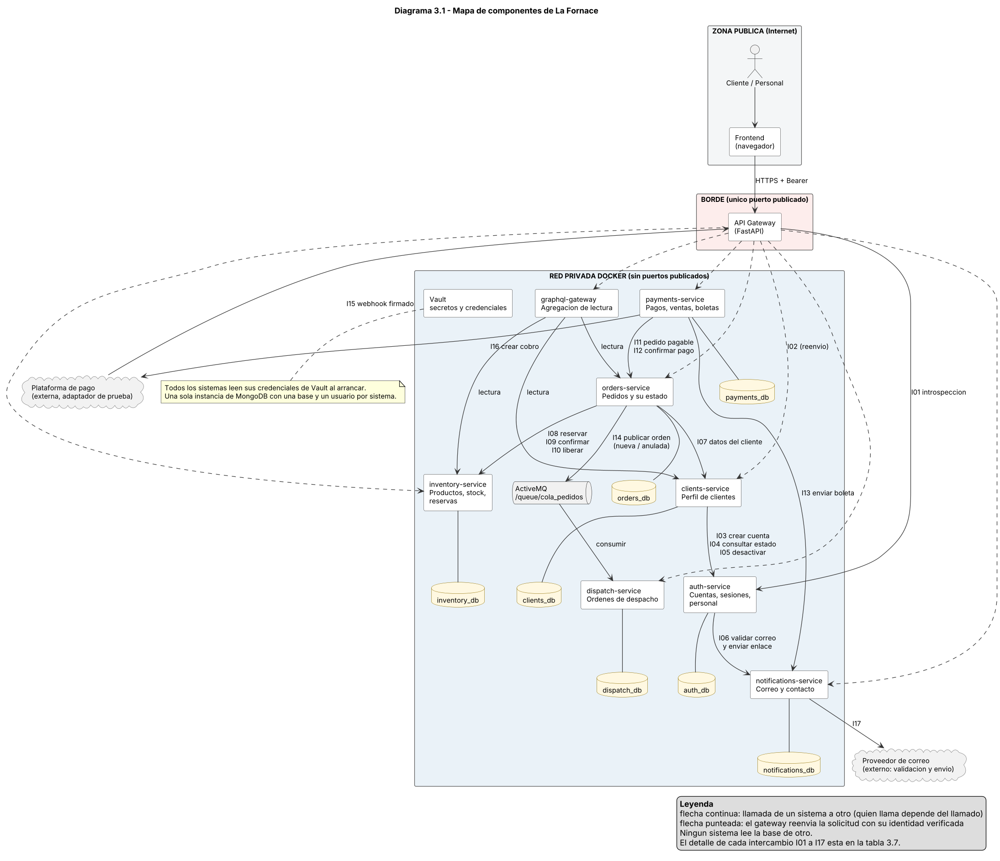
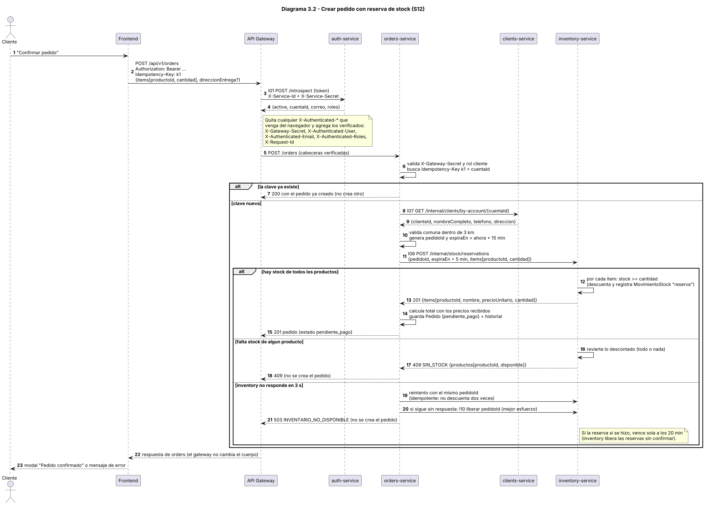
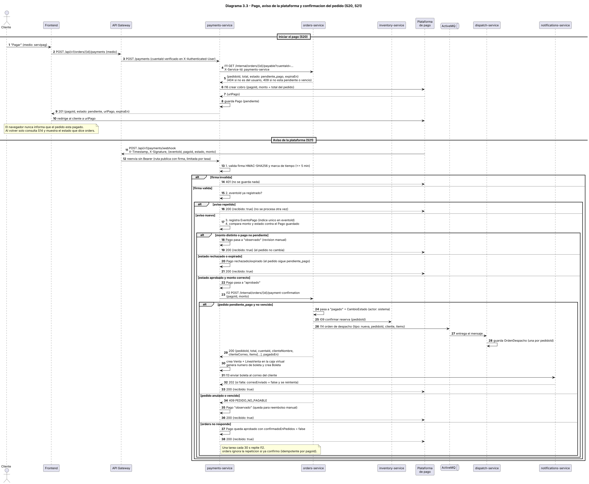

# Evaluación Unidad 2 — Backend seguro completo
## Pizzería La Fornace (derivado del Caso 19)

---

# Módulo 3 — Sistemas e integraciones

Los diagramas se entregan en formato editable (PlantUML, `.puml`) y legible (`.svg` y `.png`). Están en la carpeta `diagramas/`.

## 3.1 Cumplimiento de la guía

| Qué pide la guía | Dónde está |
| --- | --- |
| Sistemas con responsabilidad propia, incluidos inventory, orders, clients y payments como microservicios privados. | Matriz 3.3 y diagrama 3.1 (3.13). |
| Justificar los límites con cohesión, acoplamiento y propiedad de datos, sin dividir por tabla ni por pantalla. | 3.2. |
| Asignar a cada sistema su responsabilidad, la autoridad sobre sus datos y el dueño del estado oficial. | 3.3, 3.4 y 3.5. |
| Asignar los servicios del Módulo 1 a los sistemas, con sus dependencias. | 3.6. |
| Definir los intercambios: operación o evento, datos mínimos, autenticación entre componentes y manejo de errores. | 3.7 y 3.8. |
| Sistemas complementarios (despacho, boletas, mensajería), separando los propios de los proveedores externos. | 3.12. |
| Matriz de sistemas, mapa de componentes y secuencia de un flujo representativo. | 3.3, 3.13 y 3.14. |
| Resolver el caso pedidos ↔ inventario (disponibilidad, reserva y respuesta que no llega). | 3.9. |
| Resolver el caso del aviso de pago (verificación, duplicados y quién autoriza el cambio de estado). | 3.10. |

## 3.2 Decisiones de partición y límites

La regla fue dividir por **quién es dueño de un dato y de sus reglas**, no por tabla ni por pantalla. Cada sistema tiene su propia base de datos (una sola instancia de MongoDB, con una base y un usuario por sistema) y ningún sistema lee la base de otro.

| Sistema | Cohesión: qué reúne | Acoplamiento: de quién depende | Propiedad: de qué datos es dueño |
| --- | --- | --- | --- |
| `auth-service` | Todo lo que prueba quién es una persona: credenciales, sesiones, verificación de correo y el personal. Cambia por razones de seguridad. | Solo del servicio de mensajería para enviar el enlace. | Cuenta, Sesion, TokenVerificacion, Usuario. |
| `clients-service` | Datos personales y domicilio del cliente, y su registro. Cambia por razones comerciales. | De auth, porque cada cliente tiene una cuenta. | Cliente, Direccion. |
| `inventory-service` | Producto, precio, disponibilidad y stock con sus reservas. Se consulta mucho y se modifica poco. | De nadie. Es el sistema más independiente. | Producto, MovimientoStock. |
| `orders-service` | El ciclo de vida del pedido y la regla de que solo un pago confirmado lo pasa a `pagado`. | De clients (datos del cliente), inventory (reservas) y, por cola, de dispatch. | Pedido, DetallePedido, DireccionEntrega, CambioEstado. |
| `payments-service` | Todo lo que depende de la plataforma externa de pago: cobro, aviso firmado, venta en caja, boleta y reporte de ventas. | De orders (confirmar el pago) y de mensajería (enviar la boleta). | Pago, EventoPago, Venta, LineaVenta, Boleta, CajaVirtual. |
| `dispatch-service` | La cola que usa la cocina: orden de llegada e impresión. No necesita saber precios. | De nadie (solo consume la cola). | OrdenDespacho, LineaDespacho. |
| `notifications-service` | Toda la salida de correo y los mensajes de contacto. Aísla al proveedor externo. | Del proveedor externo de correo. | MensajeContacto. |

Alternativas que se descartaron:

| Alternativa | Por qué no |
| --- | --- |
| Un servicio por clase del Módulo 2 (21 servicios). | Cada pedido tocaría seis servicios y cada cambio exigiría coordinar a todos. Es dividir por tabla. |
| Un servicio por pantalla. | Las pantallas comparten datos (P03, P10 y P11 usan el mismo pedido). Se duplicaría la lógica. |
| Unir orders con payments. | El pago depende de un tercero (firma, avisos repetidos, reintentos) y tiene otro ritmo de cambio. Separarlos deja que la autoridad del estado del pedido sea una sola. |
| Unir inventory con orders. | El precio y el stock tienen otro dueño y otra frecuencia de cambio que el estado de un pedido. Además el catálogo público se consulta sin sesión. |
| Unir auth con clients. | Las credenciales necesitan más aislamiento que los datos personales, y el personal también usa auth sin tener perfil de cliente. |
| Separar boletas y caja virtual de payments. | No tienen datos ni reglas propias: nacen 1 a 1 de una venta, que ya es de payments. Separarlas agregaría una llamada sin ganar independencia. Se explican como sistema complementario en 3.12. |

Reparto de los 35 servicios del Módulo 1:

| Sistema | Cantidad | Servicios |
| --- | --- | --- |
| `auth-service` | 8 | S01, S02, S04, S05, S30, S31, S32, S33 |
| `clients-service` | 7 | S03, S24, S25, S26, S27, S28, S29 |
| `inventory-service` | 6 | S06, S07, S08, S09, S10, S11 |
| `orders-service` | 6 | S12, S13, S14, S15, S16, S17 |
| `payments-service` | 5 | S20, S21, S22, S23, S34 |
| `dispatch-service` | 2 | S18, S19 |
| `notifications-service` | 1 | S35 |

La agrupación UML del Módulo 2 se conserva, con un ajuste: S03 (registrar cliente) se agrupa con los servicios de clients porque crea el perfil del cliente y pide la cuenta a auth. Así auth no depende de clients y no hay ciclo.

## 3.3 Matriz de sistemas

| Sistema | Responsabilidad | Datos que administra | Servicios asociados | Dependencias | Contrato de integración | Credencial o identidad requerida | Respuesta ante fallos |
| --- | --- | --- | --- | --- | --- | --- | --- |
| `api-gateway` (público) | Único punto de entrada. Valida el token, quita cualquier identidad enviada por el navegador, agrega la identidad verificada, limita la tasa y enruta por prefijo. | Ninguno de negocio. No tiene base de datos. | Los 35 pasan por él. Sin token: S01, S03, S04, S05, S06, S21 y S35. | auth (I01) y todos para enrutar (I02). Vault (I18). | Hacia afuera: HTTPS y `/api/v1/...`. Hacia adentro: JSON y cabeceras `X-Authenticated-*`. | `X-Service-Id` y `X-Service-Secret` hacia auth. `X-Gateway-Secret` hacia los demás. Ambos en Vault. | Auth caído: 503 en rutas con token (falla cerrado). Las rutas públicas siguen. Sistema caído: 502 o 503 sin reintentar escrituras. |
| `auth-service` (privado) | Identidad: cuentas, contraseñas con hash, sesiones y tokens, verificación de correo y personal. **Dueño del estado oficial de la cuenta** (`pendiente_verificacion`, `activo`, `inactivo`). | Cuenta, Sesion, TokenVerificacion, Usuario. | S01, S02, S04, S05, S30, S31, S32, S33. | notifications (I06). Vault. | Internos: `POST /internal/introspect` (I01), `POST` y `DELETE /internal/accounts` (I03), `GET /internal/accounts` (I04), `PATCH /internal/accounts/{id}` (I05). | Acepta a api-gateway (I01) y a clients-service (I03, I04, I05), cada uno con su par de credenciales. Usuario `auth_user` solo sobre `auth_db`. | Mensajería caída: no crea cuenta ni cambia token. Base de datos caída: 503. Nunca devuelve hashes en un error. |
| `clients-service` (privado) | Perfil y domicilio del cliente y su alta (web o presencial). **Autoridad de los datos personales** (RUN, nombre, teléfono, nacimiento, sexo, domicilio). | Cliente, Direccion. | S03, S24, S25, S26, S27, S28, S29. | auth (I03, I04, I05). Vault. | Interno: `GET /internal/clients/by-account/{cuentaId}` (I07). | Acepta a orders-service (I07). Usa su par de credenciales hacia auth. Usuario `clients_user` solo sobre `clients_db`. | Auth caído: S03, S26, S27, S28 y S29 responden 503 y no dejan datos a medias (compensación en I03). S24 y S25 no dependen de auth y siguen funcionando. |
| `inventory-service` (privado) | Productos, precio, disponibilidad, stock y reservas. **Autoridad de precio y stock.** | Producto, MovimientoStock. | S06, S07, S08, S09, S10, S11. | Ninguna. Vault. | Internos: `POST /internal/stock/reservations` (I08), `.../confirm` (I09) y `.../release` (I10). | Solo acepta a orders-service en las rutas internas. Usuario `inventory_user` solo sobre `inventory_db`. | Su caída detiene el catálogo y la creación de pedidos, pero no el pago de pedidos ya creados. Libera solas las reservas vencidas sin confirmar. |
| `orders-service` (privado) | Crea el pedido, congela precios y dirección, lleva el historial, vence los pedidos y publica la orden de despacho. **Dueño del estado oficial del pedido.** | Pedido, DetallePedido, DireccionEntrega, CambioEstado. | S12, S13, S14, S15, S16, S17. | clients (I07), inventory (I08, I09, I10), ActiveMQ (I14). Vault. | Internos: `GET /internal/orders/{id}/payable` (I11) y `POST /internal/orders/{id}/payment-confirmation` (I12). | Acepta a payments-service en I11 e I12. Usa sus pares hacia clients e inventory y un usuario de ActiveMQ de solo escritura. Usuario `orders_user` solo sobre `orders_db`. | Inventory caído: S12 responde 503 sin crear el pedido. ActiveMQ caído: el pedido igual queda `pagado` y la orden se publica después. Tareas de reintento cada 30 s. |
| `payments-service` (privado) | Inicia el cobro, valida el aviso, registra la venta en la caja virtual, genera la boleta y calcula el reporte de ventas. **Dueño del estado del cobro** (`pendiente`, `aprobado`, `rechazado`, `expirado`, `observado`). | Pago, EventoPago, Venta, LineaVenta, Boleta, CajaVirtual. | S20, S21, S22, S23, S34. | orders (I11, I12), notifications (I13), plataforma de pago (I16). Vault. | Público con firma: `POST /api/v1/payments/webhook` (I15). | Secreto HMAC del webhook y credencial de la plataforma (Vault). Pares hacia orders y notifications. Usuario `payments_user` solo sobre `payments_db`. | Orders caído: el pago queda `aprobado` y se reintenta. Pedido no pagable: pago `observado`. Correo caído: la venta existe y se reintenta el envío. |
| `dispatch-service` (privado) | Guarda las órdenes de despacho que llegan por la cola, las ordena por llegada y las entrega para imprimir. **Dueño de la orden de despacho y de su impresión.** | OrdenDespacho, LineaDespacho. | S18, S19. | ActiveMQ (consumidor). Vault. | Consume `cola_pedidos` (I14). | Usuario de ActiveMQ de solo lectura. Usuario `dispatch_user` solo sobre `dispatch_db`. | Broker caído: sigue mostrando lo ya guardado y reconecta. Mensaje repetido: se ignora. Mensaje inválido: va al registro de errores sin detener el consumo. |
| `notifications-service` (privado) | Valida correos, envía los correos del sistema (enlaces y boletas) y guarda los mensajes de contacto. **Dueño del mensaje de contacto.** | MensajeContacto. | S35. | Proveedor externo de correo (I17). Vault. | Interno: `POST /internal/emails` (I06 e I13). | Acepta a auth-service y a payments-service. Clave del proveedor en Vault. Usuario `notifications_user` solo sobre `notifications_db`. | Proveedor caído: 503 a quien llama. S35 siempre guarda el mensaje, porque no usa al proveedor. |

## 3.4 Autoridad de los datos

Cada dato tiene un solo sistema que lo puede cambiar. Los demás solo guardan una copia congelada cuando necesitan mostrarlo después sin volver a preguntar.

| Dato | Sistema autoridad | Copias y por qué existen | Quién lo cambia |
| --- | --- | --- | --- |
| Correo, contraseña (hash), rol y estado de la cuenta | auth | Orders guarda `clienteCorreo` en el pedido y payments `clienteCorreo` en la venta, solo para enviar la boleta. El correo llega en `X-Authenticated-Email`, ya verificado por el gateway. | Solo auth (S04, S30, S32, S33 e I05). |
| Sesión y token | auth | Ninguna. | Solo auth (S01, S02). |
| RUN, nombre, teléfono, nacimiento, sexo y domicilio del cliente | clients | `clienteNombre` y `clienteTelefono` en el pedido, `clienteNombre` en la venta y en la orden de despacho. Son copias del momento de la compra y nunca modifican al cliente. | Solo clients (S03, S25, S26, S28). |
| Nombre, precio, categoría, disponibilidad y stock del producto | inventory | Nombre y precio unitario en cada línea del pedido, de la venta y de la orden de despacho (sin precio). Congelan lo que se compró. | Solo inventory (S08 a S11 e I08 a I10). |
| Reservas de stock | inventory | Orders guarda `reservaConfirmada` solo como bandera de reintento. | Solo inventory, a pedido de orders. |
| Estado del pedido, ítems, total, dirección de entrega, historial, motivo de anulación y `reembolsoPendiente` | orders | `estadoPago` y `boletaDisponible` se deducen del estado, no se guardan en otro lado. | Solo orders (S12, S15, S17, I12 y el vencimiento). |
| Pago (estado, monto, medio, `urlPago`) y avisos recibidos | payments | Ninguna. Orders no guarda datos del pago. | Solo payments (S20, S21). |
| Venta, líneas, boleta y caja virtual | payments | Ninguna. S23 y S34 se responden con estos datos, sin llamar a orders. | Solo payments (S21). |
| Orden de despacho y si fue impresa | dispatch | Ninguna. | Solo dispatch (I14 y S19). |
| Mensaje de contacto | notifications | Ninguna. | Solo notifications (S35). |
| Credenciales entre sistemas y secretos | Vault | Cada sistema las lee al arrancar. | Solo el administrador de la infraestructura. |

Regla de lectura: el sistema autoridad se consulta por un servicio o una integración (3.7), nunca por la base. Las copias se usan para mostrar, nunca para decidir. Por ejemplo, orders decide el precio de un pedido nuevo con el precio que devuelve inventory en I08, no con una copia.

## 3.5 Estado oficial del pedido y del cobro

El estado del pedido tiene un solo dueño (orders) y el del cobro otro (payments). Se relacionan por una sola regla: un pedido está `pagado` si y solo si payments confirmó un pago `aprobado` por I12.

| Transición | Quién la ejecuta | Cómo | Quién la autoriza |
| --- | --- | --- | --- |
| (nuevo) → `pendiente_pago` | orders | S12 | Cliente con token y rol `cliente`. |
| `pendiente_pago` → `pagado` | orders | Solo al recibir I12 | La credencial `payments-service`, después de que orders compruebe que el pedido sigue `pendiente_pago`, no venció y el monto es igual al total. **No** S17, **ni** el frontend. |
| `pagado` → `en_preparacion` → `en_despacho` → `entregado` | orders | S17 | `encargado_despachos` o `administrador`. |
| `pendiente_pago`, `pagado` o `en_preparacion` → `anulado` | orders | S15 (cliente, mientras no esté `en_preparacion`), S17 (administrador) o el vencimiento automático | Cliente dueño, administrador o el propio sistema. Al anular se libera el stock (I10) y, si estaba pagado, se publica una orden `anulada` (I14) y queda `reembolsoPendiente`. |

| Estado del cobro | Quién lo fija | Cuándo |
| --- | --- | --- |
| `pendiente` | payments | S20 crea el cobro. |
| `aprobado`, `rechazado`, `expirado` | payments | Un aviso válido (S21). Solo `aprobado` lleva a I12. |
| `observado` | payments | Monto distinto, pago que no estaba pendiente o pedido que ya no se puede pagar. Queda para revisión y reembolso manual. |

Conciliación: una tarea revisa cada 10 minutos los pagos `aprobado` con `confirmadoEnPedidos` en falso y repite I12. Si pasan más de 10 minutos, queda un registro de alerta para el administrador.

## 3.6 Servicios del Módulo 1 asignados a sistemas

| ID | Servicio | Sistema | Acceso (Módulo 1) | Integraciones que dispara | Datos que toca |
| --- | --- | --- | --- | --- | --- |
| S01 | Iniciar sesión | `auth-service` | A | — | Lee Cuenta; escribe Sesion |
| S02 | Cerrar sesión e invalidar el token | `auth-service` | Au (cualquier rol) | — | Escribe Sesion |
| S03 | Registrar un cliente desde la web | `clients-service` | A | I03 (y por auth, I06) | Escribe Cliente y Direccion; Cuenta por I03 |
| S04 | Confirmar el correo y, si corresponde, definir la contraseña | `auth-service` | A | — | Lee TokenVerificacion; escribe Cuenta |
| S05 | Reenviar el correo de confirmación | `auth-service` | A | I06 | Escribe TokenVerificacion |
| S06 | Consultar el catálogo | `inventory-service` | A | — | Lee Producto |
| S07 | Listar productos con stock y retirados | `inventory-service` | Au (administrador, dueno) | — | Lee Producto |
| S08 | Crear un producto | `inventory-service` | Au (administrador, dueno) | — | Escribe Producto |
| S09 | Reemplazar los datos de un producto | `inventory-service` | Au (administrador, dueno) | — | Escribe Producto |
| S10 | Retirar un producto (baja lógica, conserva el historial de pedidos) | `inventory-service` | Au (administrador, dueno) | — | Escribe Producto |
| S11 | Actualizar stock y disponibilidad de un producto | `inventory-service` | Au (administrador, dueno) | — | Escribe Producto y MovimientoStock |
| S12 | Crear un pedido | `orders-service` | Au (cliente) | I07, I08 (I10 si falla) | Escribe Pedido, DetallePedido, DireccionEntrega, CambioEstado |
| S13 | Listar los pedidos propios | `orders-service` | Au (cliente) | — | Lee Pedido |
| S14 | Consultar el detalle de un pedido | `orders-service` | Au (cliente dueño; administrador, cajero_virtual, encargado_despachos) | — | Lee Pedido y sus partes |
| S15 | Anular un pedido propio | `orders-service` | Au (cliente dueño) | I10, I14 si estaba pagado | Escribe Pedido y CambioEstado |
| S16 | Listar todos los pedidos para el personal | `orders-service` | Au (administrador, cajero_virtual, encargado_despachos) | — | Lee Pedido |
| S17 | Cambiar el estado de un pedido | `orders-service` | Au (encargado_despachos, administrador) | I10 e I14 si anula | Escribe Pedido y CambioEstado |
| S18 | Consultar la cola de órdenes de despacho en orden de llegada | `dispatch-service` | Au (encargado_despachos, administrador) | — | Lee OrdenDespacho |
| S19 | Obtener la orden de despacho lista para imprimir | `dispatch-service` | Au (encargado_despachos, administrador) | — | Lee OrdenDespacho; escribe `impresa` |
| S20 | Iniciar el pago de un pedido en la plataforma externa | `payments-service` | Au (cliente dueño) | I11, I16 | Escribe Pago |
| S21 | Recibir el resultado del pago | `payments-service` | Identidad de la plataforma (firma) | I12, I13 | Escribe EventoPago, Pago, Venta, LineaVenta, Boleta |
| S22 | Consultar las ventas de la caja virtual | `payments-service` | Au (cajero_virtual, administrador) | — | Lee Venta y Boleta |
| S23 | Obtener la boleta digital de un pedido pagado | `payments-service` | Au (cliente dueño; cajero_virtual, administrador) | — | Lee Boleta, Venta y LineaVenta |
| S24 | Consultar mi perfil | `clients-service` | Au (cliente) | — | Lee Cliente y Direccion |
| S25 | Reemplazar mis datos de perfil | `clients-service` | Au (cliente) | — | Escribe Cliente y Direccion |
| S26 | Registrar un cliente presencialmente | `clients-service` | Au (administrador) | I03 (y por auth, I06) | Escribe Cliente y Direccion; Cuenta por I03 |
| S27 | Listar clientes | `clients-service` | Au (administrador) | I04 | Lee Cliente y Direccion; estado por I04 |
| S28 | Reemplazar los datos de un cliente | `clients-service` | Au (administrador) | I04 | Escribe Cliente y Direccion |
| S29 | Dar de baja a un cliente (baja lógica) | `clients-service` | Au (administrador) | I05 | Cambia el estado de la Cuenta por I05 |
| S30 | Crear un usuario del personal | `auth-service` | Au (administrador) | I06 | Escribe Usuario y Cuenta |
| S31 | Listar usuarios del personal | `auth-service` | Au (administrador) | — | Lee Usuario y Cuenta |
| S32 | Cambiar nombre, rol o estado de un usuario | `auth-service` | Au (administrador) | — | Escribe Usuario y Cuenta |
| S33 | Dar de baja a un usuario (baja lógica) | `auth-service` | Au (administrador) | — | Escribe Cuenta y Sesion |
| S34 | Reporte de ventas por período | `payments-service` | Au (dueno, administrador) | — | Lee Venta y LineaVenta |
| S35 | Registrar un mensaje de contacto | `notifications-service` | A | — | Escribe MensajeContacto |

Operaciones internas del Módulo 1: "Realizar venta" y "Enviar boleta" pertenecen a payments (I12 e I13). "Publicar orden de despacho" y "Expirar pedidos" pertenecen a orders (I14 e I10). "Validar y enviar correos" pertenece a auth (I06).

## 3.7 Catálogo de intercambios

Las rutas `/internal/...` no las publica el gateway: solo existen dentro de la red privada. Todas las respuestas de error usan el formato del Módulo 1.

| ID | Origen → destino | Operación o evento | Tipo | Datos mínimos | Autenticación | Si falla |
| --- | --- | --- | --- | --- | --- | --- |
| I01 | `api-gateway` → `auth-service` | `POST /internal/introspect` | Síncrono | Entrada: `token`. Salida: `active`, `cuentaId`, `correo`, `roles` | `X-Service-Id: api-gateway` y `X-Service-Secret` (par propio) | Auth no responde: el gateway devuelve 503 y no deja pasar la solicitud (falla cerrado). Token inactivo: 401. |
| I02 | `api-gateway` → todos los sistemas de negocio | Reenvío de `/api/v1/...` a la ruta interna del sistema | Síncrono | La solicitud original más `X-Authenticated-User` (cuentaId), `X-Authenticated-Email`, `X-Authenticated-Roles` y `X-Request-Id` | `X-Gateway-Secret`: un secreto distinto por sistema destino (`gateway-to-<sistema>`), guardado en Vault | Sistema sin respuesta en 10 s: 502 o 503 con el formato de error del Módulo 1. No reintenta POST, PUT, PATCH ni DELETE para no duplicar efectos. |
| I03 | `clients-service` → `auth-service` | `POST /internal/accounts` (crear cuenta `pendiente_verificacion`). Compensación: `DELETE /internal/accounts/{cuentaId}` solo si sigue pendiente | Síncrono | `correo`, `rol` (siempre `cliente`), `password` (solo en S03) | `X-Service-Id: clients-service` + `X-Service-Secret` | 409 correo duplicado, 422 correo inexistente, 503 sin respuesta: S03 y S26 devuelven el mismo código y no crean perfil. Si la cuenta se creó y el perfil no se pudo guardar, clients llama a la compensación. |
| I04 | `clients-service` → `auth-service` | `GET /internal/accounts?ids=a,b,c` | Síncrono | Entrada: lista de `cuentaId`. Salida: `cuentaId`, `correo`, `estado` | `X-Service-Id: clients-service` + `X-Service-Secret` | Sin respuesta: S27 y S28 devuelven 503. No se muestran clientes con `estado` inventado. |
| I05 | `clients-service` → `auth-service` | `PATCH /internal/accounts/{cuentaId}` con `estado: inactivo` | Síncrono | `cuentaId`, `estado`. Auth invalida las sesiones de esa cuenta | `X-Service-Id: clients-service` + `X-Service-Secret` | Sin respuesta: S29 devuelve 503 y no queda nada a medias, porque la baja es solo el cambio de estado de la cuenta. Repetir la llamada no cambia el resultado. |
| I06 | `auth-service` → `notifications-service` | `POST /internal/emails` con plantilla `verificacion` | Síncrono | `correo`, `enlace` (con el token de un solo uso) | `X-Service-Id: auth-service` + `X-Service-Secret` | 422 si el proveedor dice que el correo no existe. 503 si el proveedor no responde: auth no crea la cuenta ni cambia el token (S03, S05, S26, S30). |
| I07 | `orders-service` → `clients-service` | `GET /internal/clients/by-account/{cuentaId}` | Síncrono | Salida: `clienteId`, `nombreCompleto`, `telefono`, `direccion` (calle, comuna, provincia, región) | `X-Service-Id: orders-service` + `X-Service-Secret` | 404 sin perfil: S12 responde 403. Sin respuesta en 3 s: S12 responde 503 y no reserva stock, porque esta llamada se hace antes que I08. |
| I08 | `orders-service` → `inventory-service` | `POST /internal/stock/reservations` | Síncrono | Entrada: `pedidoId`, `expiraEn`, `items[productoId, cantidad]`. Salida: `items[productoId, nombre, precioUnitario, cantidad]` | `X-Service-Id: orders-service` + `X-Service-Secret` | 409 `SIN_STOCK` con los productos que faltan. Sin respuesta en 3 s: un reintento con el mismo `pedidoId`; luego 503 y liberación (I10). Detalle en 3.9. |
| I09 | `orders-service` → `inventory-service` | `POST /internal/stock/reservations/{pedidoId}/confirm` | Síncrono (con reintento) | `pedidoId` | `X-Service-Id: orders-service` + `X-Service-Secret` | Si falla, `Pedido.reservaConfirmada` queda en falso y una tarea cada 30 s repite la llamada. La reserva tiene 5 minutos de margen sobre el vencimiento del pedido. |
| I10 | `orders-service` → `inventory-service` | `POST /internal/stock/reservations/{pedidoId}/release` | Síncrono (mejor esfuerzo) | `pedidoId` | `X-Service-Id: orders-service` + `X-Service-Secret` | Si falla, la reserva sin confirmar vence sola. Para un pedido ya confirmado que se anula, orders repite la llamada hasta que responda. |
| I11 | `payments-service` → `orders-service` | `GET /internal/orders/{id}/payable?cuentaId=...` | Síncrono | Salida: `pedidoId`, `total`, `estado`, `expiraEn` | `X-Service-Id: payments-service` + `X-Service-Secret` | 404 si el pedido no es del usuario, 409 si no está `pendiente_pago` o venció. Sin respuesta en 5 s: S20 responde 503 y no crea el pago. |
| I12 | `payments-service` → `orders-service` | `POST /internal/orders/{id}/payment-confirmation` | Síncrono (con reintento) | Entrada: `pagoId`, `monto`. Salida: `pedidoId`, `total`, `cuentaId`, `clienteNombre`, `clienteCorreo`, `items[productoId, nombre, cantidad, precioUnitario]`, `pagadoEn` | `X-Service-Id: payments-service` + `X-Service-Secret`. Es la única credencial que orders acepta para pasar a `pagado` | 409 `PEDIDO_NO_PAGABLE` (anulado, vencido o monto distinto): el pago queda `observado`. Sin respuesta: el pago queda `aprobado` con `confirmadoEnPedidos` en falso y una tarea cada 30 s repite la llamada. Orders la trata como idempotente por `pagoId`. |
| I13 | `payments-service` → `notifications-service` | `POST /internal/emails` con plantilla `boleta` | Síncrono (con reintento) | `correo`, `numeroBoleta`, `total`, `items` | `X-Service-Id: payments-service` + `X-Service-Secret` | Si falla, la venta y la boleta ya existen: `Boleta.correoEnviado` queda en falso y una tarea cada 5 minutos reintenta hasta 5 veces. Se ve en S22. |
| I14 | `orders-service` → `dispatch-service` | Mensaje en la cola ActiveMQ `/queue/cola_pedidos` | Asíncrono (STOMP) | `tipo` (`nueva` o `anulada`), `pedidoId`, `pagadoEn`, `clienteNombre`, `telefono`, `direccionEntrega`, `items[nombre, cantidad]`. Sin precios, RUN ni correo | Usuario de ActiveMQ solo de escritura para orders y solo de lectura para dispatch (credenciales en Vault) | Broker caído: el pedido queda `pagado` con `despachoPublicado` en falso y una tarea cada 30 s publica. Dispatch ignora un mensaje repetido (mismo `pedidoId` y `tipo`) y manda al registro de errores el mensaje con formato inválido. |
| I15 | Plataforma de pago (externa) → payments-service (por el gateway) | `POST /api/v1/payments/webhook` (S21) | Síncrono | `eventoId`, `pagoId`, `estado`, `monto`; cabeceras `X-Timestamp` y `X-Signature` | Firma HMAC-SHA256 con el secreto del webhook (Vault). La ruta no lleva token de usuario | 401 firma inválida. 400 cuerpo inválido. Todo lo demás responde 200 para que la plataforma no reintente sin necesidad. Reglas en 3.10. |
| I16 | `payments-service` → Plataforma de pago (externa) | Crear cobro (adaptador de prueba propio) | Síncrono | `pagoId`, `monto`, `medio`. Salida: `urlPago` | Credencial de la plataforma (Vault) | Sin respuesta: S20 responde 502 o 503 y no guarda un pago pendiente. |
| I17 | `notifications-service` → Proveedor de correo (externo) | Validar un correo y enviar un mensaje | Síncrono | `correo`, asunto y cuerpo de la plantilla | Clave del proveedor (Vault) | El proveedor no responde: 503 a quien llamó (I06 o I13). S35 no usa esta llamada. |
| I18 | todos los sistemas → Vault | `GET /v1/secret/data/<sistema>` | Síncrono, al arrancar | Credenciales de su base de datos, secretos de integración y de ActiveMQ | Token de Vault de cada sistema, con política de solo lectura sobre su ruta | Si Vault no responde o falta un secreto, el sistema no arranca. No hay valores por defecto en el código. |

Orden de dependencias entre sistemas de negocio: `dispatch-service`, `inventory-service`, `notifications-service`, `auth-service`, `clients-service`, `orders-service`, `payments-service`. Cada sistema solo llama a sistemas que aparecen antes en esta lista, así que no hay ciclos. Auth no llama a clients, y payments llama a orders pero orders nunca llama a payments.

## 3.8 Identidad entre componentes

| Camino | Qué se envía | Qué verifica el que recibe |
| --- | --- | --- |
| Navegador → gateway | `Authorization: Bearer <token>` | El gateway pregunta a auth (I01). Sin token válido, 401. |
| Gateway → sistema | `X-Gateway-Secret` (uno por sistema destino), `X-Authenticated-User` (cuentaId), `X-Authenticated-Email`, `X-Authenticated-Roles`, `X-Request-Id` | El sistema compara `X-Gateway-Secret` en tiempo constante, con el secreto que le corresponde solo a él, y confía en las demás cabeceras solo si coincide. El gateway **borra** cualquier cabecera `X-Authenticated-*` que traiga el navegador. |
| Sistema → sistema | `X-Service-Id`, `X-Service-Secret` y, si actúa en nombre de un usuario, `X-Authenticated-User` | El receptor revisa que el par exista en su lista de llamadores y que esa ruta esté permitida para ese llamador. Por ejemplo, solo `payments-service` puede llamar a `payment-confirmation`. |
| Plataforma de pago → payments | Firma HMAC-SHA256 y marca de tiempo | Payments recalcula la firma con el secreto de Vault y rechaza marcas con más de 5 minutos. |
| Orders y dispatch ↔ ActiveMQ | Usuario y contraseña de STOMP | El broker permite escribir solo a orders y leer solo a dispatch. |

Reglas comunes:
- Cada par llamador–llamado tiene su propio secreto, guardado en Vault bajo `secret/data/services/<llamador>-to-<llamado>`. Si se filtra uno, solo se rota ese.
- El servicio que recibe nunca usa la identidad de un usuario para decidir si otro sistema puede llamarlo. Son dos comprobaciones distintas: quién es el sistema que llama y qué usuario lo originó.
- La red privada de Docker no publica ningún puerto salvo el del gateway. Las bases de datos, Vault y ActiveMQ solo se ven desde dentro de esa red.
- Se sigue el patrón del laboratorio (`X-Gateway-Secret`, `/introspect`, secretos en Vault) y se corrige lo que el laboratorio dejaba débil: no hay secretos por defecto en el código (ver 1.13).

## 3.9 Pedidos ↔ inventario: disponibilidad, reserva y respuesta que no llega

| Pregunta | Regla |
| --- | --- |
| ¿Quién decide si hay stock? | Inventory. Orders nunca lee ni cambia el stock. Tampoco confía en el precio que el navegador mande: toma nombre y precio de la respuesta de I08. |
| ¿Cuándo se reserva? | En S12, después de validar el cliente (I07) y la cobertura de 3 km, y antes de guardar el pedido. |
| ¿Es todo o nada? | Sí. Para cada producto, inventory descuenta con una actualización condicional (`stock >= cantidad`, producto disponible y no retirado). Si alguno falla, devuelve lo que ya descontó y responde 409 con los productos que faltan. Los movimientos de tipo `reserva` quedan registrados en MovimientoStock. |
| ¿Qué pasa si dos clientes compran la última unidad? | La actualización condicional es atómica por producto. Gana quien llega primero. El otro recibe 409. |
| ¿Se puede repetir la misma solicitud? | Sí. La reserva se identifica por `pedidoId`. Si llega otra vez con el mismo `pedidoId`, inventory devuelve la respuesta anterior sin descontar de nuevo. |
| ¿Qué pasa si la respuesta no llega? | Orders espera 3 s y repite **una vez** con el mismo `pedidoId` (seguro, por lo anterior). Si sigue sin respuesta, intenta liberar (I10), responde 503 `INVENTARIO_NO_DISPONIBLE` y **no crea el pedido**. El cliente reintenta S12 con la misma `Idempotency-Key`. |
| ¿Y si la reserva sí se hizo pero orders no lo supo? | Cada reserva lleva `expiraEn` (vencimiento del pedido más 5 minutos). Inventory libera las reservas vencidas sin confirmar con una tarea cada minuto. El stock nunca queda retenido más de 20 minutos. |
| ¿Cuándo se confirma? | Cuando orders pasa el pedido a `pagado` (I09). Una reserva confirmada ya no vence. |
| ¿Cuándo se libera? | Al anular el pedido (S15 o S17) o al vencer sin pago (I10). Se devuelve el stock y queda un movimiento `liberacion`. |
| ¿Y el ajuste manual de stock (S11)? | Se registra como movimiento `ajuste` sobre el stock disponible. No toca las reservas existentes. |
| Caso residual | Si la confirmación (I09) llegara después de que la reserva venció y el stock ya se vendió, inventory responde 409. Orders deja el pedido marcado para revisión en S16 y el administrador lo resuelve a mano. El margen de 5 minutos y el reintento cada 30 s lo vuelven muy poco probable. |

## 3.10 Aviso de pago: verificación, duplicados y autoridad del cambio de estado

El navegador no decide que un pedido está pagado. Al volver de la plataforma de pago solo consulta S14 y muestra el estado que dice orders. El único camino a `pagado` es: aviso firmado → payments → I12 → orders.

| Paso | Verificación en payments | Si no se cumple |
| --- | --- | --- |
| 1 | Firma HMAC-SHA256 sobre la marca de tiempo y el cuerpo, con el secreto de Vault. Marca de tiempo de máximo 5 minutos. | 401. No se guarda nada. |
| 2 | Cuerpo válido (`eventoId`, `pagoId`, `estado`, `monto`) y `pagoId` existente. | 400. |
| 3 | `eventoId` no registrado antes. Hay un índice único sobre `eventoId`. | Si ya existe: 200 `{recibido: true}` y no se procesa otra vez. |
| 4 | Se registra el EventoPago. | — |
| 5 | El pago estaba `pendiente` y el `monto` informado es igual al `monto` guardado al iniciar el pago (S20), que viene del total del pedido. | El pago pasa a `observado`, el pedido no cambia y se responde 200. |
| 6 | `estado` informado: `rechazado` o `expirado` actualizan el pago y el pedido sigue `pendiente_pago`. `aprobado` pasa el pago a `aprobado` y llama a I12. | — |
| 7 | Orders comprueba que el pedido está `pendiente_pago`, no venció, el `monto` es igual al total y el `pagoId` no se usó antes. Solo entonces lo pasa a `pagado`, registra el cambio con actor "sistema", confirma la reserva (I09) y publica la orden de despacho (I14). | 409 `PEDIDO_NO_PAGABLE`: el pago queda `observado` y se reembolsa a mano. |
| 8 | Con la respuesta de orders, payments crea la Venta con sus líneas en la caja virtual, genera el número de boleta y la Boleta, y llama a I13. | Si falla el correo, la venta ya existe y el envío se reintenta. |

Por qué no hay duplicados: el índice único en `eventoId` evita procesar dos veces el mismo aviso, el índice único en `Venta.pedidoId` evita dos ventas por pedido, y orders trata I12 como idempotente por `pagoId` (si el pedido ya está `pagado` con ese mismo pago, devuelve la misma respuesta). Si payments se cae entre I12 y la creación de la venta, el reintento repite I12, recibe la misma respuesta y completa la venta.

Quién autoriza el cambio de estado: orders, que es el dueño del estado del pedido. Payments solo lo solicita con la credencial `payments-service`, y orders vuelve a comprobar las reglas con sus propios datos. Si el aviso llega con el monto alterado o por otro camino, no hay forma de llegar a `pagado`.

## 3.11 Fallos y consistencia del negocio

| Situación | Qué ocurre | Estado final |
| --- | --- | --- |
| Falta stock en S12 | Inventory revierte y responde 409. | Sin pedido y sin stock retenido. |
| Inventory no responde en S12 | Un reintento, luego liberación y 503. | Sin pedido. Si quedó una reserva, vence sola. |
| Orders no puede guardar el pedido después de reservar | Orders libera (I10) y responde 500. | Sin pedido y sin stock retenido. |
| El cliente hace doble clic en "Confirmar" | La misma `Idempotency-Key` devuelve el pedido ya creado. | Un solo pedido y una sola reserva. |
| Aviso de pago repetido | Se responde 200 sin procesar. | Un solo pago, una sola venta. |
| Aviso con firma inválida o antigua | 401. | Nada cambia. |
| Aviso con monto distinto | Pago `observado`. | Pedido `pendiente_pago`. Revisión manual. |
| Aviso aprobado y orders no responde | Pago `aprobado` con `confirmadoEnPedidos` en falso. Se repite I12 cada 30 s. | Al volver orders, el pedido pasa a `pagado` y se completa la venta. |
| Aviso aprobado de un pedido anulado o vencido | Orders responde 409. | Pago `observado` y reembolso manual. |
| Pedido sin pago a los 15 minutos | Orders lo anula (motivo "vencido") y libera el stock. | `anulado`, stock devuelto. |
| Cliente anula un pedido ya pagado (S15) | Se anula, se libera el stock, se publica una orden `anulada` y queda `reembolsoPendiente`. | `anulado`. La venta y la boleta se conservan. El reporte S34 muestra lo recaudado y no descuenta reembolsos. |
| ActiveMQ caído al pagar | El pedido pasa a `pagado` igual. `despachoPublicado` queda en falso y se publica después. | La orden llega a cocina con retraso, no se pierde. |
| Proveedor de correo caído al enviar la boleta | La venta y la boleta existen. `correoEnviado` en falso. Reintento cada 5 minutos, hasta 5 veces. | Visible en S22. |
| Proveedor de correo caído en el registro (S03) | Auth responde 503 a clients y clients responde 503 sin crear perfil. | Sin cuenta y sin perfil. |
| Falla el guardado del perfil después de crear la cuenta | Clients borra la cuenta pendiente (compensación de I03). | Sin cuenta y sin perfil. |
| Auth caído | Las rutas con token responden 503. El catálogo (S06) y el aviso de pago (S21) siguen, porque no usan token. | No se acepta ninguna solicitud sin verificar. |
| Baja de un cliente (S29) | Solo cambia el estado de la cuenta a `inactivo` y se invalidan sus sesiones. Los pedidos en curso siguen su flujo con los datos que ya guardan. | Pedidos y ventas intactos. |

## 3.12 Sistemas complementarios: propios y externos

| Sistema | Propio o externo | Qué hace | Cómo se integra |
| --- | --- | --- | --- |
| GraphQL Gateway (`graphql-gateway`) | Propio, privado. Se detalla en los Módulos 5 y 8 | Agrega consultas de solo lectura que combinan orders, inventory y clients para una pantalla. No tiene datos propios ni hace escrituras. | `POST /api/v1/graphql` por el API Gateway. Llama a los sistemas con su propio par de credenciales y el contexto verificado del usuario. |
| Despacho (`dispatch-service`) | Propio | Recibe las órdenes pagadas, las ordena por llegada y las entrega para imprimir. Se separa porque su único dato es una copia sin precios y se alimenta por cola. | Cola ActiveMQ `cola_pedidos` (I14). |
| Boletas | Propio, dentro de `payments-service` | Genera la boleta digital de cada venta con IVA incluido. Se simplifica: es un documento interno y no se envía a una entidad tributaria. | Se genera en el mismo paso que la venta (3.10, paso 8). |
| Mensajería (`notifications-service`) | Propio, sobre un proveedor externo | Valida correos, envía los enlaces y las boletas, y guarda los mensajes de contacto. | I06 e I13 hacia notifications. I17 hacia el proveedor. |
| Proveedor de correo | Externo | Valida que un correo exista y lo envía. | I17, con clave en Vault. Se puede reemplazar sin cambiar a los demás sistemas. |
| Plataforma de pago | Externa. En la entrega se usa un adaptador de prueba propio que imita a Servipag, porque Servipag no tiene un entorno de prueba público (ver 10.11) | Cobra y avisa el resultado. | I16 y I15. |
| ActiveMQ | Infraestructura propia | Transporta las órdenes de despacho. | STOMP, con usuarios de solo lectura o solo escritura. |
| Vault | Infraestructura propia | Guarda los secretos y las credenciales entre sistemas. | I18, al arrancar cada sistema. |
| MongoDB | Infraestructura propia | Una instancia, una base y un usuario por sistema. | Cada sistema solo ve su base. |

## 3.13 Diagrama 3.1 — Mapa de componentes



Fuente editable: `diagramas/diagrama-3-1-componentes.puml`. Versión vectorial: `diagramas/diagrama-3-1-componentes.svg`.

## 3.14 Diagramas de secuencia

Se muestran los dos tramos del flujo de compra: crear el pedido con reserva de stock, y pagarlo con el aviso de la plataforma. Los dos incluyen las alternativas de fallo de 3.9 y 3.10.

### Diagrama 3.2 — Crear pedido con reserva de stock (S12)



Fuente editable: `diagramas/diagrama-3-2-secuencia-pedido.puml`. Versión vectorial: `diagramas/diagrama-3-2-secuencia-pedido.svg`.

### Diagrama 3.3 — Pago, aviso y confirmación (S20, S21)



Fuente editable: `diagramas/diagrama-3-3-secuencia-pago.puml`. Versión vectorial: `diagramas/diagrama-3-3-secuencia-pago.svg`.

## 3.15 Contratos de los intercambios principales (datos ficticios)

### I08 Reservar stock (orders → inventory)
```json
// POST /internal/stock/reservations
// X-Service-Id: orders-service   X-Service-Secret: <desde Vault>
{ "pedidoId": "ped_0001", "expiraEn": "2026-11-07T18:50:00Z",
  "items": [ { "productoId": "prod_001", "cantidad": 2 }, { "productoId": "prod_007", "cantidad": 1 } ] }
// 201
{ "pedidoId": "ped_0001",
  "items": [ { "productoId": "prod_001", "nombre": "Napolitana", "precioUnitario": 8990, "cantidad": 2 },
            { "productoId": "prod_007", "nombre": "Bebida 500ml", "precioUnitario": 1990, "cantidad": 1 } ] }
// 409
{ "error": { "codigo": "SIN_STOCK", "mensaje": "La Napolitana no tiene stock suficiente.",
            "productos": [ { "productoId": "prod_001", "disponible": 1 } ] } }
```

### I12 Confirmar el pago (payments → orders)
```json
// POST /internal/orders/ped_0001/payment-confirmation
// X-Service-Id: payments-service   X-Service-Secret: <desde Vault>
{ "pagoId": "pag_0001", "monto": 19970 }
// 200
{ "pedidoId": "ped_0001", "total": 19970, "cuentaId": "cta_0007", "clienteNombre": "Camila Rojas",
  "clienteCorreo": "camila@ejemplo.cl", "pagadoEn": "2026-11-07T18:34:12Z",
  "items": [ { "productoId": "prod_001", "nombre": "Napolitana", "cantidad": 2, "precioUnitario": 8990 },
            { "productoId": "prod_007", "nombre": "Bebida 500ml", "cantidad": 1, "precioUnitario": 1990 } ] }
// 409
{ "error": { "codigo": "PEDIDO_NO_PAGABLE", "mensaje": "El pedido está anulado o vencido." } }
```

### I15 Aviso de la plataforma de pago (S21)
```json
// POST /api/v1/payments/webhook
// X-Timestamp: 1794161261   X-Signature: sha256=<HMAC del timestamp y el cuerpo>
{ "eventoId": "evt_ficticio_001", "pagoId": "pag_0001", "estado": "aprobado", "monto": 19970 }
// 200
{ "recibido": true }
```

### I14 Orden de despacho (mensaje en `/queue/cola_pedidos`)
```json
{ "tipo": "nueva", "pedidoId": "ped_0001", "pagadoEn": "2026-11-07T18:34:12Z",
  "clienteNombre": "Camila Rojas", "telefono": "+56911112222",
  "direccionEntrega": "Av. Ejemplo 1234, Maipú (Casa azul)",
  "items": [ { "nombre": "Napolitana", "cantidad": 2 }, { "nombre": "Bebida 500ml", "cantidad": 1 } ] }
```

## 3.16 Control antes de avanzar

| Pregunta | Respuesta |
| --- | --- |
| ¿Hay al menos cuatro sistemas con funciones reales? | Sí. Hay siete sistemas de negocio privados (auth, clients, inventory, orders, payments, dispatch, notifications), cada uno con su base y sus servicios (3.2 y 3.3), más el gateway. |
| ¿Cada dato tiene una autoridad? | Sí. La tabla 3.4 asigna un sistema a cada dato y explica cada copia. |
| ¿Los 35 servicios del Módulo 1 están asignados? | Sí. La tabla 3.6 tiene los 35 IDs, cada uno en un solo sistema. |
| ¿Hay ciclos de dependencia? | No. El orden de 3.7 lo muestra y el diagrama 3.1 no tiene flechas de vuelta. |
| ¿Se consideraron los fallos y la consistencia del negocio? | Sí. 3.9, 3.10 y 3.11 cubren stock, respuesta perdida, aviso repetido, aviso alterado, sistemas caídos y compensaciones. |
| ¿Quién autoriza que un pedido pase a pagado? | Solo orders, a petición de payments con su credencial, y nunca el frontend (3.5 y 3.10). |
