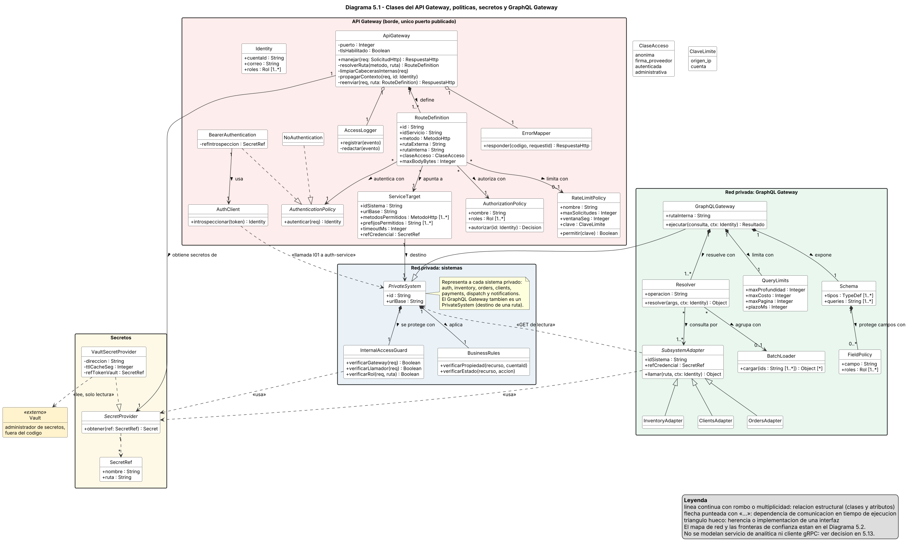
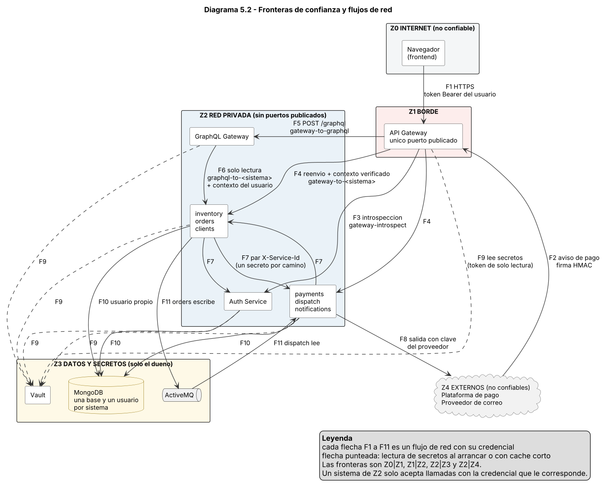
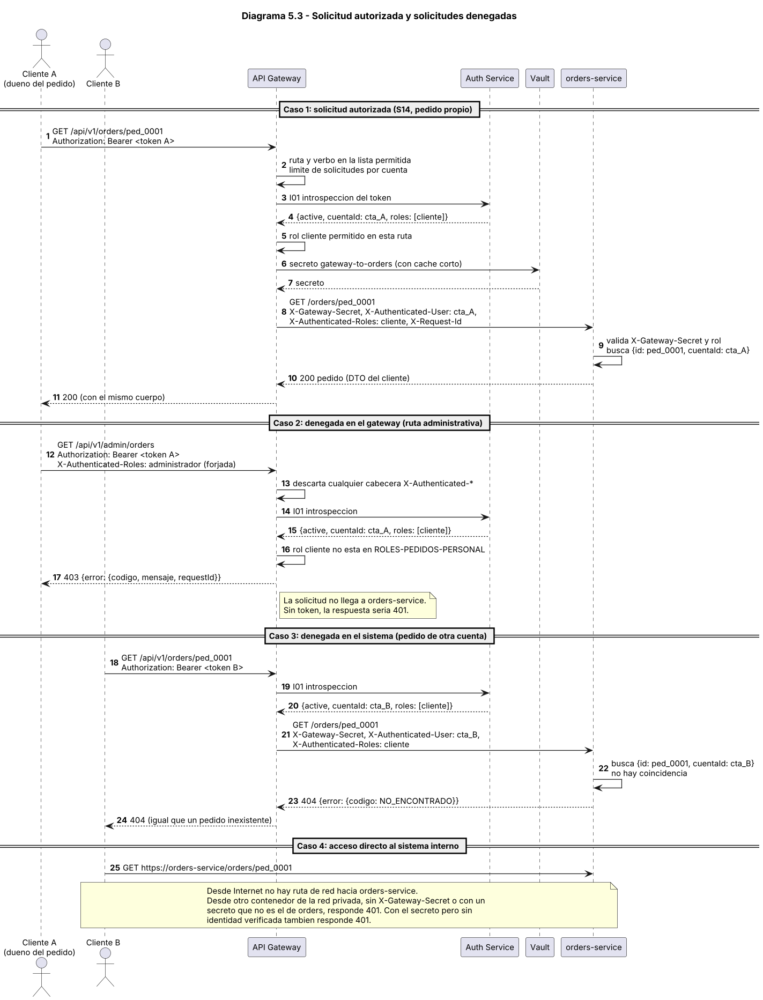

# Evaluación Unidad 2 — Backend seguro completo
## Pizzería La Fornace (derivado del Caso 19)

---

# Módulo 5 — Clases del API Gateway

Los diagramas se entregan en formato editable (PlantUML, `.puml`) y legible (`.svg` y `.png`). Están en la carpeta `diagramas/`. Este módulo complementa el mapa de componentes del Módulo 3: no lo reemplaza.

## 5.1 Cumplimiento de los pasos a seguir de la guía

| Paso de la guía | Dónde está |
| --- | --- |
| 1. Decidir cuántos gateways y por qué. | 5.2. |
| 2. Clasificar rutas anónimas, autenticadas, administrativas e internas. | 5.3. |
| 3. Modelar ApiGateway, RouteDefinition, AuthenticationPolicy, AuthorizationPolicy, ServiceTarget, SecretProvider, GraphQLGateway, Schema, Resolver y adaptadores. | Diagrama 5.1 y catálogo de clases (5.4). |
| 4. Atributos, operaciones, multiplicidades y dependencias hacia autenticación, sistemas y secretos. | Diagrama 5.1 y tabla de relaciones (5.5). |
| 5. Qué valida el gateway y qué valida cada sistema. | 5.8. |
| Fronteras de confianza y recorrido de una solicitud autorizada y una denegada. | 5.9 (diagrama 5.2) y 5.11 (diagrama 5.3). |
| Validación de identidad, autorización por ruta, límites, tiempos, errores y registros. | 5.6 y 5.7. |
| Cómo se impide el acceso directo a los sistemas internos. | 5.10. |

## 5.2 Cuántos gateways

Se usan **dos**, de naturaleza distinta:

| Gateway | Rol | Dónde está |
| --- | --- | --- |
| API Gateway | Borde: recibe todo lo que viene de Internet. Autentica, autoriza por ruta, limita y reenvía. | Es el único con un puerto publicado. |
| GraphQL Gateway | Agregación: combina consultas de lectura de varios sistemas para una pantalla. No autentica a usuarios y no publica nada hacia Internet. | Dentro de la red privada. Se llega a él solo por el API Gateway (`POST /api/v1/graphql`). |

Se descartaron otras opciones:

| Alternativa | Por qué no |
| --- | --- |
| Un API Gateway por tipo de público (uno para clientes y otro para personal). | Las diferencias entre públicos se resuelven con políticas de autorización por ruta. Dos gateways duplicarían la validación de tokens, los secretos y la configuración, sin que cambien la red, el protocolo ni la escala. |
| Un API Gateway por sistema. | Habría seis puertos publicados y seis lugares donde fallar al validar identidad. Es lo contrario de un punto de entrada único. |
| Un solo gateway que también agregue datos (sin GraphQL Gateway). | Mezclaría el borde público con lógica de composición. El borde debe ser fino, y la agregación debe vivir en la red privada. |
| Sin GraphQL Gateway. | La guía exige al menos uno privado con una agregación útil de dos o más sistemas (Módulo 8). |

Un segundo gateway de borde solo se justificaría si hubiera una exposición, un protocolo de autenticación o una escala distintos. En La Fornace no ocurre ninguna de las tres.

## 5.3 Clasificación de rutas

| Clase de ruta | Servicios | Quién llama | Autenticación en el gateway | Política de autorización | Datos que puede transportar |
| --- | --- | --- | --- | --- | --- |
| Externa anónima | S01, S03, S04, S05, S06, S35 | Cualquier visitante | Ninguna. Límite de solicitudes por IP | Ninguna | S06 solo datos públicos. S01, S03, S04, S05 y S35 reciben credenciales o datos personales de quien las envía, pero no devuelven datos de otras personas. |
| Externa con firma del proveedor | S21 | Plataforma de pago | Ninguna del usuario. El gateway solo limita tasa, verbo y tamaño | Ninguna en el gateway. La firma la verifica payments | Resultado de un pago. |
| Externa autenticada | S02, S12, S13, S14, S15, S20, S23, S24, S25 | Cliente (y personal en S14, S23 y S02) | Token Bearer (I01) | `ROLES-TODOS`, `ROLES-CLIENTE`, `ROLES-PEDIDO-LECTURA` o `ROLES-BOLETA` | Datos restringidos del propio cliente: pedidos, dirección, boleta y perfil. La propiedad la comprueba el sistema dueño. |
| Administrativa | S07, S08, S09, S10, S11, S16, S17, S18, S19, S22, S26, S27, S28, S29, S30, S31, S32, S33, S34 | Personal | Token Bearer (I01) | `ROLES-CATALOGO`, `ROLES-PEDIDOS-PERSONAL`, `ROLES-DESPACHO`, `ROLES-VENTAS`, `ROLES-REPORTE` o `ROLES-ADMIN` | Datos restringidos de clientes y pedidos, y datos operativos. Incluye rutas bajo `/api/v1/products` (S08 a S11), que no tienen el prefijo `admin` pero son administrativas por su rol. |
| Externa autenticada: GraphQL | `POST /api/v1/graphql` (nueva, Módulo 8) | Cliente y personal | Token Bearer (I01) | `ROLES-TODOS` en la ruta y política por campo dentro del gateway GraphQL | Agregaciones de lectura. Cada campo se autoriza por separado. |
| Interna | Todo `/internal/...` y el gateway GraphQL | Solo sistemas y el API Gateway | No se publica | No se publica | No aplica desde Internet. Ver 5.10. |

Una ruta pública de red puede transportar datos restringidos para un usuario autorizado. Por eso la clase no depende del prefijo de la ruta, sino de quién puede llamarla y qué devuelve. La lista completa de rutas, con su destino y sus controles, es el contenido del Módulo 6.

## 5.4 Diagrama 5.1 — Clases del gateway, políticas, secretos y GraphQL

Fuente editable: `diagramas/diagrama-5-1-clases-gateway.puml`. Versión vectorial: `diagramas/diagrama-5-1-clases-gateway.svg`.

El diagrama separa tres cosas: la **configuración de rutas** (`RouteDefinition` y `ServiceTarget`), las **políticas** (autenticación, autorización y límites) y los **secretos** (`SecretProvider`). Las líneas con rombo y multiplicidad son relaciones estructurales. Las flechas punteadas con estereotipo son dependencias de comunicación en tiempo de ejecución; el mapa de red está en el diagrama 5.2.

| Clase | Tipo | Responsabilidad | Atributos relevantes | Operaciones | Depende de |
| --- | --- | --- | --- | --- | --- |
| `ApiGateway` | Clase | Punto de entrada único. Recibe la solicitud, la valida con las políticas de su ruta, descarta la identidad que traiga el navegador, agrega el contexto verificado y la reenvía. | `puerto`, `tlsHabilitado` | `manejar`, `resolverRuta`, `limpiarCabecerasInternas`, `propagarContexto`, `reenviar` | SecretProvider, AccessLogger, ErrorMapper |
| `RouteDefinition` | Clase de configuración | Una fila de la lista de rutas permitidas: verbo, ruta externa, ruta interna, clase de acceso y límites. Es la única forma de llegar a un sistema. | `id`, `idServicio`, `metodo`, `rutaExterna`, `rutaInterna`, `claseAcceso`, `maxBodyBytes` | — | AuthenticationPolicy, AuthorizationPolicy, RateLimitPolicy, ServiceTarget |
| `AuthenticationPolicy` | Interfaz | Cómo se identifica quien llama. Se implementa con `NoAuthentication` (rutas anónimas) y `BearerAuthentication` (token de usuario). | — | `autenticar` | AuthClient (solo Bearer) |
| `AuthorizationPolicy` | Clase de política | Conjunto de roles que pueden usar un grupo de rutas. Es la primera barrera: corta antes de molestar a un sistema. | `nombre`, `roles` | `autorizar` | Identity |
| `RateLimitPolicy` | Clase de política | Límite de solicitudes por ventana de tiempo y por origen o por cuenta. | `nombre`, `maxSolicitudes`, `ventanaSeg`, `clave` | `permitir` | — |
| `ServiceTarget` | Clase de configuración | Un sistema interno al que se puede reenviar. Fija la URL, los verbos y los prefijos de ruta admitidos, el plazo y la referencia de la credencial. | `idSistema`, `urlBase`, `metodosPermitidos`, `prefijosPermitidos`, `timeoutMs`, `refCredencial` | — | PrivateSystem, SecretProvider |
| `Identity` | Objeto de valor | Identidad verificada del usuario: la que devuelve Auth Service y que el gateway propaga. | `cuentaId`, `correo`, `roles` | — | — |
| `AuthClient` | Clase | Cliente de Auth Service para la introspección del token (I01). | — | `introspeccionar` | Auth Service, SecretProvider |
| `ErrorMapper` | Clase | Convierte cualquier falla en un error controlado con `codigo`, `mensaje` y `requestId`, sin detalles internos. | — | `responder` | — |
| `AccessLogger` | Clase | Registra cada solicitud sin secretos, sin tokens y sin cuerpo. | — | `registrar`, `redactar` | — |
| `SecretProvider` | Interfaz | Entrega un secreto a partir de una referencia simbólica. Nadie lee secretos desde el código ni desde variables fijas. | — | `obtener` | SecretRef |
| `VaultSecretProvider` | Clase | Implementación contra Vault con un token de solo lectura y un caché corto. | `direccion`, `ttlCacheSeg`, `refTokenVault` | — | Vault |
| `SecretRef` | Objeto de valor | Referencia simbólica (por ejemplo, `gateway-to-orders`). Nunca contiene el valor. | `nombre`, `ruta` | — | — |
| `PrivateSystem` | Clase abstracta | Cualquier sistema de la red privada. Cada uno tiene su guardia de acceso y sus reglas de negocio. | `id`, `urlBase` | — | InternalAccessGuard, BusinessRules |
| `InternalAccessGuard` | Clase | Lo que cada sistema comprueba antes de atender: que lo llame el gateway o un sistema permitido, y que el rol sirva para la ruta. | — | `verificarGateway`, `verificarLlamador`, `verificarRol` | SecretProvider |
| `BusinessRules` | Clase | Comprobaciones que solo el dueño del dato puede hacer: propiedad, estado y reglas del negocio. | — | `verificarPropiedad`, `verificarEstado` | — |
| `GraphQLGateway` | Clase | Gateway privado de agregación. Recibe consultas de lectura ya autenticadas por el API Gateway y las resuelve llamando a los sistemas. | `rutaInterna` | `ejecutar` | Schema, Resolver, QueryLimits |
| `Schema` | Clase | Tipos y consultas expuestos, con las políticas por campo. | `tipos`, `queries` | — | FieldPolicy |
| `FieldPolicy` | Clase de política | Roles que pueden leer un campo. Evita filtrar datos restringidos al elegir campos. | `campo`, `roles` | — | — |
| `Resolver` | Clase | Resuelve una consulta combinando datos de uno o más sistemas. | `operacion` | `resolver` | SubsystemAdapter, BatchLoader |
| `BatchLoader` | Clase | Agrupa en una sola llamada los ids repetidos (por ejemplo, los productos de varios pedidos) para evitar una llamada por ítem. | — | `cargar` | SubsystemAdapter |
| `SubsystemAdapter` | Clase abstracta | Cliente de lectura hacia un sistema. Lleva su propia credencial y el contexto del usuario. | `idSistema`, `refCredencial` | `llamar` | PrivateSystem, SecretProvider |
| `OrdersAdapter, InventoryAdapter, ClientsAdapter` | Clases | Adaptadores hacia orders, inventory y clients. Solo hacen GET. | — | — | OrdersService, InventoryService, ClientsService |
| `QueryLimits` | Clase de política | Profundidad, costo, tamaño de página y plazo máximo de una consulta. | `maxProfundidad`, `maxCosto`, `maxPagina`, `plazoMs` | — | — |
| `ClaseAcceso, ClaveLimite` | Enumeraciones | `ClaseAcceso`: anonima, firma_proveedor, autenticada, administrativa. `ClaveLimite`: origen_ip, cuenta. | — | — | — |

## 5.5 Tabla de relaciones

| ID | Origen | Destino | Mult. origen | Mult. destino | Tipo | Regla |
| --- | --- | --- | --- | --- | --- | --- |
| R5-01 | `ApiGateway` | `RouteDefinition` | 1 | 1..* | Composición | Cada definición pertenece a un solo gateway y no existe fuera de él. Un gateway sin rutas no deja pasar nada, así que tiene al menos una. |
| R5-02 | `RouteDefinition` | `AuthenticationPolicy` | * | 1 | Asociación | Toda ruta tiene exactamente una forma de autenticarse (anónima o con token). La política se **comparte**: la misma `BearerAuthentication` sirve a todas las rutas autenticadas, y así hay una sola implementación que auditar. |
| R5-03 | `RouteDefinition` | `AuthorizationPolicy` | * | 1 | Asociación | Toda ruta tiene un conjunto de roles. Varias rutas comparten el mismo (por ejemplo, `ROLES-ADMIN`), lo que evita copiar listas de roles y que se desalineen. |
| R5-04 | `RouteDefinition` | `RateLimitPolicy` | * | 0..1 | Asociación | Una ruta puede tener un límite compartido o ninguno. Las rutas administrativas usan el límite por cuenta. |
| R5-05 | `RouteDefinition` | `ServiceTarget` | * | 1 | Asociación | Toda ruta apunta a exactamente un destino. Un destino atiende a muchas rutas. El destino limita los verbos y prefijos, así que una ruta mal escrita no puede alcanzar `/internal/...`. |
| R5-06 | `ServiceTarget` | `PrivateSystem` | 1 | 1 | Asociación | Cada destino corresponde a un sistema de la red privada y cada sistema tiene un solo destino registrado en el gateway. |
| R5-07 | `BearerAuthentication` | `AuthClient` | 1 | 1 | Asociación | La autenticación con token necesita un cliente de Auth Service para la introspección. |
| R5-08 | `ApiGateway` | `SecretProvider` | 1 | 1 | Asociación | Un gateway usa un solo proveedor de secretos, que entrega `gateway-introspect` (para I01) y un `gateway-to-<sistema>` por cada destino. |
| R5-09 | `PrivateSystem` | `InternalAccessGuard` | 1 | 1 | Composición | Cada sistema trae su propia guardia. No hay un sistema que dependa de que el gateway haya filtrado antes. |
| R5-10 | `PrivateSystem` | `BusinessRules` | 1 | 1 | Composición | Las reglas de propiedad y estado pertenecen al dueño del dato y no se delegan al gateway. |
| R5-11 | `GraphQLGateway` | `Schema` | 1 | 1 | Composición | Un solo esquema por gateway GraphQL. |
| R5-12 | `GraphQLGateway` | `Resolver` | 1 | 1..* | Composición | Cada consulta expuesta tiene un resolver. |
| R5-13 | `GraphQLGateway` | `QueryLimits` | 1 | 1 | Composición | Los límites son parte de la configuración del gateway GraphQL. |
| R5-14 | `Schema` | `FieldPolicy` | 1 | 0..* | Composición | Los campos restringidos tienen una política y los públicos no necesitan ninguna. |
| R5-15 | `Resolver` | `SubsystemAdapter` | * | 1..* | Asociación | Un resolver consulta a uno o más sistemas (al menos uno). Un adaptador lo pueden usar varios resolvers. |
| R5-16 | `Resolver` | `BatchLoader` | * | 0..1 | Asociación | Solo los resolvers que repiten ids (productos de varios pedidos) usan agrupación. |

Políticas compartidas: las políticas de autenticación, autorización y límites no pertenecen a una sola ruta. Muchas rutas apuntan a la misma política (R5-02 a R5-04). Se comparten porque la regla es la misma (por ejemplo, "solo el administrador") y mantenerla en un solo lugar impide que dos rutas del mismo grupo queden con reglas distintas.

## 5.6 Políticas nombradas

### Autorización por rol

Salen de la columna "Acceso" del Módulo 1 y de la matriz del Módulo 4.

| Política | Roles | Descripción | Servicios |
| --- | --- | --- | --- |
| `ROLES-TODOS` | `administrador`, `cajero_virtual`, `cliente`, `dueno`, `encargado_despachos` | Cualquier usuario con sesión | S02 |
| `ROLES-CLIENTE` | `cliente` | Solo el cliente | S12, S13, S15, S20, S24, S25 |
| `ROLES-PEDIDO-LECTURA` | `administrador`, `cajero_virtual`, `cliente`, `encargado_despachos` | Cliente (lo suyo) y personal que atiende pedidos | S14 |
| `ROLES-BOLETA` | `administrador`, `cajero_virtual`, `cliente` | Cliente (lo suyo), cajero virtual y administrador | S23 |
| `ROLES-CATALOGO` | `administrador`, `dueno` | Administrador y dueño | S07, S08, S09, S10, S11 |
| `ROLES-REPORTE` | `administrador`, `dueno` | Dueño y administrador, para el reporte | S34 |
| `ROLES-PEDIDOS-PERSONAL` | `administrador`, `cajero_virtual`, `encargado_despachos` | Personal que atiende pedidos | S16 |
| `ROLES-DESPACHO` | `administrador`, `encargado_despachos` | Encargado de despachos y administrador | S17, S18, S19 |
| `ROLES-VENTAS` | `administrador`, `cajero_virtual` | Cajero virtual y administrador | S22 |
| `ROLES-ADMIN` | `administrador` | Solo el administrador | S26, S27, S28, S29, S30, S31, S32, S33 |

Las rutas anónimas usan `NoAuthentication` y no tienen política de autorización. S21 tampoco la tiene en el gateway: su control es la firma, que verifica payments.

### Límites de solicitudes

| Política | Clave | Límite | Servicios | Motivo |
| --- | --- | --- | --- | --- |
| `RL-SENSIBLE` | Por IP | 10 por minuto | S01, S03, S04, S05, S35 | Frena la fuerza bruta de contraseñas y el envío masivo de correos o mensajes. |
| `RL-CATALOGO` | Por IP | 120 por minuto | S06 | Consulta pública frecuente, con tope para evitar abusos. |
| `RL-WEBHOOK` | Por IP de origen | 60 por minuto | S21 | El volumen esperado de avisos es bajo. |
| `RL-USUARIO` | Por cuenta | 120 por minuto | S02, S12 a S15, S20, S23 a S25 y las rutas administrativas | Evita que una sola cuenta sature a los sistemas. Si se excede, 429. |

## 5.7 Controles del gateway

| Control | Cómo se aplica |
| --- | --- |
| Validación de identidad | El gateway pregunta a Auth Service por el token en cada solicitud (I01). No decodifica ni confía en el token por sí mismo. Si Auth Service no responde, 503: no deja pasar sin verificar (falla cerrado). |
| Autorización por ruta | Cada `RouteDefinition` apunta a una `AuthorizationPolicy` con los roles de la tabla 5.6. Lo no listado, denegado. |
| Límites de solicitudes | Tabla 5.6. Se responde 429 con `Retry-After`. |
| Tiempos de espera | 10 segundos por destino. 5 segundos para el aviso de pago. 15 segundos para GraphQL. El gateway no reintenta POST, PUT, PATCH ni DELETE para no duplicar efectos. Si el destino no responde, 502 o 503. |
| Tamaño del cuerpo | 64 KB por defecto y 16 KB para el aviso de pago. Más que eso, 413. |
| Mensajes de error controlados | Siempre `{ error: { codigo, mensaje, requestId } }` (formato del Módulo 1). Nunca trazas, URLs internas ni nombres de campos de la base de datos. |
| Registros sin secretos | Se registra `requestId`, ruta, verbo, estado, duración, `cuentaId` y decisión. Nunca se registran tokens, contraseñas, cuerpos, cabeceras de secretos ni correos. |
| Redirección restringida | No existe un reenvío genérico del tipo `/api/{path}`. Cada fila de la lista fija verbo, ruta externa, destino y ruta interna. Además, cada `ServiceTarget` limita los verbos y prefijos que acepta, así que una fila mal escrita no puede llegar a `/internal/...`. |
| Cabeceras | Descarta `X-Authenticated-*`, `X-Gateway-Secret`, `X-Service-*` y `X-Request-Id` que traiga el navegador. Escribe las suyas. |

## 5.8 Qué valida el gateway y qué valida cada sistema

| Comprobación | API Gateway | Cada sistema |
| --- | --- | --- |
| Que la ruta y el verbo estén en la lista permitida | Sí. Lo que no está en la lista responde 404 (ruta) o 405 (verbo). No hay reenvío genérico. | No lo necesita, pero rechaza rutas internas que no sean para quien llama. |
| TLS, tamaño del cuerpo y límite de solicitudes | Sí. TLS en el borde y también hacia cada destino (6.12). | Los sistemas atienden solo por TLS. No repiten el límite ni el tamaño. |
| Identidad del usuario (token) | Sí, con I01 a Auth Service. Sin token válido, 401. | No ven el token. Confían en las cabeceras `X-Authenticated-*` solo si el secreto del gateway coincide. |
| Rol permitido para la ruta | Sí (primera barrera). Si no está, 403. | Sí (segunda barrera) con `X-Authenticated-Roles`, por si alguien llama sin pasar por el gateway. |
| Cabeceras de identidad que manda el navegador | Las descarta todas y escribe solo las suyas. | Reciben solo las del gateway. |
| Que la llamada venga del gateway o de un sistema permitido | Agrega `X-Gateway-Secret` propio del destino. | Sí. `InternalAccessGuard` compara el secreto en tiempo constante y revisa el par llamador–ruta. Si falla, 401 o 403. |
| Propiedad del recurso (C1) | No. No tiene el dato. | Sí. El sistema filtra por `cuentaId` y responde 404 si no coincide. |
| Estado del recurso y reglas del negocio (C2, C5, C7) | No. | Sí. Cada sistema aplica las suyas. |
| Validación del cuerpo y de los campos | Solo tamaño máximo y tipo de contenido. | Sí. Esquema, rangos y formatos. |
| Firma del aviso de pago (C8) | No. Solo limita tasa, verbo y tamaño. | Sí. payments verifica firma, marca de tiempo, `eventoId` y monto. |
| Precios, totales, estado de pago e identidad enviados por el navegador | No los interpreta. | Los ignoran: el servidor calcula el precio, el estado de pago lo fija el aviso firmado y la identidad sale del token. |
| Tiempos de espera y errores controlados | Sí. Plazo por destino y mensajes sin detalles internos. | Sí en sus propias llamadas (por ejemplo, orders a inventory en 3 s). |
| Registros sin secretos | Sí. | Sí. |

Regla general: el gateway comprueba lo que se puede decidir sin conocer el negocio (quién eres, qué rol tienes, si la ruta existe y cuánto llamas). Cada sistema comprueba lo que solo él puede decidir (si el recurso es tuyo, si su estado lo permite y si los datos cumplen las reglas). Ninguna de las dos capas reemplaza a la otra.

## 5.9 Fronteras de confianza

Fuente editable: `diagramas/diagrama-5-2-fronteras.puml`. Versión vectorial: `diagramas/diagrama-5-2-fronteras.svg`.

Este diagrama muestra **flujos de red**, a diferencia del 5.1, que muestra la estructura de clases. Cada flecha F1 a F11 lleva su credencial.

| Frontera | Qué cruza | Controles en la frontera | Qué pasa si falla |
| --- | --- | --- | --- |
| Z0 ↔ Z1 Internet y borde | Navegador → API Gateway (F1). Plataforma de pago → API Gateway (F2). | TLS. Solo el puerto del gateway está publicado. Lista de rutas permitidas, límite de solicitudes, tamaño máximo y token. | Una solicitud mal formada o sin credencial se corta en el borde con 400, 401, 404, 405 o 429. |
| Z1 ↔ Z2 Borde y red privada | API Gateway → Auth Service (F3), sistemas (F4) y GraphQL Gateway (F5). | El gateway agrega el secreto del destino y el contexto verificado. Cada sistema vuelve a comprobar secreto, rol, propiedad y estado. | Si el gateway fuera vulnerado, un sistema igual rechaza lo que no cumpla sus reglas. Los secretos son por destino: el robo de uno no abre los demás. |
| Dentro de Z2 Sistema a sistema | F6 (GraphQL → sistemas) y F7. | Par `X-Service-Id` y secreto por camino. Cada ruta interna acepta solo a su llamador. GraphQL solo hace GET. | Un sistema comprometido solo alcanza las rutas de sus propias integraciones. |
| Z2 ↔ Z3 Sistemas y datos o secretos | Sistemas → Vault (F9), MongoDB (F10) y ActiveMQ (F11). | Cada sistema tiene su usuario de base de datos, su política de solo lectura en Vault y su usuario del broker. Ni el gateway ni el navegador tienen credenciales de base de datos. | Un sistema solo lee su base. Si Vault no responde, ver 5.10. |
| Z2 ↔ Z4 Sistemas y externos | payments → plataforma de pago y notifications → proveedor de correo (F8). La plataforma entrega avisos por Z0 ↔ Z1 (F2). | Clave del proveedor guardada en Vault y usada solo por el sistema dueño de esa integración. El aviso se acepta solo con firma. | Un aviso falsificado no pasa la firma. La clave del proveedor nunca llega al navegador. |

Identificación de componentes: API Gateway (Z1), Auth Service y GraphQL Gateway (Z2), administrador de secretos Vault (Z3), sistemas privados (Z2) con sus bases de datos (Z3). No hay servicios de analítica ni de alta demanda (5.13).

## 5.10 Cómo se impide el acceso directo a los sistemas internos

Hay cuatro capas, y cada una por sí sola ya impide un acceso directo desde Internet:

1. **Red.** Los sistemas, Vault, MongoDB y ActiveMQ no publican puertos. Solo el API Gateway tiene uno. Desde Internet no hay ruta de red hacia ellos.
2. **Lista de rutas.** El gateway solo reenvía las filas de su lista y nunca `/internal/...`. Lo que no está listado, 404.
3. **Secreto por destino.** Cada sistema exige `X-Gateway-Secret` con el secreto que le corresponde solo a él (`gateway-to-<sistema>`), o un par de servicio permitido para esa ruta. Alguien dentro de la red privada sin el secreto recibe 401.
4. **Identidad y negocio.** Aunque tuviera el secreto, el sistema revisa el rol y la propiedad con la identidad propagada. Sin identidad verificada, 401.

Si Vault no responde: un sistema en ejecución sigue con los secretos que cargó al arrancar, y el gateway mantiene el último valor hasta 15 minutos. Pasado ese plazo el gateway responde 503 y no deja pasar nada. Un sistema que no puede leer sus secretos al arrancar no arranca (detalle en 6.10). No hay valores por defecto.

Si una clave se filtra: se revoca y reemplaza solo esa referencia (por ejemplo, `gateway-to-orders`) y los demás caminos siguen intactos. El detalle de rotación y revocación está en el inventario de secretos del Módulo 6.

## 5.11 Recorrido de una solicitud autorizada y de las denegadas

Fuente editable: `diagramas/diagrama-5-3-secuencia-acceso.puml`. Versión vectorial: `diagramas/diagrama-5-3-secuencia-acceso.svg`.

| Caso | Qué ocurre | Dónde se decide | Resultado |
| --- | --- | --- | --- |
| 1. Cliente A consulta su pedido (S14). | El gateway encuentra la ruta, valida el token con Auth Service, comprueba el rol y reenvía con el secreto de orders y el contexto verificado. Orders busca el pedido por `id` y `cuentaId`. | Gateway: token y rol. Orders: secreto, rol y propiedad. | 200 |
| 2. Cliente A pide `/api/v1/admin/orders` y envía una cabecera de rol falsa. | El gateway descarta la cabecera, obtiene el rol real y ve que `cliente` no está en `ROLES-PEDIDOS-PERSONAL`. | Gateway: autorización por ruta. | 403. No llega a orders. |
| 3. Cliente B consulta el pedido de A. | El rol sirve para la ruta, así que el gateway reenvía. Orders no encuentra un pedido con ese `id` y la cuenta de B. | Orders: propiedad (C1). | 404, igual que un pedido inexistente. |
| 4. Alguien intenta llamar a orders directamente. | Desde Internet no hay ruta. Dentro de la red privada, sin el secreto o con el de otro sistema, 401. | Red y `InternalAccessGuard`. | Sin acceso. |

## 5.12 GraphQL Gateway en la red privada

- **Para qué:** entregar al frontend consultas que combinan sistemas sin exponerlos. Por ejemplo, `resumenPedido` une el estado y los ítems de orders con el nombre, la imagen y la descripción vigentes de inventory, y `miCuenta` une el perfil de clients con los últimos pedidos de orders. El esquema, los resolvers y la matriz de autorización final son el Módulo 8.
- **Cómo se llega:** el navegador llama a `POST /api/v1/graphql` en el API Gateway. El gateway autentica, aplica `ROLES-TODOS` y reenvía con el secreto `gateway-to-graphql` y el contexto verificado. El GraphQL Gateway no vuelve a autenticar al usuario.
- **Qué hace con cada sistema:** llama a los sistemas por sus APIs de lectura con su propio par de credenciales (`graphql-to-orders`, `graphql-to-inventory` y `graphql-to-clients`) y con el contexto del usuario. Los sistemas siguen aplicando la propiedad: si pide un pedido ajeno, orders responde 404 aunque el que llama sea el GraphQL Gateway.
- **Qué no hace:** no tiene mutaciones, no accede a bases de datos y no decide reglas de negocio. Las escrituras siguen siendo los servicios REST.
- **Seguridad por campo:** cada campo restringido tiene una `FieldPolicy`. Elegir un campo en la consulta no lo autoriza.
- **Límites:** `QueryLimits` fija la profundidad, el costo, el tamaño de página y el plazo. `BatchLoader` evita una llamada por ítem.
- **Si un sistema no responde:** la consulta devuelve lo que sí pudo resolver y marca los campos que faltan en `errors`, sin inventar valores (Módulo 8).

## 5.13 Analítica y gRPC

No se modelan un servicio de analítica ni un cliente gRPC en esta etapa. Es una decisión preliminar, basada en la carga del caso: un solo local, el reporte de ventas (S34) cubre como máximo 92 días con un volumen de ventas diario de orden bajo, y no hay un flujo que requiera streaming (el despacho usa una cola ActiveMQ). La decisión se formaliza con un ADR y una medición de carga en el Módulo 9. Si la medición mostrara lo contrario, se agregarían un servicio privado de analítica y su adaptador, que el GraphQL Gateway consultaría como cualquier otro subsistema.

## 5.14 Qué se aprovecha del gateway de ejemplo y qué se corrige

El gateway del curso muestra el flujo correcto: validar el token con Auth Service y reenviar con un secreto de Vault. Para esta entrega se corrige lo que quedaba abierto:

| En el ejemplo | En esta propuesta |
| --- | --- |
| Reenvío genérico `/api/{path}` a un solo destino fijo. | Lista de rutas con verbo, ruta externa, destino y ruta interna, y destinos con verbos y prefijos limitados. |
| Un solo secreto de backend para todo. | Un secreto por destino y por camino. |
| Consulta de Vault en cada solicitud. | Caché corto del secreto, con falla cerrada si no hay valor. |
| Pasa `X-Authenticated-Client` leyendo un campo que la identidad no trae (falla con error interno), y escribe el tipo de contenido con un nombre de cabecera incorrecto. | Contexto de identidad definido (`cuentaId`, correo, roles) y cabeceras con sus nombres correctos. |
| Mensajes de error con detalle libre. | `ErrorMapper` con código, mensaje y `requestId`. |
| Sin límites de solicitudes ni de tamaño. | Políticas de límite y tamaño máximo por ruta. |

## 5.15 Control antes de avanzar

| Pregunta | Respuesta |
| --- | --- |
| ¿Se entiende cómo se impide el acceso directo no autorizado a los sistemas internos? | Sí. 5.10 explica las cuatro capas (red, lista de rutas, secreto por destino, identidad y negocio) y el caso 4 de 5.11 lo ejemplifica. |
| ¿El diagrama distingue configuración de rutas, políticas y secretos? | Sí. En el 5.1, `RouteDefinition` y `ServiceTarget` son configuración; las políticas son clases aparte compartidas; y `SecretProvider` con `SecretRef` está en su propio paquete. |
| ¿La elección de uno o varios gateways tiene fundamento? | Sí. 5.2 justifica un API Gateway de borde y un GraphQL Gateway privado, y descarta las alternativas con motivos concretos. |
