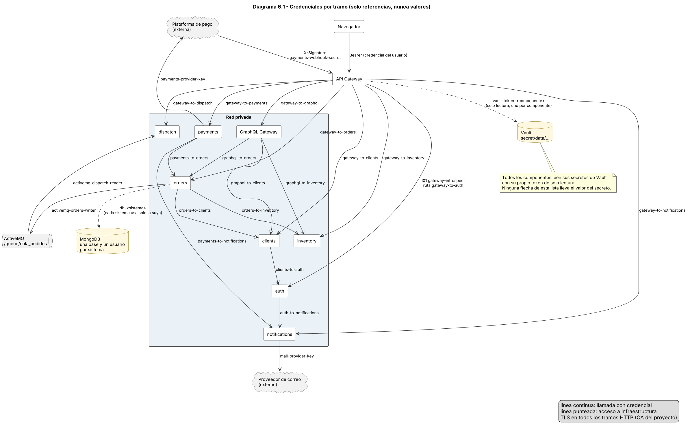

# Evaluación Unidad 2 — Backend seguro completo
## Pizzería La Fornace (derivado del Caso 19)

---

# Módulo 6 — Rutas y secretos de integración

Todo lo que aparece como credencial en este módulo es una **referencia simbólica**. No hay valores reales en el informe, ni en el repositorio, ni en las capturas.

## 6.1 Cumplimiento de los pasos a seguir de la guía

| Paso de la guía | Dónde está |
| --- | --- |
| 1. Lista explícita de rutas y verbos, vinculada con un servicio y una política del Módulo 4. | 6.3 (36 filas: 35 servicios y la ruta de GraphQL). |
| 2. Ruta externa, transformación y ruta interna. Sin endpoints internos publicados por omisión. | 6.3, 6.4 y 6.5. |
| 3. Credencial del usuario distinta de la credencial entre sistemas. Cómo se conserva una identidad confiable para comprobar propiedad. | 6.7. |
| 4. Secreto, certificado o identidad de servicio por integración, con justificación. | 6.8. |
| 5. Responsable, almacenamiento, permisos mínimos, rotación y revocación. | 6.9 y 6.10. |
| Matriz de rutas, operaciones GraphQL y gRPC. | 6.3, 6.6 y 6.11. |
| Inventario de secretos. | 6.9. |
| Decisiones de seguridad (un secreto por camino, credencial de payments mínima, base de datos propia, cabeceras, TLS). | 6.12. |
| Qué pasa si una clave se filtra o Vault no responde. | 6.10. |

## 6.2 Reglas de la lista de rutas

1. **Lista cerrada.** El gateway reenvía solo lo que está en la tabla 6.3 (verbo y ruta exactos). Otra ruta responde 404, y otro verbo en una ruta existente, 405.
2. **Un destino por ruta.** Cada fila fija el sistema y la ruta interna. No hay reenvío genérico por prefijo.
3. **Nada interno por omisión.** El gateway no publica `/internal/...`, la documentación automática de los sistemas (`/docs`, `/openapi.json`), `/metrics` ni los puertos de Vault, MongoDB y la consola de ActiveMQ (6.5).
4. **Política vinculada.** Cada fila indica el nombre de la política de roles (M5 5.6) y las condiciones del Módulo 4 que verifica el sistema dueño del dato.
5. **Credencial por destino.** La referencia de la última columna es la que el gateway usa para ese destino. Ninguna fila usa la credencial de otro.

### Controles comunes

| Control | Regla |
| --- | --- |
| Plazo de espera | `T10`: 10 s. `T5`: 5 s (aviso de pago). `T15`: 15 s (GraphQL). Sin respuesta: 502 o 503. El gateway no reintenta ninguna solicitud. |
| Tamaño | `B64`: cuerpo máximo de 64 KB. `B16`: 16 KB (aviso de pago y GraphQL). URL máxima de 2 KB. Más que eso, 413 o 414. |
| Límite de solicitudes | `RL-SENSIBLE`, `RL-CATALOGO`, `RL-WEBHOOK` y `RL-USUARIO` (M5 5.6). Excedido: 429. |
| CORS | Solo se acepta el origen del frontend. Las rutas con firma del proveedor (R21) no responden CORS. |
| Errores | `{ error: { codigo, mensaje, requestId } }` (M1 y M5 5.7). Sin trazas ni URLs internas. |

## 6.3 Matriz de rutas del API Gateway

Los números de fila coinciden con los de los servicios del Módulo 1 (R01 es S01). Los roles se abrevian con el nombre de la política (tabla de M5 5.6).

| ID | Gateway | Verbo | Ruta externa | Acceso y rol | Sistema y ruta destino | Controles | Referencia de credencial |
| --- | --- | --- | --- | --- | --- | --- | --- |
| R01 | API Gateway | POST | `/api/v1/auth/login` | Anónimo (`NoAuthentication`). M4: C4, C9 | `auth-service`: POST `/auth/login` | `RL-SENSIBLE`; plazo 10 s; cuerpo máx. 64 KB; límite de intentos fallidos por cuenta en auth (C9) | `gateway-to-auth` |
| R02 | API Gateway | POST | `/api/v1/auth/logout` | Autenticado (I01). `ROLES-TODOS`: `administrador`, `cajero_virtual`, `cliente`, `dueno`, `encargado_despachos` | `auth-service`: POST `/auth/logout` | `RL-USUARIO`; plazo 10 s; cuerpo máx. 64 KB | `gateway-to-auth` |
| R03 | API Gateway | POST | `/api/v1/auth/register` | Anónimo (`NoAuthentication`). M4: C9 | `clients-service`: POST `/clients/register` | `RL-SENSIBLE`; plazo 10 s; cuerpo máx. 64 KB | `gateway-to-clients` |
| R04 | API Gateway | POST | `/api/v1/auth/verify-email` | Anónimo (`NoAuthentication`). M4: C10 | `auth-service`: POST `/auth/verify-email` | `RL-SENSIBLE`; plazo 10 s; cuerpo máx. 64 KB | `gateway-to-auth` |
| R05 | API Gateway | POST | `/api/v1/auth/resend-verification` | Anónimo (`NoAuthentication`). M4: C9, C10 | `auth-service`: POST `/auth/resend-verification` | `RL-SENSIBLE`; plazo 10 s; cuerpo máx. 64 KB | `gateway-to-auth` |
| R06 | API Gateway | GET | `/api/v1/products` | Anónimo (`NoAuthentication`). M4: C12 | `inventory-service`: GET `/products` | `RL-CATALOGO`; plazo 10 s; cuerpo máx. 64 KB; respuesta solo con campos públicos (C12) | `gateway-to-inventory` |
| R07 | API Gateway | GET | `/api/v1/admin/products` | Autenticado (I01). `ROLES-CATALOGO`: `administrador`, `dueno` | `inventory-service`: GET `/admin/products` | `RL-USUARIO`; plazo 10 s; cuerpo máx. 64 KB | `gateway-to-inventory` |
| R08 | API Gateway | POST | `/api/v1/products` | Autenticado (I01). `ROLES-CATALOGO`: `administrador`, `dueno` | `inventory-service`: POST `/products` | `RL-USUARIO`; plazo 10 s; cuerpo máx. 64 KB | `gateway-to-inventory` |
| R09 | API Gateway | PUT | `/api/v1/products/{id}` | Autenticado (I01). `ROLES-CATALOGO`: `administrador`, `dueno` | `inventory-service`: PUT `/products/{id}` | `RL-USUARIO`; plazo 10 s; cuerpo máx. 64 KB | `gateway-to-inventory` |
| R10 | API Gateway | DELETE | `/api/v1/products/{id}` | Autenticado (I01). `ROLES-CATALOGO`: `administrador`, `dueno`. M4: C13 | `inventory-service`: DELETE `/products/{id}` | `RL-USUARIO`; plazo 10 s; cuerpo máx. 64 KB; Baja lógica (C13) | `gateway-to-inventory` |
| R11 | API Gateway | PUT | `/api/v1/products/{id}/stock` | Autenticado (I01). `ROLES-CATALOGO`: `administrador`, `dueno` | `inventory-service`: PUT `/products/{id}/stock` | `RL-USUARIO`; plazo 10 s; cuerpo máx. 64 KB | `gateway-to-inventory` |
| R12 | API Gateway | POST | `/api/v1/orders` | Autenticado (I01). `ROLES-CLIENTE`: `cliente`. M4: C4 | `orders-service`: POST `/orders` | `RL-USUARIO`; plazo 10 s; cuerpo máx. 64 KB; Pasa `Idempotency-Key` | `gateway-to-orders` |
| R13 | API Gateway | GET | `/api/v1/orders` | Autenticado (I01). `ROLES-CLIENTE`: `cliente`. M4: C1 | `orders-service`: GET `/orders` | `RL-USUARIO`; plazo 10 s; cuerpo máx. 64 KB | `gateway-to-orders` |
| R14 | API Gateway | GET | `/api/v1/orders/{id}` | Autenticado (I01). `ROLES-PEDIDO-LECTURA`: `administrador`, `cajero_virtual`, `cliente`, `encargado_despachos`. M4: C1, C3 | `orders-service`: GET `/orders/{id}` | `RL-USUARIO`; plazo 10 s; cuerpo máx. 64 KB | `gateway-to-orders` |
| R15 | API Gateway | POST | `/api/v1/orders/{id}/cancel` | Autenticado (I01). `ROLES-CLIENTE`: `cliente`. M4: C1, C2 | `orders-service`: POST `/orders/{id}/cancel` | `RL-USUARIO`; plazo 10 s; cuerpo máx. 64 KB | `gateway-to-orders` |
| R16 | API Gateway | GET | `/api/v1/admin/orders` | Autenticado (I01). `ROLES-PEDIDOS-PERSONAL`: `administrador`, `cajero_virtual`, `encargado_despachos`. M4: C3 | `orders-service`: GET `/admin/orders` | `RL-USUARIO`; plazo 10 s; cuerpo máx. 64 KB | `gateway-to-orders` |
| R17 | API Gateway | PATCH | `/api/v1/admin/orders/{id}/status` | Autenticado (I01). `ROLES-DESPACHO`: `administrador`, `encargado_despachos`. M4: C7 | `orders-service`: PATCH `/admin/orders/{id}/status` | `RL-USUARIO`; plazo 10 s; cuerpo máx. 64 KB; Nunca pasa a `pagado` (C7) | `gateway-to-orders` |
| R18 | API Gateway | GET | `/api/v1/admin/dispatch-orders` | Autenticado (I01). `ROLES-DESPACHO`: `administrador`, `encargado_despachos` | `dispatch-service`: GET `/admin/dispatch-orders` | `RL-USUARIO`; plazo 10 s; cuerpo máx. 64 KB | `gateway-to-dispatch` |
| R19 | API Gateway | GET | `/api/v1/admin/dispatch-orders/{pedidoId}/print` | Autenticado (I01). `ROLES-DESPACHO`: `administrador`, `encargado_despachos` | `dispatch-service`: GET `/admin/dispatch-orders/{pedidoId}/print` | `RL-USUARIO`; plazo 10 s; cuerpo máx. 64 KB | `gateway-to-dispatch` |
| R20 | API Gateway | POST | `/api/v1/orders/{id}/payments` | Autenticado (I01). `ROLES-CLIENTE`: `cliente`. M4: C1, C2 | `payments-service`: POST `/orders/{id}/payments` | `RL-USUARIO`; plazo 10 s; cuerpo máx. 64 KB | `gateway-to-payments` |
| R21 | API Gateway | POST | `/api/v1/payments/webhook` | Firma del proveedor (C8). Sin token de usuario. M4: C8 | `payments-service`: POST `/payments/webhook` | `RL-WEBHOOK`; plazo 5 s; cuerpo máx. 16 KB; Pasa `X-Timestamp`, `X-Signature` y el cuerpo sin modificar; sin CORS ni token de usuario | `gateway-to-payments` |
| R22 | API Gateway | GET | `/api/v1/admin/sales` | Autenticado (I01). `ROLES-VENTAS`: `administrador`, `cajero_virtual`. M4: C6 | `payments-service`: GET `/admin/sales` | `RL-USUARIO`; plazo 10 s; cuerpo máx. 64 KB | `gateway-to-payments` |
| R23 | API Gateway | GET | `/api/v1/orders/{id}/receipt` | Autenticado (I01). `ROLES-BOLETA`: `administrador`, `cajero_virtual`, `cliente`. M4: C1, C2 | `payments-service`: GET `/orders/{id}/receipt` | `RL-USUARIO`; plazo 10 s; cuerpo máx. 64 KB | `gateway-to-payments` |
| R24 | API Gateway | GET | `/api/v1/clients/me` | Autenticado (I01). `ROLES-CLIENTE`: `cliente`. M4: C1 | `clients-service`: GET `/clients/me` | `RL-USUARIO`; plazo 10 s; cuerpo máx. 64 KB | `gateway-to-clients` |
| R25 | API Gateway | PUT | `/api/v1/clients/me` | Autenticado (I01). `ROLES-CLIENTE`: `cliente`. M4: C1 | `clients-service`: PUT `/clients/me` | `RL-USUARIO`; plazo 10 s; cuerpo máx. 64 KB | `gateway-to-clients` |
| R26 | API Gateway | POST | `/api/v1/admin/clients` | Autenticado (I01). `ROLES-ADMIN`: `administrador` | `clients-service`: POST `/admin/clients` | `RL-USUARIO`; plazo 10 s; cuerpo máx. 64 KB | `gateway-to-clients` |
| R27 | API Gateway | GET | `/api/v1/admin/clients` | Autenticado (I01). `ROLES-ADMIN`: `administrador`. M4: C3 | `clients-service`: GET `/admin/clients` | `RL-USUARIO`; plazo 10 s; cuerpo máx. 64 KB | `gateway-to-clients` |
| R28 | API Gateway | PUT | `/api/v1/admin/clients/{id}` | Autenticado (I01). `ROLES-ADMIN`: `administrador` | `clients-service`: PUT `/admin/clients/{id}` | `RL-USUARIO`; plazo 10 s; cuerpo máx. 64 KB | `gateway-to-clients` |
| R29 | API Gateway | DELETE | `/api/v1/admin/clients/{id}` | Autenticado (I01). `ROLES-ADMIN`: `administrador`. M4: C13 | `clients-service`: DELETE `/admin/clients/{id}` | `RL-USUARIO`; plazo 10 s; cuerpo máx. 64 KB; Baja lógica (C13) | `gateway-to-clients` |
| R30 | API Gateway | POST | `/api/v1/admin/users` | Autenticado (I01). `ROLES-ADMIN`: `administrador` | `auth-service`: POST `/admin/users` | `RL-USUARIO`; plazo 10 s; cuerpo máx. 64 KB | `gateway-to-auth` |
| R31 | API Gateway | GET | `/api/v1/admin/users` | Autenticado (I01). `ROLES-ADMIN`: `administrador` | `auth-service`: GET `/admin/users` | `RL-USUARIO`; plazo 10 s; cuerpo máx. 64 KB | `gateway-to-auth` |
| R32 | API Gateway | PUT | `/api/v1/admin/users/{id}` | Autenticado (I01). `ROLES-ADMIN`: `administrador`. M4: C5 | `auth-service`: PUT `/admin/users/{id}` | `RL-USUARIO`; plazo 10 s; cuerpo máx. 64 KB | `gateway-to-auth` |
| R33 | API Gateway | DELETE | `/api/v1/admin/users/{id}` | Autenticado (I01). `ROLES-ADMIN`: `administrador`. M4: C5, C13 | `auth-service`: DELETE `/admin/users/{id}` | `RL-USUARIO`; plazo 10 s; cuerpo máx. 64 KB; Baja lógica (C13) | `gateway-to-auth` |
| R34 | API Gateway | GET | `/api/v1/admin/reports/sales` | Autenticado (I01). `ROLES-REPORTE`: `administrador`, `dueno`. M4: C3, C6 | `payments-service`: GET `/admin/reports/sales` | `RL-USUARIO`; plazo 10 s; cuerpo máx. 64 KB | `gateway-to-payments` |
| R35 | API Gateway | POST | `/api/v1/contact-messages` | Anónimo (`NoAuthentication`). M4: C9 | `notifications-service`: POST `/contact-messages` | `RL-SENSIBLE`; plazo 10 s; cuerpo máx. 64 KB | `gateway-to-notifications` |
| R36 | API Gateway → GraphQL Gateway | POST | `/api/v1/graphql` | Autenticado (I01). `ROLES-TODOS`. Cada operación y campo se autoriza dentro del GraphQL Gateway (6.6) | `graphql-gateway`: POST `/graphql` | `RL-USUARIO`; plazo 15 s; cuerpo máx. 16 KB; límites de consulta (M8) | `gateway-to-graphql` |

Rutas por sistema destino (suman 35 más la ruta de GraphQL):

| Sistema | Rutas |
| --- | --- |
| `auth-service` | 8 |
| `clients-service` | 7 |
| `dispatch-service` | 2 |
| `inventory-service` | 6 |
| `notifications-service` | 1 |
| `orders-service` | 6 |
| `payments-service` | 5 |

## 6.4 Transformación que aplica el gateway

| Elemento | Regla |
| --- | --- |
| Prefijo | Se quita `/api/v1`. Por ejemplo, `GET /api/v1/orders/{id}` pasa a `GET /orders/{id}`. |
| Excepción de ruta | R03 (registro desde la web) es `POST /api/v1/auth/register` para el navegador, pero su sistema es clients, que expone `POST /clients/register`. Es la única ruta renombrada. |
| Cabeceras del navegador | Pasan solo `Content-Type` y `Accept`. Además, `Idempotency-Key` en R12 y `X-Timestamp` y `X-Signature` en R21. Todo lo demás se descarta, en especial `Authorization`, `Cookie`, `X-Authenticated-*`, `X-Gateway-Secret`, `X-Service-*` y `X-Request-Id`. |
| Cabeceras que agrega | `X-Gateway-Secret` (el del destino), y en rutas autenticadas `X-Authenticated-User` (cuentaId), `X-Authenticated-Email`, `X-Authenticated-Roles` y `X-Authenticated-Session` (id de la sesión, para cerrarla en S02), tomados de la respuesta de auth (I01). Siempre `X-Request-Id`. |
| Token del usuario | No se reenvía a los sistemas. Los sistemas nunca ven el token ni necesitan validarlo. |
| Cuerpo y consulta | Se reenvían sin cambios. Cada sistema valida campos, rangos y filtros. El gateway solo limita el tamaño. En R21 el cuerpo pasa exacto, porque la firma se calcula sobre él. |
| Respuesta | Se devuelve el estado y el cuerpo del sistema. Los errores de red del gateway usan el formato de error del Módulo 1. |

## 6.5 Lo que no se publica

| Elemento | Por qué no se publica | Qué ocurre si alguien lo pide |
| --- | --- | --- |
| `/internal/...` de cualquier sistema | Solo lo usan otros sistemas con su par de credenciales | Por el gateway, 404. Dentro de la red, 401 sin el par correcto. |
| `/docs` y `/openapi.json` | Revelan el contrato interno y no son parte de los servicios | 404. Se desactivan en cada sistema y en el gateway. |
| Salud y métricas | Las usa Docker dentro de la red | 404 por el gateway. |
| Vault, MongoDB, ActiveMQ y su consola | Infraestructura de datos y secretos | Sin puerto publicado. |
| El GraphQL Gateway directamente | Es privado (M5 5.12) | Solo se llega por R36. |

## 6.6 GraphQL: operaciones, campos y subsistemas

R36 no autoriza a todas las operaciones: el API Gateway solo comprueba que haya sesión (`ROLES-TODOS`). Cada operación, recurso y campo se autoriza dentro del GraphQL Gateway con `FieldPolicy`, y los sistemas siguen comprobando la propiedad. Todas son consultas de lectura y **no hay mutaciones** (las escrituras siguen siendo REST).

| ID | Operación | Tipo | Quién puede | Campos autorizados | Resolver | Subsistemas consultados |
| --- | --- | --- | --- | --- | --- | --- |
| G01 | `resumenPedido(id: ID!)` | Query | `ROLES-PEDIDO-LECTURA`. El cliente solo si el pedido es suyo (C1). El dueño no tiene acceso (C3). | Cliente dueño: `id`, `estado`, `estadoPago`, `total`, `creadoEn`, `direccionEntrega`, `historialEstados`, `items { cantidad precioUnitario producto { nombre categoria descripcion precio imagen disponible } }`. Personal: además `clienteNombre`. Nadie: RUN, correo, teléfono, fecha de nacimiento, sexo, stock. | `resolverResumenPedido` con `BatchLoader` de productos | `orders-service`: GET `/orders/{id}` (`graphql-to-orders`, con el contexto del usuario). `inventory-service`: GET `/products?ids=...` (`graphql-to-inventory`), una sola llamada para todos los ítems |
| G02 | `miCuenta(limitePedidos: Int = 5)` | Query | `ROLES-CLIENTE`. Solo la cuenta propagada (C1). | `perfil { nombreCompleto correo telefono direccion { calle comuna provincia region } }` y `pedidos { id estado total creadoEn }`. El esquema no incluye `run`, `fechaNacimiento` ni `sexo`. | `resolverMiCuenta` | `clients-service`: GET `/clients/me` (`graphql-to-clients`). `orders-service`: GET `/orders?limit=` (`graphql-to-orders`) |

Reglas comunes: la introspección del esquema se desactiva fuera del desarrollo, una operación no listada no existe en el esquema, y elegir un campo no lo autoriza (M5 5.12). El esquema completo, los límites de profundidad y costo, y la matriz final de autorización están en el Módulo 8.

## 6.7 Credencial del usuario y credencial entre sistemas

| | Credencial del usuario | Credencial entre sistemas |
| --- | --- | --- |
| Qué es | Token Bearer opaco de 256 bits, emitido por auth al iniciar sesión (S01), con vigencia de 900 s (M1) | `X-Gateway-Secret` por destino, o el par `X-Service-Id` y `X-Service-Secret` por camino |
| Quién la tiene | El navegador | Los componentes que la guardan en memoria desde Vault |
| Qué prueba | Qué usuario actúa y con qué roles | Qué componente llama |
| Quién la valida | Solo el API Gateway, preguntando a auth (I01) | El sistema que recibe |
| Cuánto dura | 900 s o hasta cerrar sesión (S02) | Hasta la próxima rotación |
| Dónde viaja | `Authorization` hacia el gateway. No pasa a ningún sistema | Cabeceras dentro de la red privada, siempre por TLS. Nunca en la ruta ni en parámetros de consulta |

**Cómo se conserva la identidad confiable.** El gateway deja en la solicitud el `X-Authenticated-User` que auth confirmó, y los sistemas lo creen solo si el secreto del gateway coincide. Cuando un sistema llama a otro en nombre del usuario, reenvía esa misma identidad, y el sistema que tiene el dato la vuelve a verificar contra el recurso:

| Flujo | Cómo llega la identidad | Quién comprueba la propiedad |
| --- | --- | --- |
| S14 consultar mi pedido | Gateway a orders con `X-Authenticated-User` | Orders filtra por `cuentaId` (C1). |
| S12 crear pedido | Gateway a orders. Orders pide a clients el perfil de esa cuenta (I07) | Clients entrega solo el de la cuenta indicada. |
| S20 iniciar pago | Gateway a payments con `X-Authenticated-User`. Payments consulta a orders con `cuentaId` (I11) | Orders responde 404 si el pedido no es de esa cuenta (C1). |
| S21 aviso de pago | No hay usuario. El actor es la plataforma, identificada por la firma | Payments valida firma, marca de tiempo y monto. Orders valida estado, vencimiento y monto en I12. |
| R36 consulta GraphQL | Gateway al GraphQL Gateway con el contexto. GraphQL lo reenvía a cada sistema | Cada sistema aplica C1, aunque llame GraphQL. |
| Tarea interna (por ejemplo, el vencimiento de pedidos) | No hay usuario | Corre dentro del propio sistema, sin llamada externa. |

## 6.8 Mecanismo de cada integración

Se usa **secreto estático por par** sobre **TLS**, y no certificados de cliente (mTLS) ni tokens de corta vida entre sistemas. Razón: el alcance del caso son nueve componentes en una sola red privada, y gestionar certificados de cliente por par y un emisor de tokens añade piezas que hay que operar y que no cambian a quién se puede llamar. El riesgo de un secreto estático se reduce con: un valor distinto por camino, TLS con comprobación del nombre del servidor, lista de rutas permitidas por llamador (M4 4.10), rotación con doble valor y revocación. Si en el futuro hubiera más sistemas o equipos, el siguiente paso es mTLS.

| Integración | Camino | Mecanismo | Referencia | Justificación |
| --- | --- | --- | --- | --- |
| I01 | `api-gateway` → `auth-service` | Identidad de servicio con secreto de par | `gateway-introspect` | Es una llamada de sistema a sistema con una ruta única y fija. |
| I02 | `api-gateway` → sistemas y GraphQL Gateway | Secreto compartido por destino | `gateway-to-<destino>` | Un secreto por destino. El robo de uno no abre los demás. |
| I03 a I05 | `clients-service` → `auth-service` | Identidad de servicio con secreto de par | `clients-to-auth` | Par exclusivo. Auth limita las rutas y los roles permitidos. |
| I06 | `auth-service` → `notifications-service` | Identidad de servicio con secreto de par | `auth-to-notifications` | Notifications permite solo la plantilla `verificacion` para este par. |
| I07 | `orders-service` → `clients-service` | Identidad de servicio con secreto de par | `orders-to-clients` | Solo lectura y sin datos sensibles. |
| I08 a I10 | `orders-service` → `inventory-service` | Identidad de servicio con secreto de par | `orders-to-inventory` | Solo reservas. No cambia precio ni stock por otra vía. |
| I11 e I12 | `payments-service` → `orders-service` | Identidad de servicio con secreto de par | `payments-to-orders` | Es el único par aceptado para confirmar un pago. Dos rutas en una sola credencial, porque ambas pertenecen al mismo flujo y orders ya limita cada ruta por llamador. |
| I13 | `payments-service` → `notifications-service` | Identidad de servicio con secreto de par | `payments-to-notifications` | Notifications permite solo la plantilla `boleta` para este par. |
| I14 | `orders-service` y `dispatch-service` ↔ ActiveMQ | Usuario y contraseña de STOMP, uno por rol | `activemq-orders-writer` y `activemq-dispatch-reader` | El broker no tiene un mecanismo más simple de identidad. Los permisos de escritura y lectura quedan separados. |
| I15 | Plataforma de pago → `payments-service` | Firma HMAC-SHA256 con marca de tiempo | `payments-webhook-secret` | No hay token de usuario. La firma identifica al emisor y la marca de tiempo (5 minutos) y el `eventoId` impiden repeticiones. |
| I16 | `payments-service` → plataforma de pago | Clave de API del proveedor | `payments-provider-key` | Lo exige el proveedor. |
| I17 | `notifications-service` → proveedor de correo | Clave de API del proveedor | `mail-provider-key` | Lo exige el proveedor. |
| I18 | Todos los componentes → Vault | Token de Vault con política de solo lectura | `vault-token-<componente>` | Cada componente lee únicamente lo suyo (tabla 6.9). |
| Consultas GraphQL | `graphql-gateway` → orders, inventory y clients | Identidad de servicio con secreto de par | `graphql-to-<sistema>` | Solo GET. El contexto del usuario viaja en cabeceras y cada sistema vuelve a comprobar la propiedad. |
| Base de datos | Cada sistema → su base de MongoDB | Usuario y contraseña de la base | `db-<sistema>` | Permisos solo sobre la base propia. Ni el navegador ni el gateway la conocen. |

## 6.9 Inventario de secretos

Hay 44 referencias. Ninguna tiene valor en este documento.

| Referencia | Tipo | Emisor | Consumidor | Finalidad | Ubicación segura | Alcance (permisos) | Rotación | Revocación |
| --- | --- | --- | --- | --- | --- | --- | --- | --- |
| `gateway-to-auth` | Secreto compartido estático (`X-Gateway-Secret`) | Responsable de infraestructura | api-gateway, auth-service | El gateway se identifica ante auth. Cada destino tiene un valor distinto | Vault `secret/data/services/gateway-to-auth` | Solo sirve en rutas de negocio de auth. No abre `/internal/...` ni otro sistema | Cada 90 días y ante sospecha. Con doble valor (6.10) | Se borra el valor en Vault y se emite uno nuevo. Los componentes lo toman en 5 minutos o al reiniciar |
| `gateway-to-clients` | Secreto compartido estático (`X-Gateway-Secret`) | Responsable de infraestructura | api-gateway, clients-service | El gateway se identifica ante clients. Cada destino tiene un valor distinto | Vault `secret/data/services/gateway-to-clients` | Solo sirve en rutas de negocio de clients. No abre `/internal/...` ni otro sistema | Cada 90 días y ante sospecha. Con doble valor (6.10) | Se borra el valor en Vault y se emite uno nuevo. Los componentes lo toman en 5 minutos o al reiniciar |
| `gateway-to-inventory` | Secreto compartido estático (`X-Gateway-Secret`) | Responsable de infraestructura | api-gateway, inventory-service | El gateway se identifica ante inventory. Cada destino tiene un valor distinto | Vault `secret/data/services/gateway-to-inventory` | Solo sirve en rutas de negocio de inventory. No abre `/internal/...` ni otro sistema | Cada 90 días y ante sospecha. Con doble valor (6.10) | Se borra el valor en Vault y se emite uno nuevo. Los componentes lo toman en 5 minutos o al reiniciar |
| `gateway-to-orders` | Secreto compartido estático (`X-Gateway-Secret`) | Responsable de infraestructura | api-gateway, orders-service | El gateway se identifica ante orders. Cada destino tiene un valor distinto | Vault `secret/data/services/gateway-to-orders` | Solo sirve en rutas de negocio de orders. No abre `/internal/...` ni otro sistema | Cada 90 días y ante sospecha. Con doble valor (6.10) | Se borra el valor en Vault y se emite uno nuevo. Los componentes lo toman en 5 minutos o al reiniciar |
| `gateway-to-payments` | Secreto compartido estático (`X-Gateway-Secret`) | Responsable de infraestructura | api-gateway, payments-service | El gateway se identifica ante payments. Cada destino tiene un valor distinto | Vault `secret/data/services/gateway-to-payments` | Solo sirve en rutas de negocio de payments. No abre `/internal/...` ni otro sistema | Cada 90 días y ante sospecha. Con doble valor (6.10) | Se borra el valor en Vault y se emite uno nuevo. Los componentes lo toman en 5 minutos o al reiniciar |
| `gateway-to-dispatch` | Secreto compartido estático (`X-Gateway-Secret`) | Responsable de infraestructura | api-gateway, dispatch-service | El gateway se identifica ante dispatch. Cada destino tiene un valor distinto | Vault `secret/data/services/gateway-to-dispatch` | Solo sirve en rutas de negocio de dispatch. No abre `/internal/...` ni otro sistema | Cada 90 días y ante sospecha. Con doble valor (6.10) | Se borra el valor en Vault y se emite uno nuevo. Los componentes lo toman en 5 minutos o al reiniciar |
| `gateway-to-notifications` | Secreto compartido estático (`X-Gateway-Secret`) | Responsable de infraestructura | api-gateway, notifications-service | El gateway se identifica ante notifications. Cada destino tiene un valor distinto | Vault `secret/data/services/gateway-to-notifications` | Solo sirve en rutas de negocio de notifications. No abre `/internal/...` ni otro sistema | Cada 90 días y ante sospecha. Con doble valor (6.10) | Se borra el valor en Vault y se emite uno nuevo. Los componentes lo toman en 5 minutos o al reiniciar |
| `gateway-to-graphql` | Secreto compartido estático (`X-Gateway-Secret`) | Responsable de infraestructura | api-gateway, graphql-gateway | El gateway se identifica ante graphql. Cada destino tiene un valor distinto | Vault `secret/data/services/gateway-to-graphql` | Solo sirve en rutas de negocio de graphql. No abre `/internal/...` ni otro sistema | Cada 90 días y ante sospecha. Con doble valor (6.10) | Se borra el valor en Vault y se emite uno nuevo. Los componentes lo toman en 5 minutos o al reiniciar |
| `gateway-introspect` | Par de servicio (`X-Service-Id` y `X-Service-Secret`) | Responsable de infraestructura | api-gateway, auth-service | Validar tokens de usuario (I01) | Vault `secret/data/services/gateway-introspect` | Solo `POST /internal/introspect`. No crea cuentas ni sesiones | Cada 90 días y ante sospecha. Con doble valor (6.10) | Se borra el valor en Vault y se emite uno nuevo. Los componentes lo toman en 5 minutos o al reiniciar |
| `clients-to-auth` | Par de servicio (`X-Service-Id` y `X-Service-Secret`) | Responsable de infraestructura | clients-service, auth-service | Crear, consultar y dar de baja cuentas (I03, I04, I05) | Vault `secret/data/services/clients-to-auth` | Solo las rutas de I03 a I05 y solo sobre cuentas de rol `cliente` (M4 4.10) | Cada 90 días y ante sospecha. Con doble valor (6.10) | Se borra el valor en Vault y se emite uno nuevo. Los componentes lo toman en 5 minutos o al reiniciar |
| `auth-to-notifications` | Par de servicio (`X-Service-Id` y `X-Service-Secret`) | Responsable de infraestructura | auth-service, notifications-service | Enviar el correo de verificación (I06) | Vault `secret/data/services/auth-to-notifications` | Solo `POST /internal/emails` con plantilla `verificacion` | Cada 90 días y ante sospecha. Con doble valor (6.10) | Se borra el valor en Vault y se emite uno nuevo. Los componentes lo toman en 5 minutos o al reiniciar |
| `orders-to-clients` | Par de servicio (`X-Service-Id` y `X-Service-Secret`) | Responsable de infraestructura | orders-service, clients-service | Leer nombre, teléfono y domicilio de una cuenta (I07) | Vault `secret/data/services/orders-to-clients` | Solo `GET /internal/clients/by-account/{cuentaId}`. Sin RUN ni fecha de nacimiento | Cada 90 días y ante sospecha. Con doble valor (6.10) | Se borra el valor en Vault y se emite uno nuevo. Los componentes lo toman en 5 minutos o al reiniciar |
| `orders-to-inventory` | Par de servicio (`X-Service-Id` y `X-Service-Secret`) | Responsable de infraestructura | orders-service, inventory-service | Reservar, confirmar y liberar stock (I08, I09, I10) | Vault `secret/data/services/orders-to-inventory` | Solo `/internal/stock/reservations...`. No cambia precio ni stock por otra vía | Cada 90 días y ante sospecha. Con doble valor (6.10) | Se borra el valor en Vault y se emite uno nuevo. Los componentes lo toman en 5 minutos o al reiniciar |
| `payments-to-orders` | Par de servicio (`X-Service-Id` y `X-Service-Secret`) | Responsable de infraestructura | payments-service, orders-service | Consultar si un pedido es pagable y confirmar el pago (I11, I12) | Vault `secret/data/services/payments-to-orders` | Solo `GET .../payable` y `POST .../payment-confirmation`. Es la única credencial que puede llevar un pedido a `pagado` | Cada 90 días y ante sospecha. Con doble valor (6.10) | Se borra el valor en Vault y se emite uno nuevo. Los componentes lo toman en 5 minutos o al reiniciar |
| `payments-to-notifications` | Par de servicio (`X-Service-Id` y `X-Service-Secret`) | Responsable de infraestructura | payments-service, notifications-service | Enviar la boleta por correo (I13) | Vault `secret/data/services/payments-to-notifications` | Solo `POST /internal/emails` con plantilla `boleta` | Cada 90 días y ante sospecha. Con doble valor (6.10) | Se borra el valor en Vault y se emite uno nuevo. Los componentes lo toman en 5 minutos o al reiniciar |
| `graphql-to-orders` | Par de servicio (`X-Service-Id` y `X-Service-Secret`) | Responsable de infraestructura | graphql-gateway, orders-service | Leer pedidos para las agregaciones | Vault `secret/data/services/graphql-to-orders` | Solo GET de `/orders` y `/orders/{id}`, con el contexto del usuario | Cada 90 días y ante sospecha. Con doble valor (6.10) | Se borra el valor en Vault y se emite uno nuevo. Los componentes lo toman en 5 minutos o al reiniciar |
| `graphql-to-inventory` | Par de servicio (`X-Service-Id` y `X-Service-Secret`) | Responsable de infraestructura | graphql-gateway, inventory-service | Leer el catálogo público para las agregaciones | Vault `secret/data/services/graphql-to-inventory` | Solo `GET /products`, campos públicos (C12) | Cada 90 días y ante sospecha. Con doble valor (6.10) | Se borra el valor en Vault y se emite uno nuevo. Los componentes lo toman en 5 minutos o al reiniciar |
| `graphql-to-clients` | Par de servicio (`X-Service-Id` y `X-Service-Secret`) | Responsable de infraestructura | graphql-gateway, clients-service | Leer el perfil propio para las agregaciones | Vault `secret/data/services/graphql-to-clients` | Solo `GET /clients/me` de la cuenta propagada | Cada 90 días y ante sospecha. Con doble valor (6.10) | Se borra el valor en Vault y se emite uno nuevo. Los componentes lo toman en 5 minutos o al reiniciar |
| `payments-webhook-secret` | Clave HMAC-SHA256 compartida | Plataforma de pago (en el laboratorio, su adaptador propio, con valor generado por el responsable de infraestructura) | payments-service, plataforma de pago | Firmar y verificar el aviso de pago (I15, C8) | Vault `secret/data/payments/webhook` | Solo verifica avisos. No permite crear cobros ni llamar a otras rutas | Cada 90 días. Doble valor durante 10 minutos | Se borra y se reemplaza. Los avisos firmados con el valor anterior se rechazan al terminar la ventana |
| `payments-provider-key` | Clave de API del proveedor | Plataforma de pago | payments-service | Crear cobros (I16) | Vault `secret/data/payments/provider` | Solo crear cobros. Sin permiso para reembolsos ni para consultar otras cuentas | Cada 180 días o según el proveedor | Se revoca en el panel del proveedor y se guarda la nueva en Vault |
| `mail-provider-key` | Clave de API del proveedor | Proveedor de correo | notifications-service | Validar y enviar correos (I17) | Vault `secret/data/notifications/mail` | Solo envío y validación desde el dominio de la pizzería | Cada 180 días o según el proveedor | Se revoca en el panel del proveedor y se guarda la nueva en Vault |
| `activemq-orders-writer` | Usuario y contraseña de STOMP | Responsable de infraestructura | orders-service | Publicar órdenes de despacho (I14) | Vault `secret/data/orders/activemq` | Solo SEND sobre `/queue/cola_pedidos` | Cada 90 días y ante sospecha. Con doble valor (6.10) | Se cambia la contraseña en el broker y en Vault |
| `activemq-dispatch-reader` | Usuario y contraseña de STOMP | Responsable de infraestructura | dispatch-service | Recibir órdenes de despacho (I14) | Vault `secret/data/dispatch/activemq` | Solo SUBSCRIBE sobre `/queue/cola_pedidos` | Cada 90 días y ante sospecha. Con doble valor (6.10) | Se cambia la contraseña en el broker y en Vault |
| `activemq-admin` | Usuario y contraseña de la consola del broker | Responsable de infraestructura | script de despliegue | Crear la cola y los usuarios del broker | Archivo de despliegue fuera del repositorio. No se monta en ningún contenedor de negocio | Administración del broker. La consola web no se publica | Cada 90 días y ante sospecha. Con doble valor (6.10) | Se cambia en el broker y en el archivo de despliegue |
| `db-auth` | Usuario y contraseña de MongoDB | Responsable de infraestructura | auth-service | Acceder a la base de auth | Vault `secret/data/auth/db` | `readWrite` solo sobre la base de auth. Sin acceso a las demás ni a tareas de administración | Cada 90 días y ante sospecha. Con doble valor (6.10) | Se cambia la contraseña del usuario en MongoDB y en Vault, y se reinicia el sistema |
| `db-clients` | Usuario y contraseña de MongoDB | Responsable de infraestructura | clients-service | Acceder a la base de clients | Vault `secret/data/clients/db` | `readWrite` solo sobre la base de clients. Sin acceso a las demás ni a tareas de administración | Cada 90 días y ante sospecha. Con doble valor (6.10) | Se cambia la contraseña del usuario en MongoDB y en Vault, y se reinicia el sistema |
| `db-inventory` | Usuario y contraseña de MongoDB | Responsable de infraestructura | inventory-service | Acceder a la base de inventory | Vault `secret/data/inventory/db` | `readWrite` solo sobre la base de inventory. Sin acceso a las demás ni a tareas de administración | Cada 90 días y ante sospecha. Con doble valor (6.10) | Se cambia la contraseña del usuario en MongoDB y en Vault, y se reinicia el sistema |
| `db-orders` | Usuario y contraseña de MongoDB | Responsable de infraestructura | orders-service | Acceder a la base de orders | Vault `secret/data/orders/db` | `readWrite` solo sobre la base de orders. Sin acceso a las demás ni a tareas de administración | Cada 90 días y ante sospecha. Con doble valor (6.10) | Se cambia la contraseña del usuario en MongoDB y en Vault, y se reinicia el sistema |
| `db-payments` | Usuario y contraseña de MongoDB | Responsable de infraestructura | payments-service | Acceder a la base de payments | Vault `secret/data/payments/db` | `readWrite` solo sobre la base de payments. Sin acceso a las demás ni a tareas de administración | Cada 90 días y ante sospecha. Con doble valor (6.10) | Se cambia la contraseña del usuario en MongoDB y en Vault, y se reinicia el sistema |
| `db-dispatch` | Usuario y contraseña de MongoDB | Responsable de infraestructura | dispatch-service | Acceder a la base de dispatch | Vault `secret/data/dispatch/db` | `readWrite` solo sobre la base de dispatch. Sin acceso a las demás ni a tareas de administración | Cada 90 días y ante sospecha. Con doble valor (6.10) | Se cambia la contraseña del usuario en MongoDB y en Vault, y se reinicia el sistema |
| `db-notifications` | Usuario y contraseña de MongoDB | Responsable de infraestructura | notifications-service | Acceder a la base de notifications | Vault `secret/data/notifications/db` | `readWrite` solo sobre la base de notifications. Sin acceso a las demás ni a tareas de administración | Cada 90 días y ante sospecha. Con doble valor (6.10) | Se cambia la contraseña del usuario en MongoDB y en Vault, y se reinicia el sistema |
| `mongo-root` | Usuario administrador de MongoDB | Responsable de infraestructura | script de despliegue | Crear las bases y los usuarios `db-<sistema>` una sola vez | Archivo de despliegue fuera del repositorio. No va a Vault ni a ningún contenedor de negocio | Solo en la inicialización | Al terminar cada inicialización | Se cambia en el servidor de base de datos |
| `vault-token-api-gateway` | Token de Vault | Vault (lo emite el script de inicialización con la política del componente) | api-gateway | Leer sus secretos al arrancar o al renovarlos (I18) | Archivo montado en el contenedor, fuera del repositorio | Política de solo lectura sobre las rutas que le corresponden (6.9) | Vigencia de 30 días, renovable por el responsable | Se revoca en Vault y se emite uno nuevo. El componente deja de leer secretos |
| `vault-token-graphql-gateway` | Token de Vault | Vault (lo emite el script de inicialización con la política del componente) | graphql-gateway | Leer sus secretos al arrancar o al renovarlos (I18) | Archivo montado en el contenedor, fuera del repositorio | Política de solo lectura sobre las rutas que le corresponden (6.9) | Vigencia de 30 días, renovable por el responsable | Se revoca en Vault y se emite uno nuevo. El componente deja de leer secretos |
| `vault-token-auth-service` | Token de Vault | Vault (lo emite el script de inicialización con la política del componente) | auth-service | Leer sus secretos al arrancar o al renovarlos (I18) | Archivo montado en el contenedor, fuera del repositorio | Política de solo lectura sobre las rutas que le corresponden (6.9) | Vigencia de 30 días, renovable por el responsable | Se revoca en Vault y se emite uno nuevo. El componente deja de leer secretos |
| `vault-token-clients-service` | Token de Vault | Vault (lo emite el script de inicialización con la política del componente) | clients-service | Leer sus secretos al arrancar o al renovarlos (I18) | Archivo montado en el contenedor, fuera del repositorio | Política de solo lectura sobre las rutas que le corresponden (6.9) | Vigencia de 30 días, renovable por el responsable | Se revoca en Vault y se emite uno nuevo. El componente deja de leer secretos |
| `vault-token-inventory-service` | Token de Vault | Vault (lo emite el script de inicialización con la política del componente) | inventory-service | Leer sus secretos al arrancar o al renovarlos (I18) | Archivo montado en el contenedor, fuera del repositorio | Política de solo lectura sobre las rutas que le corresponden (6.9) | Vigencia de 30 días, renovable por el responsable | Se revoca en Vault y se emite uno nuevo. El componente deja de leer secretos |
| `vault-token-orders-service` | Token de Vault | Vault (lo emite el script de inicialización con la política del componente) | orders-service | Leer sus secretos al arrancar o al renovarlos (I18) | Archivo montado en el contenedor, fuera del repositorio | Política de solo lectura sobre las rutas que le corresponden (6.9) | Vigencia de 30 días, renovable por el responsable | Se revoca en Vault y se emite uno nuevo. El componente deja de leer secretos |
| `vault-token-payments-service` | Token de Vault | Vault (lo emite el script de inicialización con la política del componente) | payments-service | Leer sus secretos al arrancar o al renovarlos (I18) | Archivo montado en el contenedor, fuera del repositorio | Política de solo lectura sobre las rutas que le corresponden (6.9) | Vigencia de 30 días, renovable por el responsable | Se revoca en Vault y se emite uno nuevo. El componente deja de leer secretos |
| `vault-token-dispatch-service` | Token de Vault | Vault (lo emite el script de inicialización con la política del componente) | dispatch-service | Leer sus secretos al arrancar o al renovarlos (I18) | Archivo montado en el contenedor, fuera del repositorio | Política de solo lectura sobre las rutas que le corresponden (6.9) | Vigencia de 30 días, renovable por el responsable | Se revoca en Vault y se emite uno nuevo. El componente deja de leer secretos |
| `vault-token-notifications-service` | Token de Vault | Vault (lo emite el script de inicialización con la política del componente) | notifications-service | Leer sus secretos al arrancar o al renovarlos (I18) | Archivo montado en el contenedor, fuera del repositorio | Política de solo lectura sobre las rutas que le corresponden (6.9) | Vigencia de 30 días, renovable por el responsable | Se revoca en Vault y se emite uno nuevo. El componente deja de leer secretos |
| `vault-root-token` | Token raíz y llaves de desbloqueo de Vault | Responsable de infraestructura | script de inicialización | Crear políticas y tokens, y cargar los secretos iniciales | Archivo local fuera del repositorio y de las capturas. En el laboratorio, Vault en modo servidor con almacenamiento persistente | Administración total. No se entrega a ningún componente | Se regenera en cada reinstalación | Se revoca desde Vault y se genera uno nuevo |
| `tls-ca` | Clave privada de la CA del proyecto | Responsable de infraestructura | script de despliegue | Firmar los certificados de los componentes | Archivo local fuera del repositorio. Solo el certificado público (sin clave) se distribuye | Solo firma. Los componentes confían en su certificado público | Cada 3 años | Se genera una CA nueva y se reemplazan todos los certificados |
| `tls-<componente>` | Certificado y clave privada TLS | Responsable de infraestructura | api-gateway, graphql-gateway, auth-service, clients-service, inventory-service, orders-service, payments-service, dispatch-service, notifications-service, Vault | Cifrar los tramos HTTP y comprobar el nombre del servidor | Archivos montados en cada contenedor, fuera del repositorio. Un par por componente | Solo el nombre de su componente | Cada año | Se emite uno nuevo con la CA. El anterior se elimina del contenedor |

### Qué lee cada componente de Vault

Cada componente usa su propio token y su política de solo lectura solo cubre estas rutas. Es el resultado de combinar la columna "Consumidor" del inventario.

| Componente | Token | Referencias que puede leer |
| --- | --- | --- |
| `api-gateway` | `vault-token-api-gateway` | `gateway-to-auth`, `gateway-to-clients`, `gateway-to-inventory`, `gateway-to-orders`, `gateway-to-payments`, `gateway-to-dispatch`, `gateway-to-notifications`, `gateway-to-graphql`, `gateway-introspect`, `tls-api-gateway` |
| `graphql-gateway` | `vault-token-graphql-gateway` | `gateway-to-graphql`, `graphql-to-orders`, `graphql-to-inventory`, `graphql-to-clients`, `tls-graphql-gateway` |
| `auth-service` | `vault-token-auth-service` | `gateway-to-auth`, `gateway-introspect`, `clients-to-auth`, `auth-to-notifications`, `db-auth`, `tls-auth` |
| `clients-service` | `vault-token-clients-service` | `gateway-to-clients`, `clients-to-auth`, `orders-to-clients`, `graphql-to-clients`, `db-clients`, `tls-clients` |
| `inventory-service` | `vault-token-inventory-service` | `gateway-to-inventory`, `orders-to-inventory`, `graphql-to-inventory`, `db-inventory`, `tls-inventory` |
| `orders-service` | `vault-token-orders-service` | `gateway-to-orders`, `orders-to-clients`, `orders-to-inventory`, `payments-to-orders`, `graphql-to-orders`, `activemq-orders-writer`, `db-orders`, `tls-orders` |
| `payments-service` | `vault-token-payments-service` | `gateway-to-payments`, `payments-to-orders`, `payments-to-notifications`, `payments-webhook-secret`, `payments-provider-key`, `db-payments`, `tls-payments` |
| `dispatch-service` | `vault-token-dispatch-service` | `gateway-to-dispatch`, `activemq-dispatch-reader`, `db-dispatch`, `tls-dispatch` |
| `notifications-service` | `vault-token-notifications-service` | `gateway-to-notifications`, `auth-to-notifications`, `payments-to-notifications`, `mail-provider-key`, `db-notifications`, `tls-notifications` |

**Qué se verificó de las credenciales de base de datos.** En Docker Compose, MongoDB corre con autenticación: `mongo-root` se genera al azar en el `.env` local, el contenedor `preparacion` crea un usuario `<sistema>_user` por sistema con el rol `readWrite` solo sobre su base y guarda la clave en Vault (`secret/<sistema>/db`), y las pruebas CMP-DB-01 a CMP-DB-04 comprueban que una conexión sin credenciales es rechazada y que cada sistema es rechazado en las otras seis bases (10.9.11). En el modo local de pruebas MongoDB corre sin usuarios (`MONGO_AUTH=0`); se declara en 10.11.

Un componente solo lee los secretos de los caminos en que participa, como emisor o como receptor. El gateway no lee credenciales de bases de datos ni claves de proveedores. El GraphQL Gateway no lee ninguna base de datos. Cada sistema solo lee la suya.

## 6.10 Emisión, rotación y revocación

| Etapa | Cómo se hace |
| --- | --- |
| Emisión | El responsable de infraestructura ejecuta un script de despliegue que genera valores aleatorios de 256 bits, crea las bases y los usuarios, las políticas y los tokens de Vault, y escribe los secretos. El script no imprime valores y no guarda nada en el repositorio. |
| Entrega a los componentes | Cada componente recibe solo su archivo de token de Vault y lee el resto con él. No hay secretos en variables de entorno del repositorio, en el código ni en imágenes. El repositorio lleva un `.env.example` con nombres de referencia y sin valores. |
| Rotación | En Vault cada secreto tiene `actual` y `anterior`. Se escribe el valor nuevo como `actual`, el viejo pasa a `anterior`, y quien verifica acepta los dos durante 10 minutos (más que los 5 minutos de caché). Luego se borra `anterior`. |
| Revocación inmediata | Se borra `anterior` y se escribe un valor nuevo sin ventana. Los componentes lo toman al renovar su caché (hasta 5 minutos) o al reiniciar. Para bases de datos y brokers se cambia primero la contraseña en el servidor. |
| Responsable | El responsable de infraestructura (M4 4.2). No tiene permisos operativos sobre pedidos, clientes ni ventas. |
| Registro | Cada rotación y revocación queda anotada con fecha y referencia, nunca con el valor. |

### Si una clave se filtra

| Credencial | Qué permite al atacante | Qué se hace |
| --- | --- | --- |
| `gateway-to-<destino>` | Quien lo tenga y esté dentro de la red privada puede hacerse pasar por el gateway ante ese destino, pero el destino aún exige identidad verificada, rol y propiedad. No sirve contra otros destinos. | Rotar solo ese secreto (6.10). Revisar los registros del destino por llamadas sin `X-Request-Id` del gateway. |
| `gateway-introspect` | Quien lo tenga puede preguntar a auth si un token es válido (y obtener la cuenta y sus roles). No puede crear sesiones. | Rotar. Revisar consultas de introspección fuera del patrón normal. |
| Par `<a>-to-<b>` | Quien lo tenga puede llamar las rutas permitidas para ese par y nada más. En el par `payments-to-orders` incluye confirmar pagos, por lo que es el de mayor cuidado. | Rotar el par. En `payments-to-orders`, además revisar los pagos confirmados desde la última rotación contra los avisos firmados registrados (`EventoPago`). |
| `payments-webhook-secret` | Quien lo tenga puede firmar avisos de pago falsos. | Rotar de inmediato **sin** ventana de doble valor. Revisar los pagos aprobados contra la plataforma de pago real. |
| `payments-provider-key`, `mail-provider-key` | Uso indebido de la cuenta del proveedor. | Revocar en el panel del proveedor, guardar la nueva y revisar el uso. |
| `db-<sistema>` | Acceso de lectura y escritura a la base de ese sistema, pero solo desde la red privada. | Cambiar la contraseña en MongoDB y en Vault. Revisar la base. |
| `activemq-*` | Con el de escritura se pueden publicar órdenes de despacho falsas. Con el de lectura se leen las órdenes (nombre, teléfono y dirección). | Cambiar la contraseña en el broker y en Vault. Revisar la cola. |
| `vault-token-<componente>` | Lectura de los secretos de ese componente. | Revocar el token y rotar los secretos que ese componente podía leer. |
| `vault-root-token` | Control total de los secretos. | Rotar **todos** los secretos y regenerar Vault. |
| `tls-<componente>` o `tls-ca` | Hacerse pasar por ese componente (la CA, por cualquiera). | Reemplazar el certificado (o la CA y todos los certificados). |
| Token Bearer de un usuario | Actuar como ese usuario hasta que venza o se cierre la sesión. | El usuario cierra sesión (S02) o el administrador da de baja la cuenta. Auth invalida las sesiones. |

### Si Vault no responde

| Situación | Qué pasa | Efecto |
| --- | --- | --- |
| Un sistema que arranca | No arranca. Falta un secreto y no hay valores por defecto (I18). | No acepta tráfico hasta que Vault responda. |
| Un sistema ya en ejecución | Sigue con los secretos que cargó al arrancar. No toma rotaciones hasta que Vault vuelva. | Sin cambios para el usuario. |
| `api-gateway` en ejecución | Renueva sus secretos cada 5 minutos. Si Vault no responde, mantiene el último valor hasta 15 minutos. | Pasado ese plazo responde 503 y no deja pasar nada (falla cerrado). |
| `graphql-gateway` en ejecución | Igual que un sistema en ejecución. | Sin cambios para el usuario. |
| Durante una rotación | Si Vault cae antes de que todos lean el valor nuevo, vale la ventana de doble valor: el receptor acepta el valor anterior 10 minutos. | Si la caída dura más, se restablece Vault primero y se repite la rotación. |

## 6.11 gRPC

No hay servicio ni método gRPC en esta propuesta (M5 5.13). Por eso la matriz no tiene filas con servicio, mensaje, modalidad, identidad permitida y plazo. Si el ADR del Módulo 9 elige gRPC para una operación, se agregarán sus filas aquí, con la identidad de servicio ya definida y un plazo máximo por método.

## 6.12 Decisiones de seguridad

| Regla de la guía | Cómo se cumple |
| --- | --- |
| No asignar el mismo secreto a todos los sistemas. | Hay un secreto distinto por camino: 8 de gateway, 1 de introspección y 9 de sistema a sistema (6.9). |
| La credencial de payments solo con los permisos de su integración. | `payments-to-orders` solo abre dos rutas de orders y `payments-to-notifications` solo la plantilla `boleta`. `payments-provider-key` solo crea cobros. El gateway no tiene la clave del proveedor. |
| La credencial de base de datos pertenece al sistema, no al navegador ni al gateway. | `db-<sistema>` la lee únicamente ese sistema, con permisos sobre su base. |
| El gateway descarta cabeceras de identidad internas y transmite solo contexto verificado. | 6.4: descarta `X-Authenticated-*`, `X-Gateway-Secret`, `X-Service-*` y `X-Request-Id` del navegador, y escribe las suyas a partir de I01. |
| Sin secretos en rutas, parámetros, repositorios, capturas y registros. | Los secretos van solo en cabeceras o en el cuerpo de la conexión. Los registros no guardan cabeceras de credenciales ni cuerpos (M5 5.7). Las capturas del informe se toman con las cabeceras de credenciales ocultas. El repositorio ignora `secrets/`, `.env` y los archivos de claves. |
| TLS donde viajan credenciales o datos restringidos. | TLS en navegador → gateway, gateway → sistemas, sistema → sistema, sistemas → Vault y hacia los proveedores externos. Los certificados los firma la CA del proyecto y cada cliente comprueba el nombre del servidor. **Excepción:** MongoDB y ActiveMQ (STOMP) quedan dentro de la red privada sin TLS en esta entrega. Se compensa con una red aislada sin puertos publicados, usuarios de mínimo permiso (`db-<sistema>` y `activemq-*`) y consola del broker sin publicar. Se declara como mejora pendiente. |

## 6.13 Diagrama 6.1 — Credenciales por tramo

Fuente editable: `diagramas/diagrama-6-1-credenciales.puml`. Versión vectorial: `diagramas/diagrama-6-1-credenciales.svg`.

Cada flecha lleva la referencia de la credencial que usa. La flecha punteada de Vault representa el acceso de todos los componentes con su propio token. La de MongoDB, el acceso de cada sistema a su base.

## 6.14 Control antes de avanzar

| Pregunta | Respuesta |
| --- | --- |
| ¿Cada ruta tiene destino, autorización y controles definidos? | Sí. Las 36 filas de 6.3 tienen sistema, ruta interna, política, condiciones del Módulo 4, controles y credencial. |
| ¿Cada credencial tiene un consumidor y una finalidad? | Sí. 6.9 los define para las 44 referencias y la tabla "Qué lee cada componente" los deriva. |
| ¿Está previsto qué hacer si una clave se filtra o Vault no responde? | Sí. 6.10 trae las acciones por tipo de credencial y por situación de Vault. |
