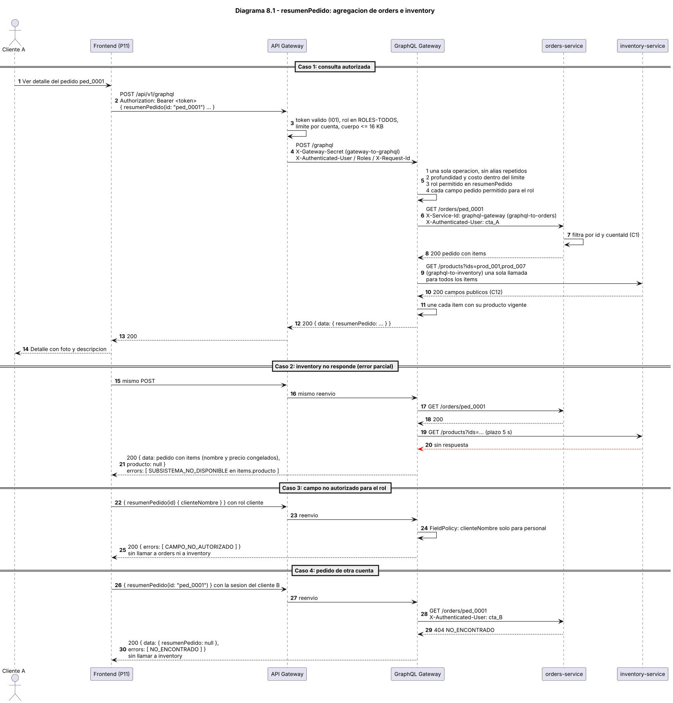

# Evaluación Unidad 2 — Backend seguro completo
## Pizzería La Fornace (derivado del Caso 19)

---

# Módulo 8 — Separación privada y agregaciones GraphQL

Este módulo diseña el GraphQL Gateway privado y define lo que se prueba. El código y las evidencias de ejecución se entregan en el Módulo 10: las columnas de resultado de 8.13 se completan con la salida real de esas pruebas.

## 8.1 Cumplimiento de los pasos a seguir de la guía

| Paso de la guía | Dónde está |
| --- | --- |
| 1. Distinguir servicios transaccionales, de agregación, analítica y de alta demanda. Privados y Vault sin acceso público. | 8.2 y 8.4. |
| 2. Límites de inventory, orders, clients y payments por cohesión, acoplamiento, mantenibilidad, evolución y propiedad de datos. | 8.3. |
| 3. Al menos un GraphQL Gateway privado con una agregación de dos o más subsistemas, por llamadas a APIs internas. | 8.4, 8.5 y 8.7. |
| 4. Schema, tipos, consultas y resolvers. Las reglas transaccionales quedan en los servicios. | 8.6 y 8.7. |
| 5. Identidad verificada, autorización por recurso y campo, paginación, límites de profundidad y costo, plazos, errores parciales y batching. | 8.8, 8.9 y 8.10. |
| 6. Integración con una pantalla real. Demostrar que el navegador no alcanza los subsistemas ni los campos que su rol no permite. | 8.11 y 8.13. |
| Mapa de clasificación, schema, resolvers, consulta de prueba, respuesta esperada, matriz de autorización y evidencia. | 8.2, 8.6, 8.7, 8.10, 8.8 y 8.13. |

## 8.2 Mapa de clasificación

| Servicio | Naturaleza | Responsabilidad | Datos propios | Contrato | Dependencias | Justificación de separación |
| --- | --- | --- | --- | --- | --- | --- |
| `api-gateway` | Borde | Autenticar, autorizar por ruta, limitar y enrutar. Único punto de entrada. | Ninguno de negocio | HTTPS y `/api/v1/...` hacia afuera. Cabeceras de identidad hacia adentro (M3 3.8, M6) | auth (I01), todos los sistemas (I02), Vault | Es el único componente con puerto publicado. Mantenerlo fino evita que una lógica de negocio quede expuesta a Internet. |
| `graphql-gateway` | Agregación | Combinar lecturas de varios sistemas para una pantalla, con autorización por operación y por campo. | Ninguno. Sin base de datos y sin caché entre solicitudes | `POST /graphql` (solo desde el API Gateway). Schema 8.6 | orders, inventory y clients por sus APIs de lectura; Vault | Cambia con las pantallas, no con las reglas del negocio. Separarlo deja las reglas en los sistemas y evita agregar lógica al borde. |
| `auth-service` | Transaccional (identidad) | Cuentas, contraseñas con hash, sesiones, verificación de correo y personal. | Cuenta, Sesion, TokenVerificacion, Usuario | REST (8 servicios) e internos I01, I03 a I05 | notifications (I06), Vault, `auth_db` | Las credenciales necesitan más aislamiento que los datos personales y cambian por razones de seguridad. |
| `clients-service` | Transaccional (datos personales) | Perfil y domicilio del cliente y su alta. | Cliente, Direccion | REST (7 servicios) e interno I07 | auth (I03 a I05), Vault, `clients_db` | Autoridad de los datos personales: un solo lugar para protegerlos y retenerlos. |
| `inventory-service` | Transaccional con lectura frecuente | Catálogo, precio, disponibilidad, stock y reservas. | Producto, MovimientoStock | REST (6 servicios) e internos I08 a I10 | Vault, `inventory_db` | Autoridad de precio y stock. Se consulta mucho (catálogo público) y cambia poco. Es el sistema más independiente. |
| `orders-service` | Transaccional (flujo principal) | Ciclo de vida del pedido y la regla de que solo un pago confirmado lo pasa a `pagado`. | Pedido, DetallePedido, DireccionEntrega, CambioEstado | REST (6 servicios) e internos I11 e I12 | clients (I07), inventory (I08 a I10), ActiveMQ (I14), Vault, `orders_db` | Dueño del estado oficial del pedido. Tiene otro ritmo de cambio que el precio y el stock. |
| `payments-service` | Transaccional (dependiente de un tercero) | Cobro, aviso firmado, venta, boleta y reporte de ventas. | Pago, EventoPago, Venta, LineaVenta, Boleta, CajaVirtual | REST (5 servicios) y aviso firmado I15 | orders (I11, I12), notifications (I13), plataforma de pago (I16), Vault, `payments_db` | Depende de la plataforma externa (firmas, avisos repetidos, reintentos). Separarlo deja una sola autoridad del estado del pedido. |
| `dispatch-service` | Transaccional asíncrono | Orden de llegada e impresión para cocina. | OrdenDespacho, LineaDespacho | REST (2 servicios) y consumo de la cola I14 | ActiveMQ, Vault, `dispatch_db` | No necesita precios ni datos de pago. Sigue funcionando con lo ya recibido si el broker cae. |
| `notifications-service` | Transaccional (salida de correo) | Validar y enviar correos, y guardar mensajes de contacto. | MensajeContacto | REST (1 servicio) e interno I06 e I13 | Proveedor de correo (I17), Vault, `notifications_db` | Aísla al proveedor externo de correo. |
| Servicio de analítica | Analítica | No existe en esta propuesta. | — | — | — | El reporte de ventas (S34) es de un solo local y un máximo de 92 días. Se decide con medición en el ADR del Módulo 9 (M5 5.13). |
| Servicios de alta demanda | Alta demanda | No hay un servicio separado. La lectura frecuente es el catálogo público (S06). | — | — | — | Se mide en el Módulo 9. Si el catálogo no cumpliera el objetivo, se agregaría caché o réplica de lectura en inventory, no un servicio nuevo. |
| Vault, MongoDB y ActiveMQ | Infraestructura privada | Secretos, datos persistentes y cola de despacho. | Secretos; una base por sistema; `/queue/cola_pedidos` | Protocolos propios, solo dentro de la red privada | — | Sin puerto publicado ni acceso desde el navegador (M5 5.10). |

Los 35 servicios del Módulo 1 se reparten así: auth 8, clients 7, inventory 6, orders 6, payments 5, dispatch 2, notifications 1. El GraphQL Gateway no suma servicios REST: tiene una sola ruta de entrada (R36 de M6).

## 8.3 Límites de inventory, orders, clients y payments

| Sistema | Cohesión | Acoplamiento | Mantenibilidad | Evolución | Propiedad de datos |
| --- | --- | --- | --- | --- | --- |
| `inventory-service` | Reúne todo lo del producto: precio, disponibilidad, stock y reservas. Una reserva solo tiene sentido junto al stock. | No llama a ningún otro sistema. Lo llaman orders (reservas) y GraphQL (lectura). | Se puede cambiar el modelo de stock sin tocar pedidos. Su catálogo se prueba solo. | Puede crecer (variantes, promociones) o tener caché sin afectar al resto. | Producto y MovimientoStock. Nadie más cambia el precio ni el stock. |
| `orders-service` | Reúne el ciclo de vida del pedido y su regla de pago. Todas las transiciones de estado están en un lugar. | Depende de clients (datos del cliente), inventory (reservas) y, por cola, de dispatch. Payments depende de orders y no al revés. | Las reglas de estado se cambian y se prueban sin la plataforma de pago. | Nuevos estados o canales entran aquí. El contrato con payments (I11 e I12) no cambia. | Pedido, DetallePedido, DireccionEntrega y CambioEstado. Es la única autoridad de `pagado`. |
| `clients-service` | Reúne los datos personales y el domicilio. El RUN, la fecha de nacimiento y el sexo no salen de aquí. | Depende de auth para crear la cuenta. Orders lo lee por cuenta y sin datos de más (I07). | Un cambio en las reglas de datos personales afecta a un solo sistema. | Puede agregar datos del cliente sin tocar credenciales ni pedidos. | Cliente y Direccion. Los demás sistemas guardan copias congeladas solo para mostrarlas. |
| `payments-service` | Reúne todo lo que depende de la plataforma de pago: cobro, firma, venta, boleta y reporte. | Depende de orders (I11, I12) y notifications (I13). Orders no depende de él. | Cambiar de proveedor de pago afecta solo a este sistema. | Otro medio de pago o la integración real con la plataforma se reemplaza sin tocar el pedido. | Pago, EventoPago, Venta, LineaVenta, Boleta y CajaVirtual. Es la única autoridad del estado del cobro. |

Cada sistema modifica solo sus datos. Las colaboraciones usan contratos explícitos (I01 a I18 del Módulo 3), nunca la base de otro. Las alternativas descartadas (unir orders con payments, inventory con orders, auth con clients, o dividir por tabla o pantalla) están en M3 3.2.

## 8.4 Separación privada

El GraphQL Gateway **no tiene puerto publicado**. Se llega a él solo por el API Gateway, y solo por una ruta:

| Elemento | Cómo queda separado |
| --- | --- |
| Entrada | `POST /api/v1/graphql` (R36). El API Gateway autentica (I01), aplica `ROLES-TODOS`, límite por cuenta y tamaño, y reenvía con `gateway-to-graphql` más la identidad verificada. |
| Quién puede llamarlo | Solo con `X-Gateway-Secret` válido para `graphql-gateway`. Sin él, 401 (T-GQL-13). |
| Qué puede llamar | Solo GET de orders, inventory y clients, con su propio par por sistema (`graphql-to-orders`, `graphql-to-inventory`, `graphql-to-clients`). Sin acceso a bases de datos. |
| Qué aceptan los sistemas de él | Las rutas de negocio de lectura aceptan dos tipos de llamador: el API Gateway (`X-Gateway-Secret`) o el GraphQL Gateway (`X-Service-Id` y `X-Service-Secret`, solo GET). El resto de los verbos responde 403 para ese par (M4 4.10). |
| Identidad | El GraphQL Gateway reenvía `X-Authenticated-User`, `X-Authenticated-Email` y `X-Authenticated-Roles` que recibió ya verificados. No autentica por su cuenta. |
| Propiedad | Cada sistema aplica C1 aunque llame GraphQL (T-GQL-16). La agregación no es un atajo. |
| Vault, MongoDB, ActiveMQ | Sin puerto publicado. GraphQL solo lee de Vault los secretos de sus caminos y su certificado (M6 6.9). |

## 8.5 Agregaciones y pantallas

| Operación | Pantalla | Qué reemplaza | Subsistemas | Por qué es útil |
| --- | --- | --- | --- | --- |
| `resumenPedido` | P11 "Ver detalle" | S14 más una consulta de catálogo (S06) por ítem | orders e inventory | El detalle muestra nombre, foto y descripción vigentes del producto sin que el frontend haga N+1 llamadas. El nombre y precio de la compra siguen congelados en orders. |
| `miCuenta` | P12 perfil, con el panel "Mis últimos pedidos" | S24 más S13 | clients y orders | Una sola ida y vuelta para armar la pantalla de la cuenta. |

S14 sigue existiendo: lo usa P10 al volver del pago, y el frontend lo usa si no hay respuesta de GraphQL.

## 8.6 Schema GraphQL

```graphql
# Solo consultas. No hay mutaciones ni suscripciones.
type Query {
  "Detalle de un pedido con los datos vigentes de sus productos (orders + inventory)."
  resumenPedido(id: ID!): ResumenPedido
  "Perfil y últimos pedidos de la cuenta autenticada (clients + orders)."
  miCuenta(limitePedidos: Int = 5): MiCuenta
}

enum EstadoPedido {
  pendiente_pago
  pagado
  en_preparacion
  en_despacho
  entregado
  anulado
}

type ResumenPedido {
  id: ID!
  estado: EstadoPedido!
  estadoPago: String!
  total: Int!
  creadoEn: String!
  expiraEn: String
  boletaDisponible: Boolean!
  direccionEntrega: DireccionEntrega
  historialEstados: [CambioEstado!]!
  items: [ItemPedido!]!
  clienteNombre: String            # solo personal
}

type ItemPedido {
  productoId: ID!
  nombre: String!                  # congelado al comprar (orders)
  cantidad: Int!
  precioUnitario: Int!             # congelado al comprar (orders)
  producto: ProductoPublico        # vigente hoy (inventory). null si no hay respuesta o fue retirado
}

type ProductoPublico {
  id: ID!
  nombre: String!
  categoria: String!
  descripcion: String!
  precio: Int!
  imagen: String
  disponible: Boolean!
}

type CambioEstado {
  estado: EstadoPedido!
  fecha: String!
}

type DireccionEntrega {
  calle: String!
  comuna: String!
  referencia: String
}

type MiCuenta {
  perfil: PerfilCliente
  pedidos: [PedidoResumen!]!
}

type PerfilCliente {
  nombreCompleto: String!
  correo: String!
  telefono: String!
  direccion: Domicilio!
}

type Domicilio {
  calle: String!
  comuna: String!
  provincia: String!
  region: String!
}

type PedidoResumen {
  id: ID!
  estado: EstadoPedido!
  total: Int!
  creadoEn: String!
}
```

Decisiones del schema:

- **Un campo, una fuente.** `nombre` y `precioUnitario` del ítem vienen de orders (lo comprado). `producto.*` viene de inventory (lo vigente). Que los dos puedan diferir es justamente lo que aporta la agregación.
- **Anulable donde puede fallar.** `ResumenPedido.items.producto` y `MiCuenta.perfil` son opcionales para poder devolver resultados parciales. `resumenPedido` es opcional para poder responder `NO_ENCONTRADO` sin ocultar el error.
- **Mínimo necesario.** No están `run`, `fechaNacimiento`, `sexo`, `stock`, `cuentaId`, teléfono del pedido ni correos de ventas. Lo que no está definido no se puede pedir.
- **Sin mutaciones.** Las reglas de negocio y las escrituras quedan en los servicios REST.

## 8.7 Resolvers

| Resolver | Operación | Qué hace | Subsistemas | Plazos | Errores |
| --- | --- | --- | --- | --- | --- |
| `resolverResumenPedido` | `resumenPedido` | 1. Pide a orders `GET /orders/{id}` con el contexto del usuario (`graphql-to-orders`). 2. Reúne los `productoId` de los ítems y los pide a inventory en una sola llamada `GET /products?ids=...` (`graphql-to-inventory`). 3. Une cada ítem con su producto. | `orders-service` y `inventory-service` | Orders: 5 s. Inventory: 5 s. | Orders no responde: `resumenPedido` queda `null` y `SUBSISTEMA_NO_DISPONIBLE`. Orders responde 404: `NO_ENCONTRADO` y no se llama a inventory. Inventory no responde: `producto` queda `null` en cada ítem, con el nombre y precio congelados, y el error indica la ruta `items.producto`. Un producto retirado o ausente del catálogo: `producto` `null` sin error. |
| `resolverMiCuenta` | `miCuenta` | 1. En paralelo: `GET /clients/me` a clients (`graphql-to-clients`) y `GET /orders?limit=N` a orders (`graphql-to-orders`). 2. Arma `perfil` y `pedidos`. | `clients-service` y `orders-service` | Clients: 5 s. Orders: 5 s. | Cada parte falla por separado: si clients no responde, `perfil` es `null` y `pedidos` sí llega, y al revés. No se inventan valores. |

**Sin llamadas por ítem.** `resolverResumenPedido` usa un `BatchLoader` creado **por solicitud**: junta todos los `productoId` y hace una sola llamada. Se evita así una consulta de catálogo por cada ítem, y no se comparte caché entre usuarios.

**Qué no hacen los resolvers:** no calculan precios, no cambian estados, no deciden la propiedad y no leen bases de datos. Solo combinan lo que cada sistema entrega.

## 8.8 Matriz de autorización

Se decide en tres niveles. Los roles usan los nombres del Módulo 5 (5.6).

### Por operación

| Operación | Roles permitidos | Rechazo | Referencia |
| --- | --- | --- | --- |
| `resumenPedido` | `ROLES-PEDIDO-LECTURA`: `cliente`, `administrador`, `cajero_virtual`, `encargado_despachos` | `dueno`: operación no autorizada (C3). Un visitante no llega: el API Gateway responde 401. | Mismo criterio que S14 (M4). |
| `miCuenta` | `ROLES-CLIENTE`: `cliente` | El personal no tiene perfil de cliente. Los demás roles reciben operación no autorizada. | Mismo criterio que S24 (M4). |

### Por recurso

| Recurso | Regla | Quién la verifica |
| --- | --- | --- |
| Pedido (`resumenPedido`) | El `cliente` solo puede pedir un pedido de su cuenta. El personal puede pedir cualquiera. | `orders-service` con `cuentaId` propagado (C1). GraphQL no decide la propiedad: si orders responde 404, GraphQL devuelve `NO_ENCONTRADO` idéntico al de un pedido inexistente. |
| Perfil (`miCuenta`) | Solo el de la cuenta autenticada. No existe un argumento para pedir el de otra. | `clients-service` (`/clients/me`). |
| Pedidos recientes (`miCuenta`) | Solo los de la cuenta autenticada. | `orders-service` (C1). |
| Productos (ambas) | Solo el catálogo público. | `inventory-service` (C12). GraphQL no puede pedir `stock`: el campo no existe en el schema. |

### Por campo

Antes de llamar a ningún sistema, el GraphQL Gateway revisa **cada campo seleccionado** contra una `FieldPolicy`. Si el rol no puede leer alguno, rechaza la consulta completa con `CAMPO_NO_AUTORIZADO` (no devuelve el campo en blanco, para no sugerir que existe un valor).

| Campo | Roles que pueden leerlo | Motivo |
| --- | --- | --- |
| `ResumenPedido.id`, `estado`, `estadoPago`, `total`, `creadoEn`, `expiraEn`, `boletaDisponible`, `historialEstados`, `items` | Los roles de la operación | Datos del pedido que el rol ya puede ver en S14. |
| `ResumenPedido.direccionEntrega` | `cliente` (si es dueño), `administrador`, `cajero_virtual`, `encargado_despachos` | Dato restringido sensible según el contexto (M7 D07). Lo recibe quien atiende o recibe el pedido. |
| `ResumenPedido.clienteNombre` | `administrador`, `cajero_virtual`, `encargado_despachos` | Dato operativo del DTO del personal (C3). El cliente conoce su nombre y no se duplica en el pedido. |
| `ItemPedido.producto` y sus campos | Los roles de la operación | Catálogo público (C12). |
| `MiCuenta.perfil.*` | `cliente` (la propia cuenta) | Datos restringidos del propio cliente. |
| `MiCuenta.pedidos.*` | `cliente` (los propios) | Pedidos propios (C1). |
| No existen en el schema | Nadie | `run`, `fechaNacimiento`, `sexo`, `stock`, `cuentaId`, `clienteTelefono`, `clienteCorreo`, hashes y secretos. Un campo que no está definido no se puede pedir. |

## 8.9 Límites, plazos y errores

| Control | Valor | Motivo |
| --- | --- | --- |
| Una operación por solicitud | Sin lotes (arreglos de operaciones) | Evita multiplicar el costo con un solo cuerpo. |
| Campos de primer nivel | Máximo 3 por solicitud (incluye alias) | Impide repetir `resumenPedido` con alias para sortear el costo. |
| Profundidad | Máximo 5 niveles | El caso más profundo es `resumenPedido.items.producto.nombre` (4 niveles). |
| Costo | Máximo 600 puntos por solicitud | Cada campo cuesta 1. Una lista multiplica el costo de lo que contiene por su tamaño máximo (ítems: 30, historial: 10, pedidos: `limitePedidos`). Una consulta completa de `resumenPedido` (la de T-GQL-09) cuesta 432 y la de `miCuenta(limitePedidos: 20)` con `id`, `estado`, `total` y `creadoEn` de cada pedido, 103. Tres alias de `resumenPedido` costarían 1296 y se rechazan. |
| Paginación | `limitePedidos` de 1 a 20 (por defecto 5) | Fuera de rango, `CONSULTA_INVALIDA`. |
| Plazo | 5 s por subsistema y 15 s por solicitud | El API Gateway espera 15 s (M6). Orders más inventory en secuencia suman a lo sumo 10 s. |
| Tamaño del cuerpo | 16 KB | Lo limita ya el API Gateway. |
| Introspección y mensajes | Introspección desactivada. Errores sin trazas ni URLs | No se publica el schema completo. Los errores usan el formato `{ message, extensions: { code, requestId } }`. |
| Operaciones de escritura | No existen | Las escrituras siguen siendo los servicios REST con sus reglas. |
| Caché | Solo dentro de una solicitud (DataLoader por solicitud) | No se comparte entre usuarios, así que un dato de una cuenta nunca llega a otra. |

Códigos de error (en `extensions.code`; el API Gateway no los transforma):

| Código | Cuándo | Qué se llama |
| --- | --- | --- |
| `CONSULTA_INVALIDA` | Sintaxis, argumentos fuera de rango o operación inexistente (incluye mutaciones) | No se llama a ningún sistema |
| `LIMITE_PROFUNDIDAD`, `LIMITE_COSTO` | La consulta excede los límites | No se llama a ningún sistema |
| `OPERACION_NO_AUTORIZADA` | El rol no puede usar esa operación | No se llama a ningún sistema |
| `CAMPO_NO_AUTORIZADO` | La selección incluye un campo que el rol no puede leer | No se llama a ningún sistema. La consulta completa se rechaza |
| `NO_ENCONTRADO` | Orders respondió 404 (pedido inexistente o ajeno) | `resumenPedido` es `null`. No se llama a inventory |
| `SUBSISTEMA_NO_DISPONIBLE` | Un sistema no respondió o respondió 5xx | Resultado parcial: lo resuelto llega, lo demás es `null`, y `path` indica qué falló |
| `PLAZO_EXCEDIDO` | Un sistema superó los 5 s | Igual que el anterior |

Ejemplo: `resumenPedido(id)` con `id`, `items{productoId producto{id}}` e `historialEstados{estado fecha}` cuesta 152, porque el costo se calcula con el tamaño máximo de cada lista (30 ítems, 10 cambios de estado) y no con el tamaño real del pedido.

## 8.10 Consultas de prueba y respuestas esperadas

Los datos son los ficticios del Módulo 1 (`ped_0001`).

**Consulta** (la usa P11 "Ver detalle"):

```graphql
query DetallePedido($id: ID!) {
  resumenPedido(id: $id) {
    id
    estado
    estadoPago
    total
    direccionEntrega { calle comuna referencia }
    historialEstados { estado fecha }
    items {
      cantidad
      precioUnitario
      producto { nombre descripcion imagen disponible }
    }
  }
}
# variables
{ "id": "ped_0001" }
```

**R1. Respuesta esperada, cliente dueño**

```json
{
  "data": {
    "resumenPedido": {
      "id": "ped_0001",
      "estado": "pagado",
      "estadoPago": "aprobado",
      "total": 19970,
      "direccionEntrega": { "calle": "Av. Ejemplo 1234", "comuna": "Maipú", "referencia": "Casa azul" },
      "historialEstados": [
        { "estado": "pendiente_pago", "fecha": "2026-11-07T18:30:00Z" },
        { "estado": "pagado", "fecha": "2026-11-07T18:33:00Z" }
      ],
      "items": [
        { "cantidad": 2, "precioUnitario": 8990,
          "producto": { "nombre": "Napolitana", "descripcion": "Pizza con tomate, mozzarella y orégano.",
                        "imagen": "https://ejemplo.cl/img/napolitana.jpg", "disponible": true } },
        { "cantidad": 1, "precioUnitario": 1990,
          "producto": { "nombre": "Bebida 500ml", "descripcion": "Bebida gaseosa.",
                        "imagen": "https://ejemplo.cl/img/bebida.jpg", "disponible": true } }
      ]
    }
  }
}
```

**R2. Inventory no responde (error parcial)**

```json
{
  "data": {
    "resumenPedido": {
      "id": "ped_0001", "estado": "pagado", "estadoPago": "aprobado", "total": 19970,
      "direccionEntrega": { "calle": "Av. Ejemplo 1234", "comuna": "Maipú", "referencia": "Casa azul" },
      "historialEstados": [ ... ],
      "items": [
        { "cantidad": 2, "precioUnitario": 8990, "producto": null },
        { "cantidad": 1, "precioUnitario": 1990, "producto": null }
      ]
    }
  },
  "errors": [
    { "message": "El catálogo no está disponible.", "path": ["resumenPedido", "items", 0, "producto"],
      "extensions": { "code": "SUBSISTEMA_NO_DISPONIBLE", "requestId": "req_ficticio_01" } },
    { "message": "El catálogo no está disponible.", "path": ["resumenPedido", "items", 1, "producto"],
      "extensions": { "code": "SUBSISTEMA_NO_DISPONIBLE", "requestId": "req_ficticio_01" } }
  ]
}
```

**R3. Un cliente pide un campo del personal**

```json
// query: { resumenPedido(id: "ped_0001") { id clienteNombre } }   (sesión de un cliente)
{ "errors": [ { "message": "No tienes permiso para consultar el campo clienteNombre.",
                "extensions": { "code": "CAMPO_NO_AUTORIZADO", "requestId": "req_ficticio_02" } } ] }
```

**R4. Pedido de otra cuenta**

```json
// query: { resumenPedido(id: "ped_0001") { id estado } }   (sesión de otro cliente)
{ "data": { "resumenPedido": null },
  "errors": [ { "message": "Pedido no encontrado.", "path": ["resumenPedido"],
                "extensions": { "code": "NO_ENCONTRADO", "requestId": "req_ficticio_03" } } ] }
```

**R5. Encargado de despachos**

```json
// query: { resumenPedido(id: "ped_0001") { id clienteNombre } }   (sesión de un encargado de despachos)
{ "data": { "resumenPedido": { "id": "ped_0001", "clienteNombre": "Camila Rojas Pérez" } } }
```

**Consulta de `miCuenta`**

```graphql
query MiCuenta {
  miCuenta(limitePedidos: 5) {
    perfil { nombreCompleto correo telefono direccion { calle comuna provincia region } }
    pedidos { id estado total creadoEn }
  }
}
```

**R6. Respuesta esperada**

```json
{
  "data": { "miCuenta": {
    "perfil": { "nombreCompleto": "Camila Rojas Pérez", "correo": "camila@ejemplo.cl", "telefono": "+56911112222",
                "direccion": { "calle": "Av. Ejemplo 1234", "comuna": "Maipú", "provincia": "Santiago", "region": "Metropolitana" } },
    "pedidos": [ { "id": "ped_0001", "estado": "pagado", "total": 19970, "creadoEn": "2026-11-07T18:30:00Z" } ]
  } }
}
```

## 8.11 Integración con el frontend

| Tema | Decisión |
| --- | --- |
| Llamada | `fetch` de `POST /api/v1/graphql` con `Authorization: Bearer` desde `sessionStorage`. La URL es la del API Gateway; el frontend no conoce otra. |
| Datos de la pantalla | P11 usa `resumenPedido`. P12 usa `miCuenta`. |
| Errores parciales | Si `producto` es `null`, la pantalla muestra el nombre y el precio congelados del pedido y oculta la foto. No muestra un error al cliente por eso. |
| Errores completos | `NO_ENCONTRADO`: "Pedido no encontrado". 401: vuelve al inicio de sesión. Otro error: mensaje genérico con el `requestId`. |
| Respaldo | Si el GraphQL Gateway no responde, P11 usa S14 (REST) y muestra el detalle sin las fotos. |
| Secretos | Ninguno en el frontend. El token es el del usuario (M7 7.10). |

## 8.12 Diagrama 8.1 — Secuencia de `resumenPedido`



Fuente editable: `diagramas/diagrama-8-1-secuencia-graphql.puml`. Versión vectorial: `diagramas/diagrama-8-1-secuencia-graphql.svg`.

Muestra una consulta autorizada, un error parcial por inventory caído, un campo no autorizado rechazado antes de llamar a los sistemas, y un pedido de otra cuenta.

## 8.13 Pruebas y evidencia

Las pruebas se ejecutan contra el sistema implementado (Módulo 10). La columna de resultado se completa con la salida real (estado, cuerpo y registros con `requestId`), no con lo esperado. Para T-GQL-15 la evidencia es una captura de la pestaña de red del navegador en P11.

| ID | Caso | Entrada | Identidad | Resultado esperado | Componente que verifica | Resultado registrado |
| --- | --- | --- | --- | --- | --- | --- |
| T-GQL-01 | Agregación autorizada | `resumenPedido(id: "ped_0001")` con la sesión del cliente dueño | `cliente` A | 200 con el pedido y, en cada ítem, el producto vigente (R1 de 8.10). Los registros de orders e inventory muestran el mismo `requestId`. | GraphQL Gateway, orders e inventory | OK. 200, 2 items con producto; registros con el requestId en ['api-gateway.log', 'auth-service.log', 'graphql-gateway.log', 'inventory-service.log', 'orders-service.log'] |
| T-GQL-02 | Sin llamada por ítem (batching) | El pedido de T-GQL-01 con 2 ítems. Contar las llamadas a inventory en sus registros | `cliente` A | Una sola llamada `GET /products?ids=...`, no dos. | `BatchLoader` del GraphQL Gateway | OK. llamadas a inventory con el requestId = 1 |
| T-GQL-03 | Inventory no disponible | Detener `inventory-service` y repetir T-GQL-01 | `cliente` A | 200 con el pedido, `producto` `null` en cada ítem y errores `SUBSISTEMA_NO_DISPONIBLE` con su `path` (R2 de 8.10). El tiempo total no pasa de 15 s. | GraphQL Gateway (plazo de 5 s) | OK. 200, errores=['SUBSISTEMA_NO_DISPONIBLE', 'SUBSISTEMA_NO_DISPONIBLE'], path=['resumenPedido', 'items', 0, 'producto'], 0.0 s |
| T-GQL-04 | Orders no disponible | Detener `orders-service` y repetir T-GQL-01 | `cliente` A | `resumenPedido` `null` y `SUBSISTEMA_NO_DISPONIBLE`. No hay llamada a inventory. | GraphQL Gateway | OK. 200, errores=['SUBSISTEMA_NO_DISPONIBLE'], llamadas a inventory=0 |
| T-GQL-05 | Pedido de otra cuenta | `resumenPedido(id: "ped_0001")` con la sesión de otro cliente. Comparar con un id inexistente | `cliente` B | `NO_ENCONTRADO` en ambos casos, sin ningún dato de A (R4 de 8.10). No hay llamada a inventory. | `orders-service` (C1) | OK. ajeno=['NO_ENCONTRADO'], inexistente=['NO_ENCONTRADO'] |
| T-GQL-06 | Campo no autorizado | Pedir `clienteNombre` con la sesión de un cliente | `cliente` A | `CAMPO_NO_AUTORIZADO` (R3 de 8.10). No hay llamadas a orders ni a inventory. Con `encargado_despachos` el mismo campo sí llega (R5 de 8.10). | GraphQL Gateway (`FieldPolicy`) | OK. cliente=['CAMPO_NO_AUTORIZADO'], despachos nombre recibido=True |
| T-GQL-07 | Operación no autorizada para el rol | `resumenPedido` con `dueno`, y `miCuenta` con `cajero_virtual` | `dueno` y `cajero_virtual` | `OPERACION_NO_AUTORIZADA` en ambos. | GraphQL Gateway | OK. ['OPERACION_NO_AUTORIZADA'], ['OPERACION_NO_AUTORIZADA'] |
| T-GQL-08 | Límite de profundidad | Una consulta anidada con más niveles que el límite (en la prueba el límite se configura en 2 con `GQL_PROFUNDIDAD`, porque el schema no admite consultas con más de 5 niveles) | `cliente` A | `LIMITE_PROFUNDIDAD`. No se llama a ningún sistema. | GraphQL Gateway | OK. 400 ['LIMITE_PROFUNDIDAD']; limite real de produccion = 5 (el schema no admite más de 5 niveles) |
| T-GQL-09 | Límite de costo | Tres alias de `resumenPedido` completo (costo 1296) | `cliente` A | `LIMITE_COSTO`. No se llama a ningún sistema. | GraphQL Gateway | OK. 400 ['LIMITE_COSTO'] |
| T-GQL-10 | Paginación fuera de rango | `miCuenta(limitePedidos: 500)` | `cliente` A | `CONSULTA_INVALIDA`. | GraphQL Gateway | OK. 400 ['CONSULTA_INVALIDA'] |
| T-GQL-11 | Sin escrituras ni introspección | `mutation { ... }` y `{ __schema { types { name } } }` | `cliente` A | `CONSULTA_INVALIDA` en ambos. | GraphQL Gateway | OK. ['CONSULTA_INVALIDA'], ['CONSULTA_INVALIDA'] |
| T-GQL-12 | Sin sesión | `POST /api/v1/graphql` sin `Authorization` | Ninguna | 401. No llega al GraphQL Gateway. | API Gateway (I01) | OK. 401, registros de graphql-gateway con ese requestId=0 |
| T-GQL-13 | Acceso directo al GraphQL Gateway | Desde el host, conectarse a su puerto. Desde otro contenedor, `POST /graphql` sin `X-Gateway-Secret`, y con el de otro destino | Ninguna | Conexión rechazada desde el host (graphql-gateway no publica ningún puerto en Docker Compose: CMP-NET-04, 10.9.11.1). 401 en los otros dos (CMP-RED-02 en Compose; T-GQL-13 en modo local). | Red de Docker y `InternalAccessGuard` | OK. Modo local: sin secreto=401, secreto de otro destino=401. Compose: CMP-RED-02 = 401, 401, 401 y CMP-NET-04 sin puertos abiertos por Compose. En modo local la conexión rechazada desde el host no es verificable (todos los puertos escuchan en loopback). |
| T-GQL-14 | Subsistemas privados desde el navegador | En la pantalla P11, intentar `fetch` a `orders-service`, `inventory-service` y `clients-service` por su nombre o puerto | `cliente` A | No se alcanzan: no hay ruta (404, T-GQL-14) ni nombre resoluble desde la red pública ni puerto publicado (Docker Compose: CMP-NET-06 y CMP-NET-04, 10.9.11.1). | Red de Docker | OK. Modo local: rutas por nombre de servicio=[404, 404, 404], rutas /internal=[404, 404]. Compose: CMP-NET-06 desde la red pública resuelve [] nombres privados, /internal 404, sin token 401. |
| T-GQL-15 | Agregación desde el frontend | Abrir P11 "Ver detalle" y revisar la red del navegador | `cliente` A | Una sola llamada `POST /api/v1/graphql` trae el detalle completo. No hay llamadas a `/orders/{id}` ni a `/products` desde esa pantalla. | Frontend, API Gateway y GraphQL Gateway | OK. graphql=1, otras=0 |
| T-GQL-16 | Los sistemas siguen decidiendo | Llamar `GET /orders/{id}` directamente con el par `graphql-to-orders` y la identidad de otra cuenta | Par de GraphQL | 404 de orders. GraphQL no puede saltarse la propiedad. | `orders-service` (C1 y C11) | OK. 404 NO_ENCONTRADO |
| T-GQL-17 | GraphQL solo lee | Llamar `POST /orders` o `PATCH /admin/orders/{id}/status` con el par `graphql-to-orders` | Par de GraphQL | 403. El par solo tiene GET. | `orders-service` (C11, M4 4.10) | OK. POST=403, PATCH=403 |

## 8.14 Control antes de avanzar

| Pregunta | Respuesta |
| --- | --- |
| ¿La consulta combina realmente subsistemas? | Sí. `resumenPedido` une orders (estado e ítems comprados) con inventory (producto vigente). `miCuenta` une clients y orders. T-GQL-01 y T-GQL-02 lo verifican en los registros. |
| ¿Se conserva la autoridad de cada servicio? | Sí. GraphQL solo hace GET, no lee bases de datos y no decide propiedad ni estado. Orders sigue respondiendo 404 a un pedido ajeno (T-GQL-05 y T-GQL-16). |
| ¿Las políticas impiden filtrar información restringida mediante una selección de campos? | Sí. Cada campo tiene una `FieldPolicy`, los campos sensibles no existen en el schema y una selección no autorizada se rechaza antes de llamar a ningún sistema (T-GQL-06). |
| ¿La red privada y los permisos se verifican en ejecución? | Están definidos los casos T-GQL-12 a T-GQL-17. Su resultado se registra en el Módulo 10. |
