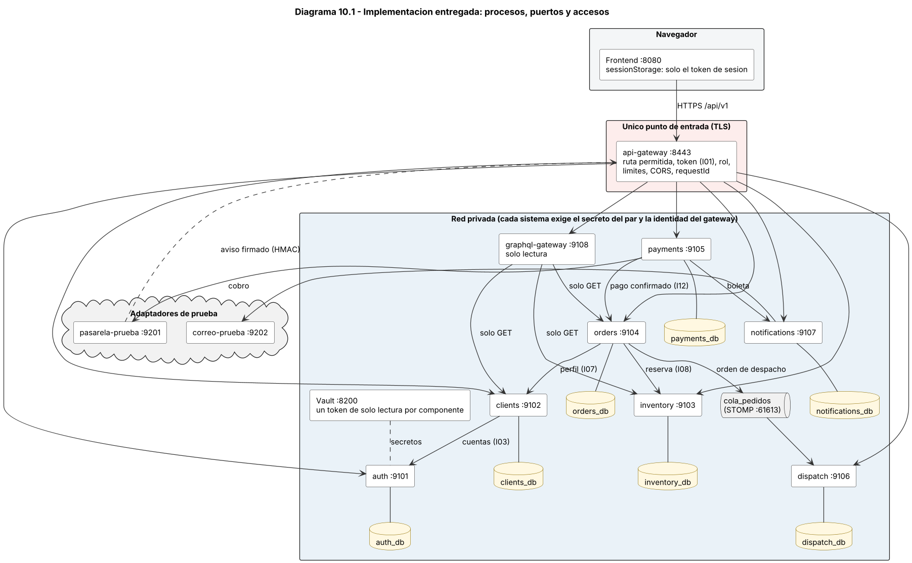
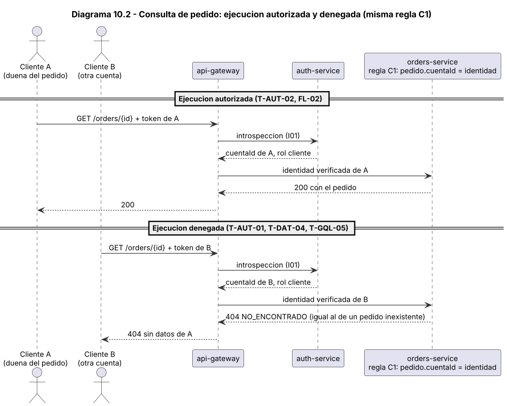
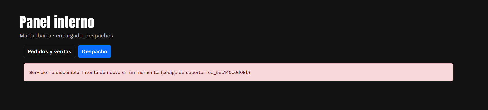
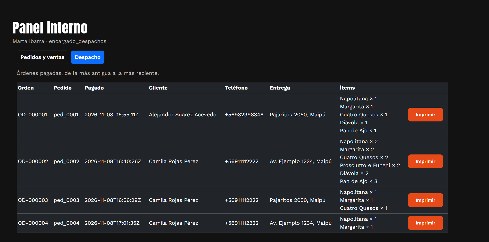
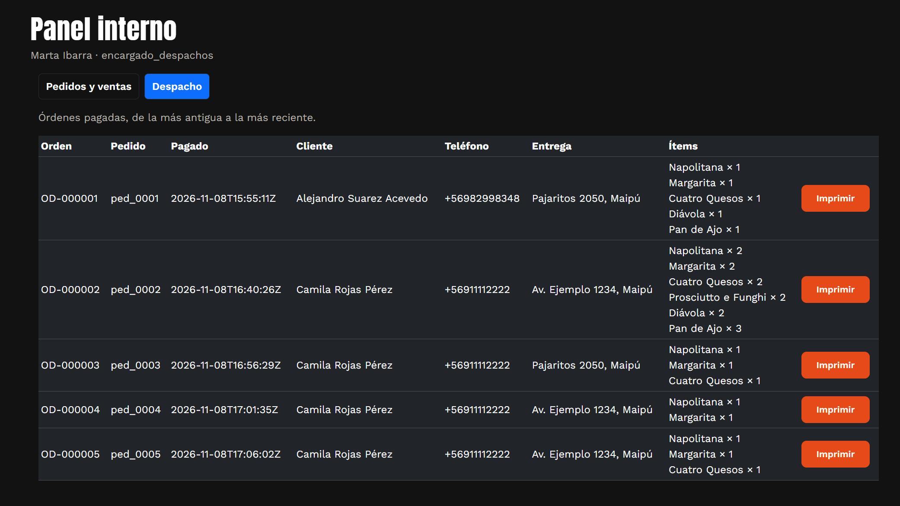

# Evaluación Unidad 2 — Backend seguro completo
## Pizzería La Fornace (derivado del Caso 19)

---

# Módulo 10 — Backend completo e integración verificable

Este módulo muestra el backend funcionando. Lo que entregamos es el **backend**: el código de los 7 sistemas, el API Gateway, el GraphQL Gateway, Vault, MongoDB, la cola de despacho en ActiveMQ y los adaptadores de prueba de pago y correo.

Como indicó el profesor, **la entrega de backend es con datos de frontend, no con el frontend integrado**. Por eso lo probamos por su API con los datos y los flujos de la Evaluación 1 (`frontend-la-fornace`, 5 páginas HTML con Bootstrap 5.3): los 12 productos de `js/data.js` están cargados tal cual en `inventory`, y las pruebas recorren las mismas operaciones de las pantallas (P01 en adelante). La carpeta `frontend/` es una demostración opcional que usa la misma API; el backend no depende de ella y las pruebas de la guía se hacen sin abrirla.

Las tablas de resultados de este módulo salen de ejecutar las pruebas (`impl/scripts/run_tests.py` y `impl/probar_todo.py`). No escribimos ningún valor a mano. La última ejecución completa dio **221 de 221 pruebas en OK** el 2026-11-08: 193 en modo local y 28 en Docker Compose, en Windows y con MongoDB, Vault y ActiveMQ reales (10.9.11).

## 10.1 Cumplimiento de los pasos a seguir de la guía

| Paso de la guía | Dónde está |
| --- | --- |
| 1. Implementar todos los requisitos funcionales y las operaciones de las pantallas. | 10.2 (qué se implementó), 10.8 (matriz de pantallas, servicios y pruebas) y 10.9.4 (35 servicios con caso válido y caso inválido). |
| 2. Persistencia real, esquema, scripts de creación, datos ficticios, validaciones, permisos, estados y errores. | 10.3. |
| 3. Integrar gateway, Auth, secretos, GraphQL y sistemas privados, con puertos limitados e identidad verificada. | 10.4, diagrama 10.1 y 10.9.11 (redes pública y privada en Docker Compose). |
| 4. Integrar el frontend responsivo con las APIs reales y usar adaptadores de prueba para pago y correo. | 10.5 (los datos de la Evaluación 1 por API y el frontend integrado como demostración) y 10.9.7. |
| 5. Pruebas de contratos, integración, reglas de negocio y seguridad, con fallos de dependencias, pagos duplicados y stock. | 10.9. |
| 6. Instrucciones de inicio y detención, secretos por referencia, datos de prueba, dependencias versionadas, variables sin valores reales, health checks y registros con correlación. | 10.6, `impl/README.md` y `impl/GUIA-DE-PRUEBA.md`. |
| Matriz requisito, pantalla, servicio, prueba, resultado y evidencia. | 10.8. |
| Demostración de los flujos principales y consulta de pedido autorizada y denegada. | 10.7 y `impl/tests/evidencia/demo-flujos.md`. |
| Pruebas gRPC y analíticas aplicables. | No aplican (ADR de los puntos 9.4 y 9.5). La alternativa implementada se mide en 10.9.9 (C5 y C6). |

## 10.2 Qué se entrega



Código fuente en `impl/`:

| Carpeta | Contenido |
| --- | --- |
| `common/fornace/` | Librería compartida: acceso a Vault con caché, fábrica de aplicaciones con registro de accesos, guardia de identidad y roles, cliente entre sistemas con el secreto del par, conexión a la base y contadores, validaciones. `routes.json` es la tabla de rutas del Módulo 6. |
| `services/auth`, `clients`, `inventory`, `orders`, `payments`, `dispatch`, `notifications` | Los 7 sistemas (Python, FastAPI), cada uno con su base `<sistema>_db`. |
| `services/api_gateway` | Único punto de entrada. Enruta por la tabla de rutas, valida el token con Auth (I01), verifica el rol, limita la tasa, el tamaño y el origen, y quita cualquier cabecera de identidad que venga del navegador. |
| `services/graphql_gateway` | Apollo Server 5 de solo lectura. Políticas de operación, campo, profundidad, costo y paginación. `resumenPedido` y `miCuenta`. |
| `services/pasarela_prueba`, `correo_prueba` | Adaptadores de prueba de la plataforma de pago y del proveedor de correo. Conservan el contrato, la autenticación por clave y la firma del aviso. |
| `frontend/` | Demostración opcional: el frontend de la Evaluación 1 conectado al API Gateway, con páginas nuevas (registro, confirmar correo, retorno de pago, mis pedidos, mi cuenta y panel del personal). El backend no depende de esta carpeta. |
| `scripts/` | `stack.py` (iniciar, detener, estado en modo local), `compose.py` (Docker Compose), `vault_init.py`, `bootstrap_compose.py`, `certs.sh`, `seed.py`, `run_tests.py`, `serve_frontend.py`, `bandeja.py`. |
| `tests/` y `carga/` | Pruebas automáticas, resultados reales (`tests/resultados/*.json`), capturas y transcripción de la demostración (`tests/evidencia/`), pruebas de carga y de fallos. |
| `docker-compose.yml`, `Dockerfile.python`, `Dockerfile.node`, `Dockerfile.broker`, `.env.example`, `requirements.txt` | Despliegue en contenedores según el Módulo 6: redes `publica` y `privada` (esta con `internal: true`), solo tres puertos publicados, usuario sin privilegios, límites de memoria y CPU. Imágenes `mongo:7`, `hashicorp/vault:1.18` (modo desarrollo) y ActiveMQ 6.2.0 (`Dockerfile.broker`). Dependencias con versión fija. |

Tecnologías: Python 3.13 en los contenedores (3.14 en la ejecución local de Windows) con FastAPI, httpx, motor y bcrypt; Node 22 con Apollo Server 5.5.1, GraphQL 16.11 y DataLoader (Node 26 en la ejecución local); MongoDB 7, Vault 1.18 y ActiveMQ 6.2.0 con STOMP para la cola; HTML, CSS y JavaScript con Bootstrap para el frontend de demostración. No se usaron tecnologías fuera de las del curso.

## 10.3 Persistencia, esquema y datos de prueba

Cada sistema escribe solo en su base. En Docker Compose MongoDB exige usuario y cada sistema tiene el suyo, con permisos solo sobre su base (`MONGO_AUTH=1`); en el modo local corre sin usuarios (`MONGO_AUTH=0`). Ver 10.11. El esquema se crea al iniciar cada sistema (colecciones e índices únicos o de búsqueda); no hay migraciones porque el sistema parte vacío. `scripts/seed.py` carga los datos de ejemplo.

| Base | Colecciones con índices | Índices (campos) |
| --- | --- | --- |
| `auth_db` | `cuentas`, `sesiones`, `tokens`, `intentos` | cuentas: id (único), correo (único); sesiones: hash (único); tokens: hash (único); intentos: correo |
| `clients_db` | `clientes` | clientes: id (único), run (único), cuentaId (único) |
| `inventory_db` | `productos`, `reservas` | productos: id (único), nombre (único); reservas: pedidoId (único), estado+expiraEn |
| `orders_db` | `pedidos` | pedidos: id (único), cuentaId+creadoEn, estado+expiraEn |
| `payments_db` | `pagos`, `eventos`, `ventas`, `resumen_dia`, `resumen_producto` | pagos: id (único), pedidoId; eventos: eventoId (único); ventas: pedidoId (único), numeroBoleta (único), fecha, enResumen; resumen_dia: fecha (único); resumen_producto: fecha+productoId (único) |
| `dispatch_db` | `mensajes`, `ordenes` | mensajes: pedidoId+tipo (único); ordenes: pedidoId (único), numeroOrden (único) |
| `notifications_db` | `mensajes` | mensajes: id (único) |

Reglas de negocio y de datos que aplican los sistemas (todas con prueba en 10.9):

- El servidor fija el precio, el total y el estado del pedido; ignora los valores que envía el navegador (T-DAT-06f).
- La reserva de stock es todo o nada y no deja stock negativo (C3). Anular o vencer un pedido devuelve el stock (S15, FL-04).
- El pago solo se confirma con un aviso firmado, reciente y con el monto exacto. Un aviso repetido no duplica la venta (T-DAT-06, C4).
- La orden de despacho llega por la cola, una sola vez por pedido y en orden de llegada (FL-01, C9, F2, F3).
- Las anulaciones, bajas y ventas no se borran: cambian de estado y conservan el historial. Las contraseñas se guardan con bcrypt (T-DAT-07).
- Una sesión se revoca al cerrarla, al dar de baja la cuenta y al cambiar el rol (T-DAT-08).

Datos de prueba: 12 productos (clásicas, premium, acompañamientos, bebidas y 4 combos), 4 cuentas de personal (una por rol) y 2 clientes. Todos ficticios, con correos `@ejemplo.cl`. Las contraseñas se generan al azar al sembrar y quedan en `impl/.run/credenciales-demo.json`, que no forma parte de la entrega.

Vencimientos y retención: los plazos corren como tareas periódicas del propio sistema, no como índices TTL, para que el comportamiento sea el mismo en cualquier motor y quede probado por las suites: vencimiento de pedidos sin pago y liberación de su reserva (orders, cada 30 s), purga de sesiones, tokens de verificación e intentos de acceso vencidos (auth, cada 5 minutos) y de claves de idempotencia (orders, cada hora). Los plazos de retención de 7.9 para órdenes de despacho, mensajes de contacto, avisos de pago, movimientos de stock, direcciones de pedidos antiguos y clientes dados de baja no tienen tarea automática en esta entrega; se declara en 10.11.

## 10.4 Integración de la arquitectura

| Pieza | Puerto | Quién puede llamarla |
| --- | --- | --- |
| API Gateway | 8443 (TLS) | Navegador y la plataforma de pago (aviso firmado). Es el único puerto de entrada. |
| auth, clients, inventory, orders, payments, dispatch, notifications | 9101 a 9107 (TLS) | Solo con `X-Gateway-Secret` del destino y la identidad verificada, o con el par `X-Service-Id` y `X-Service-Secret` de un llamador autorizado en esa ruta. |
| GraphQL Gateway | 9108 (TLS) | Solo el API Gateway. Hacia los sistemas usa el par `graphql-gateway` con permiso de lectura (GET). |
| Vault | 8200 | Cada componente con un token de solo lectura limitado a sus rutas. |
| Cola STOMP (ActiveMQ) | 61613 | orders publica; dispatch consume con confirmación manual. Un usuario por rol, con permiso de escritura (orders) o lectura (dispatch) sobre `/queue/cola_pedidos`. |
| Adaptadores de prueba | 9201 y 9202 | payments (cobro) y notifications (correo). La pasarela envía el aviso al gateway. |

Cómo se cumple cada control (con la prueba que lo comprueba):

| Control | Implementación | Prueba |
| --- | --- | --- |
| Token validado en cada petición | El gateway llama a `POST /internal/introspect` de Auth. Si Auth no responde, devuelve 503 (falla cerrado). | T-DAT-02, F6 |
| Identidad propagada | El gateway quita las cabeceras `X-Authenticated-*` del navegador y agrega las verificadas. Cada sistema confía solo en ellas y solo si llega el secreto del gateway. | T-AUT-10, T-AUT-11, T-DAT-05 |
| Permisos por rol y por recurso | Roles por ruta en el gateway y de nuevo en cada sistema. La propiedad del recurso se decide en el sistema dueño (regla C1). | T-AUT-01 a T-AUT-14, T-DAT-03, T-DAT-04 |
| Secretos fuera del código y del navegador | Todos los valores viven en Vault. El repositorio, el frontend y el informe solo tienen referencias simbólicas. El navegador solo guarda el token de sesión. | T-DAT-09, T-DAT-11, E2E-07 |
| Aviso de pago confiable | HMAC-SHA256 sobre `marca de tiempo + "." + cuerpo`, ventana de 5 minutos, monto exacto y `eventoId` único. | T-AUT-08, T-DAT-06, C4 |
| GraphQL de solo lectura con límites | Políticas antes de resolver: operación, campo, primer nivel (máx. 3), profundidad, costo (máx. 600) y paginación. Sin mutaciones ni introspección. | T-GQL-01 a T-GQL-17 |
| Límites del gateway | Tasa por IP y por cuenta, tamaño de cuerpo, CORS solo para el frontend, cabeceras de seguridad y TLS. | GW-RL-*, GW-BODY, GW-CORS, GW-CABECERAS, GW-CSP, GW-TLS |
| Registros con correlación | Una línea JSON por evento con el mismo `requestId` en gateway, GraphQL y sistemas. Sin cuerpos, cabeceras, contraseñas, tokens ni datos personales. | T-DAT-09, GW-LOG, demo de 10.7 |

## 10.5 Integración con el frontend

**Backend con los datos de la Evaluación 1.** `inventory` carga los 12 productos de `js/data.js` del frontend de la Evaluación 1 (ids `prod_001` a `prod_012`, mismos nombres, categorías y precios: de $1.990 la bebida a $34.990 el Combo Noche Fornace). Toda la compra se puede recorrer por API con esos datos, sin abrir ningún frontend: `GUIA-DE-PRUEBA.md` da los comandos `curl` de registro, catálogo, pedido, pago con aviso firmado, boleta y consulta de pedido propio y ajeno.

**Frontend integrado (demostración opcional).** `impl/frontend/` es ese mismo frontend sin datos simulados: cada pantalla llama al API Gateway (`js/config.js`). El token de sesión vive en `sessionStorage` (limitación declarada en 10.11); el carrito solo guarda `id` y `cantidad` y el precio lo calcula el servidor al crear el pedido. Los textos del API se escapan antes de mostrarlos. El detalle del pedido (P11) y "Mi cuenta" (P12) usan una sola llamada GraphQL; si el GraphQL no responde, P11 muestra el detalle por REST. La tabla de 10.8 enlaza cada pantalla con su servicio y su prueba.

La vista de teléfono (390 px) se prueba con un navegador real (Chromium de Playwright): sin desplazamiento horizontal y con el menú plegable (E2E-M1 a E2E-M5). Capturas en `impl/tests/evidencia/`.

## 10.6 Cómo iniciar, detener, sembrar y probar

El profesor indicó que basta con ejecutar el sistema en local, y que si se usa Docker hay que compartir el `docker-compose` para poder replicarlo. Entregamos las dos cosas. Hay dos formas de ejecutar el mismo código contra los mismos motores reales (detalle en `impl/README.md`). Lo que aquí se llama modo local aparece como «modo nativo» en el texto de algunas pruebas y resultados.

**A. Docker Compose** (redes `publica` y `privada`; es el despliegue del Módulo 6). Requiere Docker Desktop abierto y Python 3:

```
python scripts/compose.py up         # crea .env con un token de desarrollo al azar, construye e inicia los contenedores
python scripts/compose.py semilla     # datos ficticios; las contraseñas quedan en .run/credenciales-demo.json
python scripts/compose.py estado      # contenedores y puertos publicados (solo 8443, 8080 y 9201)
python scripts/compose.py bandeja <correo>   # correos de prueba enviados (por ejemplo, el enlace de confirmación)
python scripts/compose.py down        # detener (con --borrar también los datos)
```

**B. Local, sin Docker** (Windows; MongoDB 7 como servicio, Vault 1.18.5 y ActiveMQ 6.2.0 descomprimidos, Java 17, Python y Node). Una vez: `py -m venv .venv`, activar, `pip install -r requirements.txt -r requirements-test.txt`, `pip install -e common`, `python -m playwright install chromium` y `npm ci --omit=dev` en `services/graphql_gateway`. En cada sesión se definen `VAULT_BIN` y `ACTIVEMQ_HOME`:

```
python scripts\stack.py up            # inicia Vault, ActiveMQ y los 11 procesos (certificados y secretos se generan solos)
python scripts\seed.py                # datos ficticios
python scripts\stack.py status        # estado de cada puerto
python scripts\stack.py down --todo   # detener todo y borrar las bases del proyecto (*_db)
python scripts\run_tests.py           # reinicia desde cero y ejecuta las 193 pruebas (unos 25 minutos; --sin-carga las acorta)
```

El paso a paso por API está en `impl/GUIA-DE-PRUEBA.md`.

- **Secretos por referencia.** `vault_init.py` genera los valores al azar en el momento y los guarda solo en Vault. Si Vault se reinicia, los tokens viejos se detectan y se crean de nuevo. Cada componente tiene un token de solo lectura que `stack.py` entrega por archivo `600` en `.run/tokens`.
- **Configuración sin valores reales.** `.env.example` solo trae valores no secretos.
- **Dependencias con versión fija.** `requirements.txt` y `package-lock.json` del GraphQL Gateway.
- **Health checks.** `GET /health` en cada pieza, por TLS (prueba GW-HEALTH).
- **Escala de carga completa.** `python carga/carga.py --escala=completa` usa las duraciones del plan del Módulo 9.

Entorno donde se ejecutaron las pruebas (las cifras de CPU y memoria del equipo no se registraron):

| Dato | Valor |
| --- | --- |
| Sistema operativo | Windows 11 |
| Python | 3.14.10 |
| Node | v26.13.0 |
| Java (para ActiveMQ) | Eclipse Temurin 17.0.21 |
| MongoDB | 7.0.45 Community, servicio de Windows |
| Vault | 1.18.5 (modo desarrollo) |
| ActiveMQ Classic | 6.2.0 |
| Navegador de la prueba E2E | Chromium de Playwright |
| Docker Compose (10.9.11) | Docker 29.9.2 y Compose v5.6.1 con Docker Desktop; imágenes mongo:7, hashicorp/vault:1.18 y apache/activemq-classic:6.2.0 (JRE 17) |

## 10.7 Demostración de los flujos principales

`impl/tests/demo_flujos.py` ejecuta los flujos principales contra el sistema real y escribe `impl/tests/evidencia/demo-flujos.md`: registro con correo y verificación, catálogo, pedido con precio del servidor, pago por la plataforma de prueba con aviso firmado, boleta con correo, cola de despacho, impresión, avance de estados, reporte del dueño y detalle por GraphQL. Cada llamada muestra la respuesta y las líneas de registro de cada sistema con el mismo `requestId`.

### Consulta protegida de un pedido: autorizada y denegada



Salida real de la demostración (`tests/evidencia/demo-flujos.md`):

Las dos ejecuciones aplican la misma regla en `orders-service`: el pedido solo se devuelve si `pedido.cuentaId` es la cuenta de la identidad verificada por el gateway. La cuenta ajena recibe el mismo 404 que un pedido que no existe.

**Autorizada: la dueña del pedido**

`GET /api/v1/orders/ped_0020` con requestId `demo-99952522` · C1 permite

Respuesta 200: `{"id": "ped_0020", "estado": "pendiente_pago", "estadoPago": "pendiente", "items": [{"productoId": "prod_002", "nombre": "Margarita", "precioUnitario": 7990, "cantidad": 2}], "total": 15980, "direccionEntrega": {"calle": "Calle Ficticia 321", "comuna": "Maipú", "referencia": ""}, "historialEstados": [{"estado": "pendiente_pago", "fecha": "2026-11-08T21:59:10Z"}], "boletaDisponible": false, "creadoEn": "2026-11-08T21: ...`

Registros con el mismo requestId:

```
api-gateway        GET /api/v1/orders/ped_0020 -> 200 (15 ms) cuentaId=cta_0018
auth-service       POST /internal/introspect -> 200 (4 ms) cuentaId=None
orders-service     GET /orders/ped_0020 -> 200 (2 ms) cuentaId=cta_0018
```

**Denegada: otra cuenta con sesión válida**

`GET /api/v1/orders/ped_0020` con requestId `demo-91561857` · C1 deniega

Respuesta 404: `{"error": {"codigo": "NO_ENCONTRADO", "mensaje": "Pedido no encontrado.", "requestId": "demo-91561857"}}`

Registros con el mismo requestId:

```
api-gateway        GET /api/v1/orders/ped_0020 -> 404 (14 ms) cuentaId=cta_0019
auth-service       POST /internal/introspect -> 200 (3 ms) cuentaId=None
orders-service     GET /orders/ped_0020 -> 404 (2 ms) cuentaId=cta_0019
```

**Referencia: pedido que no existe**

`GET /api/v1/orders/ped_9999` con requestId `demo-15107439` · C1

Respuesta 404: `{"error": {"codigo": "NO_ENCONTRADO", "mensaje": "Pedido no encontrado.", "requestId": "demo-15107439"}}`

Registros con el mismo requestId:

```
api-gateway        GET /api/v1/orders/ped_9999 -> 404 (15 ms) cuentaId=cta_0019
auth-service       POST /internal/introspect -> 200 (4 ms) cuentaId=None
orders-service     GET /orders/ped_9999 -> 404 (2 ms) cuentaId=cta_0019
```

| Prueba | Qué comprueba | Resultado |
| --- | --- | --- |
| T-AUT-01 | Cliente B consulta pedido de A (S14): 404 identico a un pedido inexistente | OK. ajeno=404 NO_ENCONTRADO; inexistente=404 |
| T-AUT-02 | Cliente A consulta su pedido (S14): 200 | OK. 200 estado=pagado |
| FL-02 | Consulta de pedido: el dueno recibe 200 y otra cuenta 404 identico al inexistente (misma regla C1 en S14) | OK. dueno=200, otra cuenta=404 NO_ENCONTRADO, inexistente=404 |
| T-DAT-04 | Pedido ajeno por S14, S23 y S20: 404 identico al inexistente | OK. [404, 404, 404] |
| T-GQL-05 | Pedido de otra cuenta e inexistente: NO_ENCONTRADO identico, sin datos de A ni llamada a inventory | OK. ajeno=['NO_ENCONTRADO'], inexistente=['NO_ENCONTRADO'] |
| T-GQL-16 | Orders sigue decidiendo: par graphql-to-orders con la identidad de otra cuenta recibe 404 | OK. 404 NO_ENCONTRADO |

## 10.8 Matriz requisito, pantalla, servicio, prueba, resultado y evidencia

Parte de la trazabilidad del punto 1.8. En la columna **Prueba**, `CT-Sxx` son los casos válido (P) e inválido (N) del servicio (10.9.4) y `E2E` son las pruebas con navegador (10.9.7). El resultado es OK solo si todas las pruebas de la fila están en OK.

| Requisito | Pantalla y acción | Servicio | Prueba | Resultado | Evidencia |
| --- | --- | --- | --- | --- | --- |
| RF1, RF7 | P01 Inicio: Cargar combos | S06 (`categoria=combo`) | CT-S06, E2E-01, E2E-M1 | OK | tests/resultados/negocio.json, tests/resultados/e2e_frontend.json; tests/evidencia/e2e-01-inicio.png |
| RF1, RF7 | P01 Inicio: Cargar "más pedidas" | S06 (`destacado=true`) | CT-S06, E2E-01, E2E-M1 | OK | tests/resultados/negocio.json, tests/resultados/e2e_frontend.json; tests/evidencia/e2e-01-inicio.png |
| — | P01 Inicio: "Pedir combo" y "Agregar"; carrusel; "¿Cómo pedir?" | Sin servicio (carrito local o contenido fijo) | E2E-01, E2E-M1 | OK | tests/resultados/e2e_frontend.json; tests/evidencia/e2e-01-inicio.png |
| RF1, RF7 | P02 Menú: Cargar el catálogo y filtrar por categoría | S06 | CT-S06, E2E-02, E2E-M2 | OK | tests/resultados/negocio.json, tests/resultados/e2e_frontend.json |
| — | P02 Menú: "Agregar" | Sin servicio (carrito local) | E2E-02, E2E-M2 | OK | tests/resultados/e2e_frontend.json |
| RF1 | P03 Carrito: Mostrar el detalle de los ítems | S06 (`ids`) | CT-S06, E2E-08, E2E-09 | OK | tests/resultados/negocio.json, tests/resultados/e2e_frontend.json; tests/evidencia/e2e-08-carrito.png |
| RF5 | P03 Carrito: Precargar la dirección de entrega | S24 | CT-S24, E2E-08, E2E-09 | OK | tests/resultados/negocio.json, tests/resultados/e2e_frontend.json; tests/evidencia/e2e-08-carrito.png |
| RF1 | P03 Carrito: "Confirmar pedido" | S12 | CT-S12, E2E-08, E2E-09 | OK | tests/resultados/negocio.json, tests/resultados/e2e_frontend.json; tests/evidencia/e2e-08-carrito.png |
| — | P03 Carrito: Cambiar cantidad y "Quitar" | Sin servicio (carrito local) | E2E-08, E2E-09 | OK | tests/resultados/e2e_frontend.json; tests/evidencia/e2e-08-carrito.png |
| — | P04 Sucursales: Ver ubicación, horario y mapa | Sin servicio (contenido informativo) | E2E-M5 | OK | tests/resultados/e2e_frontend.json |
| RF14 | P05 Contacto: "Enviar mensaje" | S35 | CT-S35, E2E-14, E2E-M4 | OK | tests/resultados/negocio.json, tests/resultados/e2e_frontend.json |
| RF12 | P06 Modal de sesión (y navbar): "Entrar" | S01 | CT-S01, E2E-04, E2E-07 | OK | tests/resultados/negocio.json, tests/resultados/e2e_frontend.json |
| RF12 | P06 Modal de sesión (y navbar): "Cerrar sesión" | S02 | CT-S02, E2E-04, E2E-07 | OK | tests/resultados/negocio.json, tests/resultados/e2e_frontend.json |
| RF1 | P07 Modal "Pedido confirmado": Mostrar el resultado | Respuesta de S12 | CT-S12, E2E-09 | OK | tests/resultados/negocio.json, tests/resultados/e2e_frontend.json |
| RF5, RF11 | P08 Crear cuenta: "Crear cuenta" | S03 | CT-S03, E2E-03, E2E-M3 | OK | tests/resultados/negocio.json, tests/resultados/e2e_frontend.json; tests/evidencia/e2e-03-registro.png |
| RF11, RF6 | P09 Confirmar correo: Abrir el enlace y confirmar (o definir contraseña) | S04 | CT-S04, E2E-05, E2E-06 | OK | tests/resultados/negocio.json, tests/resultados/e2e_frontend.json |
| RF11 | P09 Confirmar correo: "Reenviar correo" | S05 | CT-S05, E2E-05, E2E-06 | OK | tests/resultados/negocio.json, tests/resultados/e2e_frontend.json |
| RF2 | P10 Pago y retorno: "Pagar" | S20 | CT-S20, E2E-09, E2E-10 | OK | tests/resultados/negocio.json, tests/resultados/e2e_frontend.json; tests/evidencia/e2e-09-pasarela.png, e2e-10-retorno.png |
| RF2 | P10 Pago y retorno: Consultar el estado tras volver del proveedor | S14 | CT-S14, E2E-09, E2E-10 | OK | tests/resultados/negocio.json, tests/resultados/e2e_frontend.json; tests/evidencia/e2e-09-pasarela.png, e2e-10-retorno.png |
| RF1 | P11 Mis pedidos: Cargar la lista | S13 | CT-S13, T-GQL-15, E2E-12, E2E-15 | OK | tests/resultados/negocio.json, tests/resultados/e2e_frontend.json; tests/evidencia/e2e-11-detalle-graphql.png |
| RF1, RF2 | P11 Mis pedidos: "Ver detalle" | S14 | CT-S14, T-GQL-15, E2E-12, E2E-15 | OK | tests/resultados/negocio.json, tests/resultados/e2e_frontend.json; tests/evidencia/e2e-11-detalle-graphql.png |
| RF3 | P11 Mis pedidos: "Anular pedido" | S15 | CT-S15, T-GQL-15, E2E-12, E2E-15 | OK | tests/resultados/negocio.json, tests/resultados/e2e_frontend.json; tests/evidencia/e2e-11-detalle-graphql.png |
| RF8 | P11 Mis pedidos: "Ver boleta" | S23 | CT-S23, T-GQL-15, E2E-12, E2E-15 | OK | tests/resultados/negocio.json, tests/resultados/e2e_frontend.json; tests/evidencia/e2e-11-detalle-graphql.png |
| RF5 | P12 Mi cuenta: Cargar y "Guardar" el perfil | S24, S25 | CT-S24, CT-S25, E2E-13 | OK | tests/resultados/negocio.json, tests/resultados/e2e_frontend.json; tests/evidencia/e2e-13-mi-cuenta.png |
| RF7, RF10 | P13 Panel · Productos: Listar con stock | S07 | CT-S07, E2E-19 | OK | tests/resultados/negocio.json, tests/resultados/e2e_frontend.json |
| RF10 | P13 Panel · Productos: "Nuevo producto", "Guardar cambios", "Retirar" | S08, S09, S10 | CT-S08, CT-S09, CT-S10, E2E-19 | OK | tests/resultados/negocio.json, tests/resultados/e2e_frontend.json |
| RF7 | P13 Panel · Productos: "Disponibilidad y stock" | S11 | CT-S11, E2E-19 | OK | tests/resultados/negocio.json, tests/resultados/e2e_frontend.json |
| RF2, RF4 | P14 Panel · Pedidos y ventas: Listar pedidos y ver detalle | S16, S14 | CT-S14, CT-S16, E2E-21 | OK | tests/resultados/negocio.json, tests/resultados/e2e_frontend.json |
| RF3 | P14 Panel · Pedidos y ventas: "Anular" (administrador) | S17 | CT-S17, E2E-21 | OK | tests/resultados/negocio.json, tests/resultados/e2e_frontend.json |
| RF4, RF8 | P14 Panel · Pedidos y ventas: Listar ventas de la caja virtual y ver boleta | S22, S23 | CT-S22, CT-S23, E2E-21 | OK | tests/resultados/negocio.json, tests/resultados/e2e_frontend.json |
| RF13 | P15 Panel · Despacho: Ver la cola de órdenes de despacho | S18 | CT-S18, E2E-16, E2E-17, E2E-18 | OK | tests/resultados/negocio.json, tests/resultados/e2e_frontend.json; tests/evidencia/e2e-17-despacho.png |
| RF13 | P15 Panel · Despacho: "Imprimir orden" | S19 | CT-S19, E2E-16, E2E-17, E2E-18 | OK | tests/resultados/negocio.json, tests/resultados/e2e_frontend.json; tests/evidencia/e2e-17-despacho.png |
| RF2 | P15 Panel · Despacho: "Avanzar estado" | S17 | CT-S17, E2E-16, E2E-17, E2E-18 | OK | tests/resultados/negocio.json, tests/resultados/e2e_frontend.json; tests/evidencia/e2e-17-despacho.png |
| RF6, RF10, RF11 | P16 Panel · Clientes: "Registrar cliente" | S26 | CT-S26, E2E-21 | OK | tests/resultados/negocio.json, tests/resultados/e2e_frontend.json |
| RF10 | P16 Panel · Clientes: Listar, "Guardar cambios" y "Dar de baja" | S27, S28, S29 | CT-S27, CT-S28, CT-S29, E2E-21 | OK | tests/resultados/negocio.json, tests/resultados/e2e_frontend.json |
| RF10, RF12 | P17 Panel · Usuarios: "Nuevo usuario", listar, "Guardar" y "Dar de baja" | S30, S31, S32, S33 | CT-S30, CT-S31, CT-S32, CT-S33, E2E-21, E2E-22 | OK | tests/resultados/negocio.json, tests/resultados/e2e_frontend.json |
| RF9 | P18 Panel · Reporte: "Generar reporte" | S34 | CT-S34, E2E-20 | OK | tests/resultados/negocio.json, tests/resultados/e2e_frontend.json; tests/evidencia/e2e-20-reporte.png |
| RF2, RF4, RF8 | Sin pantalla: La plataforma de pago avisa el resultado | S21 | T-AUT-08, T-DAT-06, C4 | OK | tests/resultados/seguridad.json, tests/resultados/carga.json |

Requisitos del Caso 19 resumidos (cada uno con las pruebas que lo cubren):

| Requisito | Descripción | Servicios | Pruebas | Resultado |
| --- | --- | --- | --- | --- |
| RF1 | Armar un pedido con los productos disponibles | S06, S12, S13, S14 | CT-S06-P, CT-S12-P, CT-S13-P, CT-S14-P, C3, FL-03 | OK |
| RF2 | Preparar la orden tras el pago por plataforma externa | S20, S21, S17, I12 | CT-S20-P, T-AUT-08b, FL-01, CT-S17-P | OK |
| RF3 | Anular una compra con motivo | S15, S17 | CT-S15-P, CT-S15-N, FL-04, T-AUT-03 | OK |
| RF4 | Ventas solo a clientes registrados, en la caja del cajero virtual | S12, S22 | CT-S12-N, CT-S22-P, FL-01 | OK |
| RF5 | Registro de clientes con todos los datos | S03, S24, S25 | CT-S03-P, CT-S03-N, CT-S24-P, CT-S25-P | OK |
| RF6 | Registro por la web o por el administrador, con validación del correo | S03, S26, S04 | CT-S26-P, CT-S04-P, E2E-03, E2E-05 | OK |
| RF7 | Consultar y actualizar la disponibilidad | S06, S07, S11 | CT-S07-P, CT-S11-P, CT-S11-N | OK |
| RF8 | Boleta digital por correo | S23, I13 | CT-S23-P, FL-01, F7 | OK |
| RF9 | Reporte de ventas por período para el dueño | S34 | CT-S34-P, CT-S34-N, C5, C6, E2E-20 | OK |
| RF10 | Mantenedores de productos, usuarios y clientes | S08 a S11, S26 a S33 | CT-S08-P, CT-S09-P, CT-S10-P, CT-S28-P, CT-S29-P, CT-S30-P, CT-S32-P, CT-S33-P | OK |
| RF11 | Validar que el correo existe | S03, S04, S05, I06 | CT-S03-P, CT-S04-P, CT-S05-P, E2E-03 | OK |
| RF12 | Autenticación y acceso según el perfil | S01, S02, S30 a S33 | CT-S01-P, CT-S02-P, T-AUT-05, T-AUT-09, T-DAT-08 | OK |
| RF13 | Órdenes de despacho en orden de llegada, impresas por el encargado | S18, S19, cola | CT-S18-P, CT-S19-P, C9, F2, F3 | OK |
| RF14 | Formulario de contacto (extra del frontend) | S35 | CT-S35-P, CT-S35-N, E2E-14 | OK |

## 10.9 Resultados de las pruebas

| Suite | Archivo con la salida | Pruebas | OK |
| --- | --- | --- | --- |
| Carga (M9) | `tests/resultados/carga.json` | 11 | 11 |
| Docker Compose: acceso directo, bases de datos y compra completa en la red privada | `tests/resultados/compose_interna.json` | 18 | 18 |
| Docker Compose: redes y puertos (M6) | `tests/resultados/compose_red.json` | 10 | 10 |
| Frontend con navegador real | `tests/resultados/e2e_frontend.json` | 27 | 27 |
| Fallos y desconexiones F1 a F4, F6 y F7 (M9) | `tests/resultados/fallos_F1_F2_F3_F4_F6_F7.json` | 6 | 6 |
| Fallo F5, Vault detenido (M9) | `tests/resultados/fallos_F5.json` | 1 | 1 |
| API Gateway | `tests/resultados/gateway.json` | 13 | 13 |
| GraphQL (M8) | `tests/resultados/graphql.json` | 16 | 16 |
| Contratos y flujos de negocio | `tests/resultados/negocio.json` | 73 | 73 |
| Retención y eliminación de datos (M7, 7.9) | `tests/resultados/retencion.json` | 14 | 14 |
| Autorización y protección de datos (M4 y M7) | `tests/resultados/seguridad.json` | 32 | 32 |
| **Total** | | **221** | **221** |

Todas las pruebas salen de una sola ejecución de `python probar_todo.py` en Windows el 8 de noviembre de 2026 (unos 10 minutos): primero la batería local y después Docker Compose. Antes hubo corridas con dos fallas de las propias pruebas, que corregimos (10.10).

### 10.9.1 Autorización por recurso y rol (Módulo 4)

| Prueba | Qué comprueba | Resultado | Observado |
| --- | --- | --- | --- |
| T-AUT-01 | Cliente B consulta pedido de A (S14): 404 identico a un pedido inexistente | OK | ajeno=404 NO_ENCONTRADO; inexistente=404 |
| T-AUT-02 | Cliente A consulta su pedido (S14): 200 | OK | 200 estado=pagado |
| T-AUT-03 | Anular pedido ajeno (404) y propio en_preparacion (409) | OK | ajeno=404, en_preparacion=409 TRANSICION_INVALIDA |
| T-AUT-04 | Cliente A... B pide boleta de pedido de A (S23): 404 | OK | 404 NO_ENCONTRADO |
| T-AUT-05 | Cliente intenta DELETE y POST de producto: 403 | OK | DELETE=403, POST=403 |
| T-AUT-06 | Visitante: catalogo 200 sin stock; pedido 401 | OK | catalogo=200, pedido=401 |
| T-AUT-07 | encargado_despachos no anula (403); nadie pasa a pagado por S17 (409) | OK | anular=403, a pagado=[409, 409] |
| T-AUT-08a | Webhook sin firma, con firma invalida y con marca de tiempo vieja: 401 y el pedido no cambia | OK | 401,401,401; estado=pendiente_pago |
| T-AUT-08b | Webhook valido: 200 y el pedido pasa a pagado | OK | webhook=200, pagado=True |
| T-AUT-09 | Dueno: lista de pedidos 403 y reporte 200 | OK | S16=403, S34=200 |
| T-AUT-10 | Cabecera X-Authenticated-Roles del navegador se descarta: 403 con el rol real | OK | 403 SIN_PERMISO |
| T-AUT-11 | Llamada directa a orders sin secreto (401) y con secreto sin identidad (401) | OK | sin secreto=401, sin identidad=401 |
| T-AUT-12 | clients-service llama a payment-confirmation de orders: 403 | OK | 403 LLAMADOR_NO_PERMITIDO |
| T-AUT-13 | Introspeccion no se expone por el gateway: 404 | OK | 404 |
| T-AUT-14 | Administrador no se da de baja (409) ni se cambia el rol del ultimo admin (409) | OK | baja=409 NO_PUEDE_ELIMINARSE, rol=409 ULTIMO_ADMINISTRADOR |

### 10.9.2 Protección de datos y sesiones (Módulo 7)

| Prueba | Qué comprueba | Resultado | Observado |
| --- | --- | --- | --- |
| T-DAT-01 | Catalogo anonimo: 200, campos publicos, sin stock ni retirados | OK | 200, 12 productos |
| T-DAT-02 | Sin token, token inventado y token cerrado (S02): 401 con formato de error | OK | [401, 401, 401] |
| T-DAT-03 | Rutas de administracion con cliente y cajero: 403; segunda barrera en inventory: 403 | OK | gateway=[403, 403, 403], directo=403 |
| T-DAT-04 | Pedido ajeno por S14, S23 y S20: 404 identico al inexistente | OK | [404, 404, 404] |
| T-DAT-05 | Acceso directo sin identidad autorizada: (b) sin secreto, (c) secreto de otro destino, (d) sin usuario, (e) graphql: 401 | OK | [401, 401, 401, 401, 401] |
| T-DAT-06a-b | Aviso sin firma y con marca de tiempo de hace mas de 5 minutos: 401 | OK | 401,401 |
| T-DAT-06c | Firma valida con monto distinto: 200, pago observado y pedido sin cambios | OK | webhook=200, pago=observado, pedido=pendiente_pago |
| T-DAT-06d | Mismo eventoId dos veces: un solo pagado y una sola venta | OK | segundo aviso=200, ventas=1 |
| T-DAT-06e | Cliente intenta PATCH estado=pagado: 403 | OK | 403 |
| T-DAT-06f | POST /orders con total, estado y rol falsos: precio del catalogo y pendiente_pago | OK | 201 total=8990 (catalogo=8990) estado=pendiente_pago |
| T-DAT-07 | Contrasena y hash no salen en respuestas; en la base solo hay hash bcrypt | OK | hash=$2b$12$... (bcrypt), campos=['_id', 'correo', 'creadoEn', 'estado', 'hash', 'id', 'nombre', 'rol'] |
| T-DAT-08 | Sesion revocada de inmediato: logout, baja de cliente (S29), cambio de rol (S32) y baja de usuario (S33) | OK | antes=200; logout=401, baja cliente=401, cambio rol=401, baja usuario=401 |
| T-DAT-09 | Registros de todos los componentes sin contrasena, token, correo, RUN, telefono, direccion ni secretos | OK | 15 valores buscados en 25 archivos; coincidencias=0 |
| T-DAT-10 | Campos minimos por rol: S16 sin RUN/correo/telefono, S34 sin datos de clientes, S18 sin precios/RUN/correo | OK | S16=True, S34=True, S18=True |
| T-DAT-11 | Sin secretos ni valores de Vault en frontend, codigo e informe | OK | archivos revisados; coincidencias=0 |
| T-DAT-12 | Token vencido (vigencia de prueba de 3 s): 401 | OK | antes=200, despues=401 TOKEN_INVALIDO |
| T-DAT-13 | Cinco fallos devuelven 401 y el sexto 429 con Retry-After de 15 minutos; correo inexistente igual que contrasena mala | OK | [401, 401, 401, 401, 401, 429], Retry-After=900 |

### 10.9.3 GraphQL Gateway (Módulo 8)

| Prueba | Qué comprueba | Resultado | Observado |
| --- | --- | --- | --- |
| T-GQL-01 | Agregacion autorizada: pedido con el producto vigente en cada item; mismo requestId en los registros de los tres sistemas | OK | 200, 2 items con producto; registros con el requestId en ['api-gateway.log', 'auth-service.log', 'graphql-gateway.log', 'inventory-service.log', 'orders-service.log'] |
| T-GQL-02 | Una sola llamada a inventory (GET /products?ids=) para los 2 items | OK | llamadas a inventory con el requestId = 1 |
| T-GQL-03 | Inventory detenido: pedido con producto null y SUBSISTEMA_NO_DISPONIBLE con path; menos de 15 s | OK | 200, errores=['SUBSISTEMA_NO_DISPONIBLE', 'SUBSISTEMA_NO_DISPONIBLE'], path=['resumenPedido', 'items', 0, 'producto'], 0.0 s |
| T-GQL-04 | Orders detenido: resumenPedido null, SUBSISTEMA_NO_DISPONIBLE y ninguna llamada a inventory | OK | 200, errores=['SUBSISTEMA_NO_DISPONIBLE'], llamadas a inventory=0 |
| T-GQL-05 | Pedido de otra cuenta e inexistente: NO_ENCONTRADO identico, sin datos de A ni llamada a inventory | OK | ajeno=['NO_ENCONTRADO'], inexistente=['NO_ENCONTRADO'] |
| T-GQL-06 | clienteNombre con cliente: CAMPO_NO_AUTORIZADO sin llamadas a sistemas; con encargado_despachos si llega | OK | cliente=['CAMPO_NO_AUTORIZADO'], despachos nombre recibido=True |
| T-GQL-07 | resumenPedido con dueno y miCuenta con cajero_virtual: OPERACION_NO_AUTORIZADA | OK | ['OPERACION_NO_AUTORIZADA'], ['OPERACION_NO_AUTORIZADA'] |
| T-GQL-08 | Consulta mas profunda que el limite (configurado en 2 para la prueba): LIMITE_PROFUNDIDAD sin llamar a sistemas | OK | 400 ['LIMITE_PROFUNDIDAD']; limite real de produccion = 5 (el schema no admite más de 5 niveles) |
| T-GQL-09 | Tres alias de resumenPedido completo superan el costo maximo: LIMITE_COSTO sin llamar a sistemas | OK | 400 ['LIMITE_COSTO'] |
| T-GQL-10 | limitePedidos: 500 fuera de rango: CONSULTA_INVALIDA | OK | 400 ['CONSULTA_INVALIDA'] |
| T-GQL-11 | Mutation e introspeccion: CONSULTA_INVALIDA | OK | ['CONSULTA_INVALIDA'], ['CONSULTA_INVALIDA'] |
| T-GQL-12 | Sin Authorization: 401 y la peticion no llega al GraphQL Gateway | OK | 401, registros de graphql-gateway con ese requestId=0 |
| T-GQL-13 | Acceso directo al GraphQL Gateway sin secreto y con el de otro destino: 401 | OK | sin secreto=401, secreto de otro destino=401. La parte "conexion rechazada desde el host" NO se pudo verificar: en modo nativo todos los puertos escuchan en loopback del mismo equipo. |
| T-GQL-14 | Subsistemas desde el navegador: el API Gateway no tiene ruta hacia orders-service, inventory-service ni clients-service ni hacia /internal (404) | OK | rutas por nombre de servicio=[404, 404, 404], rutas /internal=[404, 404]. La parte "puerto no publicado" NO se pudo verificar en modo nativo (puertos en loopback). |
| T-GQL-15 | P11 usa una sola llamada POST /api/v1/graphql y ninguna a /orders/{id} ni /products | OK | graphql=1, otras=0 |
| T-GQL-16 | Orders sigue decidiendo: par graphql-to-orders con la identidad de otra cuenta recibe 404 | OK | 404 NO_ENCONTRADO |
| T-GQL-17 | GraphQL solo lee: POST /orders y PATCH de estado con el par graphql-to-orders: 403 | OK | POST=403, PATCH=403 |

### 10.9.4 Contratos de los 35 servicios

Cada servicio tiene un caso válido (P) y uno inválido (N). Los datos de la columna "Observado" son los reales.

| Servicio | Caso válido | Resultado | Caso inválido | Resultado |
| --- | --- | --- | --- | --- |
| S01 | login valido: 200 con token — 200 claves=['access_token', 'expires_in', 'nombre', 'rol', 'token_type'] | OK | contrasena incorrecta: 401 CREDENCIALES_INVALIDAS — 401 CREDENCIALES_INVALIDAS | OK |
| S02 | logout: 204 — 204 | OK | el token cerrado ya no sirve: 401 — 401 | OK |
| S03 | registro valido: 201 pendiente_verificacion — 201 pendiente_verificacion | OK | RUN repetido 409 y RUN invalido 400 — repetido=409 RUN_DUPLICADO, invalido=400 | OK |
| S04 | verificacion con el enlace del correo: 200 — 200 | OK | el mismo enlace por segunda vez: 410 — 410 TOKEN_VENCIDO | OK |
| S05 | correo existente o no: siempre 202 (no revela cuentas) — inexistente=202, existente(ya verificado)=202 | OK | correo mal formado: 400 — 400 | OK |
| S06 | catalogo por categoria: 200 solo premium — 200 3 productos | OK | categoria invalida: 400 — 400 | OK |
| S07 | administrador ve stock y retirados: 200 — 200 12 productos | OK | cajero_virtual: 403 — 403 | OK |
| S08 | dueno crea producto: 201 — 201 prod_013 | OK | nombre repetido 409 y precio negativo 400 — 409, 400 | OK |
| S09 | modificar precio: 200 — 200 precio=10990 | OK | producto inexistente: 404 — 404 | OK |
| S10 | retirar producto: 204 y desaparece del catalogo publico — 204, en catalogo=False | OK | producto inexistente: 404 — 404 | OK |
| S11 | stock 0 deja el producto no disponible — 200 {'id': 'prod_013', 'stock': 0, 'disponible': False} | OK | stock negativo: 400 — 400 | OK |
| S12 | pedido valido: 201 pendiente_pago; misma Idempotency-Key devuelve el mismo pedido — 201 ped_0007; repetido -> ped_0007 | OK | fuera de cobertura 422 y cantidad invalida 400 — 422 FUERA_DE_COBERTURA, 400 | OK |
| S13 | mis pedidos: 200 y contiene el pedido — 200 1 pedidos | OK | filtro de estado invalido: 400 — 400 | OK |
| S14 | detalle del pedido propio: 200 — 200 | OK | pedido inexistente: 404 — 404 | OK |
| S15 | anular pedido pendiente: 200 anulado y el stock se libera — 200; stock prod_004 inicial=30, reservado=28, liberado=30 | OK | motivo corto 400; anular dos veces 409 — 400, 409 TRANSICION_INVALIDA | OK |
| S16 | cajero lista pedidos pagados: 200 con el pedido — 200 3 | OK | fecha invalida: 400 — 400 | OK |
| S17 | pagado -> en_preparacion -> en_despacho -> entregado; el administrador anula con motivo — [200, 200, 200]; anulacion=200 | OK | retroceder el estado: 409 TRANSICION_INVALIDA — 409 TRANSICION_INVALIDA | OK |
| S18 | la orden llega a la cola de despacho por el broker — orden OD-000004 | OK | filtro invalido 400 — 400 | OK |
| S19 | imprimir orden: HTML con el pedido y queda impresa — 200 html=432 bytes, impresa=True | OK | orden inexistente: 404 — 404 | OK |
| S20 | iniciar pago: 201 con urlPago de la pasarela de prueba — 201 estado=pendiente | OK | medio invalido 400; pedido ya pagado 409 — 400, 409 PEDIDO_NO_PAGABLE | OK |
| S21 | Aviso válido firmado — webhook=200, pagado=True (T-AUT-08b) | OK | Sin firma, firma inválida y marca vieja — 401,401,401; estado=pendiente_pago (T-AUT-08a) | OK |
| S22 | cajero consulta ventas: 200 con la venta del pedido — 200 5 ventas | OK | fecha invalida 400 — 400 | OK |
| S23 | cliente obtiene su boleta: 200 con numero B- — 200 B-000004 total=19480 iva=3110 | OK | pedido no pagado 409; encargado_despachos 403 — 409 PEDIDO_NO_PAGADO, 403 | OK |
| S24 | perfil propio: 200 con RUN y direccion — 200 | OK | un administrador no tiene perfil de cliente: 403 — 403 | OK |
| S25 | cambiar telefono: 200 — 200 | OK | telefono invalido: 400 — 400 | OK |
| S26 | administrador crea cliente: 201 — 201 cli_0012 | OK | RUN repetido 409; cajero 403 — 409, 403 | OK |
| S27 | buscar cliente por nombre: 200 — 200 1 resultados | OK | limit fuera de rango: 400 — 400 | OK |
| S28 | modificar cliente: 200 — 200 | OK | cliente inexistente: 404 — 404 | OK |
| S29 | baja de cliente: 204 — 204 | OK | cliente inexistente: 404 — 404 | OK |
| S30 | crear usuario de personal: 201 pendiente y llega el correo de activacion — 201 usr_0006 rol=cajero_virtual estado=pendiente_verificacion | OK | correo repetido 409; rol cliente 400 — 409, 400 | OK |
| S31 | listar por rol: 200 con el usuario — 200 2 | OK | rol invalido: 400 — 400 | OK |
| S32 | cambiar rol: 200 — 200 rol=encargado_despachos | OK | usuario inexistente: 404 — 404 | OK |
| S33 | baja de usuario: 204 — 204 | OK | usuario inexistente: 404 — 404 | OK |
| S34 | reporte de ventas del dueno: 200 con totales y maximo 10 productos — 200 ventas=5 total=51440 | OK | rango de mas de 92 dias: 400 — 400 RANGO_INVALIDO | OK |
| S35 | mensaje de contacto: 201 con id msg_ — 201 msg_0001 | OK | motivo fuera de la lista: 400 — 400 | OK |

### 10.9.5 Flujos de negocio de extremo a extremo

| Prueba | Qué comprueba | Resultado | Observado |
| --- | --- | --- | --- |
| FL-01 | Compra completa: pedido -> pago por la pasarela de prueba -> pagado -> venta y boleta -> correo con boleta -> orden de despacho -> stock descontado | OK | estado pagado=True, correo de boleta=True, orden=OD-000006, stock prod_007 200 -> 198 |
| FL-02 | Consulta de pedido: el dueno recibe 200 y otra cuenta 404 identico al inexistente (misma regla C1 en S14) | OK | dueno=200, otra cuenta=404 NO_ENCONTRADO, inexistente=404 |
| FL-03 | Stock insuficiente: pedir 2 con stock 1 da 409 STOCK_INSUFICIENTE; el ultimo se reserva una sola vez | OK | 409 SIN_STOCK, 201, 409 SIN_STOCK |
| FL-04 | Pedido sin pago vencido (vigencia de prueba de 4 s): pasa a anulado, libera el stock y ya no se puede pagar | OK | anulado=True, stock reservado=49 -> liberado=50, pago=409 PEDIDO_NO_PAGABLE |
| FL-05 | Servidor de correo de prueba detenido al pagar: la venta existe, el pedido queda pagado y la boleta queda pendiente de reintento | OK | venta=True, correoEnviado=False, intentos=0, pedido=pagado |

### 10.9.6 API Gateway: límites, CORS, TLS, salud y registros

| Prueba | Qué comprueba | Resultado | Observado |
| --- | --- | --- | --- |
| GW-BODY | Cuerpo de mas de 64 KB en login: 413 | OK | 413 CUERPO_DEMASIADO_GRANDE |
| GW-CABECERAS | Cabeceras de seguridad en las respuestas del API (incluida Content-Security-Policy) | OK | {'x-content-type-options': 'nosniff', 'cache-control': 'no-store', 'strict-transport-security': 'max-age=31536000', 'x-frame-options': 'DENY', 'referrer-policy': 'no-referrer', 'content-security-policy': "default-src 'none'; frame-ancestors 'none'"} |
| GW-CORS | CORS: solo el origen del frontend; un origen ajeno no recibe Access-Control-Allow-Origin | OK | frontend=http://127.0.0.1:8080, ajeno=None/None |
| GW-CSP | El frontend envia Content-Security-Policy: conexiones solo al API Gateway, sin plugins, sin base ajena, sin ser incrustado y formularios solo al propio sitio | OK | default-src 'self'; script-src 'self' 'unsafe-inline'; style-src 'self' 'unsafe-inline' https://fonts.googleapis.com; font-src 'self' https://fonts.gstatic.com; img-src 'self' data: https://images.unsplash.com https://maps.googleapis.com https://maps.gstatic.com; connect-src 'self' https://127.0.0.1:8443; frame-src https://maps.google.com https://www.google.com; object-src 'none'; base-uri 'self'; form-action 'self'; frame-ancestors 'none' |
| GW-HEALTH | Las 11 piezas responden /health 200 por TLS | OK | {'auth': 200, 'clients': 200, 'inventory': 200, 'orders': 200, 'payments': 200, 'dispatch': 200, 'notifications': 200, 'graphql': 200, 'pasarela': 200, 'correo': 200, 'gateway': 200} |
| GW-LOG | Los registros son JSON de una linea con requestId y sin cuerpos ni cabeceras | OK | 2196 lineas revisadas |
| GW-RL-CATALOGO | Catalogo publico: 120 por minuto por IP; la peticion 121 recibe 429 | OK | 200=120, 429=10, primer 429 en la peticion 121 |
| GW-RL-RETRY | La respuesta 429 trae Retry-After y el formato de error con requestId | OK | 429 Retry-After=59 codigo=DEMASIADAS_SOLICITUDES |
| GW-RL-SENSIBLE | Rutas sensibles (login, registro): 10 por minuto por IP; desde la 11 hay 429 | OK | [401, 401, 401, 401, 401, 401, 401, 401, 401, 429, 429, 429, 429] |
| GW-RL-USUARIO | Rutas autenticadas: 120 por minuto por cuenta; luego 429 | OK | 200=120, 429=10 |
| GW-RL-WEBHOOK | Aviso de pago: 60 por minuto; los no firmados dan 401 y desde el 61 hay 429 | OK | 401=60, 429=6 |
| GW-RUTAS | Ruta inexistente 404, metodo no permitido 404/405 y JSON invalido 400, todos con formato de error | OK | 404, 405, 400 |
| GW-TLS | El gateway solo atiende por TLS 1.2+ y el certificado se verifica con la CA del proyecto | OK | HTTP plano -> b''; version=TLSv1.3 |

### 10.9.7 Frontend con navegador real (Chrome)

| Prueba | Qué comprueba | Resultado | Observado |
| --- | --- | --- | --- |
| E2E-01 | Inicio muestra combos y destacados desde S06 | OK | 4 combos, 3 destacados |
| E2E-02 | Menu filtra por categoria con datos del servidor | OK | todas=8, premium=3 |
| E2E-03 | Registro de cliente (S03) deja la cuenta pendiente y envia correo | OK | mensaje de confirmacion visible |
| E2E-04 | Login con correo sin confirmar se rechaza (403) | OK | Confirma tu correo para activar la cuenta. (código de soporte: req_3633c0680ae5) |
| E2E-05 | Confirmar correo con el enlace de un solo uso (S04) | OK | cuenta activa |
| E2E-06 | El enlace de confirmacion no se puede reutilizar (410) | OK | 410 TOKEN_VENCIDO |
| E2E-07 | Login (S01): el token queda solo en sessionStorage, no en localStorage | OK | token en sessionStorage; localStorage solo tiene el carrito |
| E2E-08 | Carrito precarga la direccion del perfil (S24) y no cobra despacho | OK | calle=Calle Ficticia 100, total=$10.980 |
| E2E-09 | Confirmar pedido (S12) + iniciar pago (S20) redirige a la plataforma de pago | OK | https://127.0.0.1:9201 |
| E2E-10 | Retorno de pago: el estado "pagado" viene del servidor (S14) tras el aviso firmado | OK | Pago confirmado. Tu pedido está en cola de preparación. |
| E2E-12 | Boleta digital del pedido pagado (S23) | OK | Boleta B-000009 · 2026-11-08T21:58:44Z Napolitana × 1 — $8.990 Bebida 500ml × 1 — $1.990 Total $10.980 (IVA incluido $1. |
| E2E-13 | Mi cuenta (miCuenta GraphQL + S24) muestra perfil y ultimos pedidos | OK | ped_0018 · pagado · $10.980 |
| E2E-14 | Formulario de contacto guarda el mensaje (S35) | OK | confirmacion visible |
| E2E-15 | Anular un pedido pendiente propio (S15) | OK | estado Anulado visible |
| E2E-16 | Panel del encargado de despachos muestra solo sus secciones | OK | ['Pedidos y ventas', 'Despacho'] |
| E2E-17 | Cola de despacho (S18) muestra ordenes pagadas | OK | 5 ordenes en cola |
| E2E-18 | Imprimir orden (S19) abre el documento HTML con numero de orden | OK | Orden OD-000005  Pedido ped_0009 - pagado 2026-11-08T21:58:11Z  Cliente: Cliente na 800931 - Tel. +5 |
| E2E-19 | Panel del dueno: productos y reporte | OK | ['Productos', 'Reporte de ventas'] |
| E2E-20 | Reporte de ventas (S34) con total y productos mas vendidos | OK | Total recaudado: $104.360 · Ventas: 9  El total no descuenta reembolsos pendientes.  Por día Fecha	Ventas	Total 2026-11- |
| E2E-21 | Panel del administrador muestra las seis secciones | OK | ['Productos', 'Pedidos y ventas', 'Despacho', 'Clientes', 'Usuarios', 'Reporte de ventas'] |
| E2E-22 | Usuarios del personal (S31) sin contrasenas ni hashes | OK | 6 usuarios |
| E2E-M1 | Telefono 390 px: index.html sin desplazamiento horizontal y con menu plegable | OK | scrollWidth=398, innerWidth=398, menu plegable=True |
| E2E-M2 | Telefono 390 px: menu.html sin desplazamiento horizontal y con menu plegable | OK | scrollWidth=390, innerWidth=390, menu plegable=True |
| E2E-M3 | Telefono 390 px: registro.html sin desplazamiento horizontal y con menu plegable | OK | scrollWidth=390, innerWidth=390, menu plegable=True |
| E2E-M4 | Telefono 390 px: contacto.html sin desplazamiento horizontal y con menu plegable | OK | scrollWidth=390, innerWidth=390, menu plegable=True |
| E2E-M5 | Telefono 390 px: sucursales.html sin desplazamiento horizontal y con menu plegable | OK | scrollWidth=390, innerWidth=390, menu plegable=True |

Capturas: `impl/tests/evidencia/e2e-*.png`. Esta suite recorre el frontend de demostración; no interviene en las demás suites, que prueban el backend por su API.

### 10.9.8 Qué se ejecutó y a qué escala

Las pruebas de carga y de fallos del Módulo 9 se ejecutaron en el modo local de Windows descrito en 10.6, contra MongoDB 7.0.45, Vault 1.18.5 y ActiveMQ 6.2.0 reales, con el generador de carga en la misma máquina que el sistema. Datos: pedidos y pagos creados por el propio script, y 13.800 y 138.000 ventas generadas con la semilla 42. Diferencias con el plan de 9.8 (se repiten en 10.11): duraciones al 25 % (15 s en lugar de 60 s y 30 s en lugar de 120 s), sin límite de 1 CPU y 512 MB por proceso, y el reporte de 92 días lee resúmenes diarios (9.7). La columna de CPU y memoria muestra los tres procesos con más CPU de cada escenario; la CPU es porcentaje de un núcleo y puede pasar de 100 cuando un proceso usa varios hilos. En C6 el 99 % de `payments` corresponde a la siembra de las 138.000 ventas, previa a la medición. En C1-10u el registro trae una lectura de 18.646 % de CPU para ActiveMQ en la primera muestra, que no es plausible (el resto de sus lecturas fue 0 %); se descarta de la tabla y no se pudo establecer su causa.

### 10.9.9 Carga (C1 a C9)

| ID | Escenario | Objetivo | Concurrencia y duración | p50 / p95 / p99 (ms) | Throughput (por s) | Errores 5xx | CPU máx. y memoria máx. | ¿Cumple? |
| --- | --- | --- | --- | --- | --- | --- | --- | --- |
| C1-10u | C1 Catálogo (S06), 10 usuarios | p95 ≤ 300 ms hasta 50 por segundo; errores < 1 % | 10 usuarios, 1 consulta por segundo cada uno, 16.2 s | 19.7 / 108.9 / 114.2 | 8.0 | 0 (0.0 %) | inventory 6 % / 85 MB; vault 6 % / 184 MB; api_gateway 5 % / 70 MB | OK |
| C1-50u | C1 Catálogo (S06), 50 usuarios | p95 ≤ 300 ms hasta 50 por segundo; errores < 1 % | 50 usuarios, 1 consulta por segundo cada uno, 16.2 s | 23.3 / 203.8 / 373.0 | 40.1 | 0 (0.0 %) | api_gateway 46 % / 73 MB; inventory 25 % / 85 MB; mongod 11 % / 74 MB | OK |
| C1-100u | C1 Catálogo (S06), 100 usuarios | p95 ≤ 300 ms hasta 50 por segundo; errores < 1 % | 100 usuarios, 1 consulta por segundo cada uno, 16.2 s | 23.7 / 361.0 / 735.0 | 78.4 | 0 (0.0 %) | api_gateway 65 % / 70 MB; inventory 31 % / 84 MB; mongod 6 % / 74 MB | OK |
| C2 | Crear pedido (S12) | p95 ≤ 800 ms; errores < 1 % | 2 por segundo, 30.3 s, más ráfaga de 10 | 30.7 / 154.5 / 157.8 | 2.0 | 0 (0.0 %) | api_gateway 12 % / 70 MB; inventory 5 % / 85 MB; clients 5 % / 84 MB | OK |
| C3 | Sin sobreventa | 10 creados, 20 con 409, stock final 0 | 30 simultáneas | 203.2 / 267.4 / 270.2 | 104.3 | 0 | — | OK (creados 10, 409: 20, stock final 0) |
| C4 | Aviso de pago (S21) | p95 ≤ 500 ms; una venta por eventoId | 5 por segundo, 20 % repetidos, 15.2 s | 12.6 / 305.5 / 475.0 | 6.0 | 0 (0.0 %) | payments 26 % / 87 MB; mongod 17 % / 77 MB; api_gateway 14 % / 72 MB | OK |
| C5 | Reporte S34, 13.800 ventas | p95 ≤ 1500 ms; errores < 1 % | 5 consultas simultáneas, 15.1 s | 30.3 / 40.5 / 56.4 | 135.5 | 0 (0.0 %) | payments 104 % / 88 MB; api_gateway 82 % / 69 MB; mongod 70 % / 104 MB | OK |
| C6 | Reporte S34, 138.000 ventas | p95 ≤ 5000 ms; sin superar la memoria | 5 consultas simultáneas, 15.1 s | 30.4 / 39.3 / 57.3 | 135.8 | 0 (0.0 %) | payments 107 % / 87 MB; mongod 90 % / 329 MB; api_gateway 84 % / 70 MB | OK |
| C7 | Detalle GraphQL (R36) | p95 ≤ 600 ms; una llamada a inventory | 10 por segundo, 16.3 s | 19.3 / 20.3 / 20.8 | 9.2 | 0 (0.0 %) | api_gateway 15 % / 70 MB; auth 14 % / 85 MB; inventory 11 % / 84 MB | OK |
| C8 | REST (S14 + S06) frente a GraphQL | Se informa la diferencia | 100 repeticiones secuenciales | REST p50 19.3 / p95 22.7; GraphQL p50 15.8 / p95 19.3 | — | 0 | — | OK. Diferencia de p95: -3.4 ms; llamadas del navegador: 2 frente a 1 |
| C9 | Despacho (I14) | 200 en orden, sin pérdida ni duplicados, en menos de 30 s | 200 mensajes en 12.6 s | — | — | — | — | OK (recibidas 200, en orden sí, última a los 12.6 s) |

Lectura de los resultados: C5 y C6 miden 40.5 ms y 39.3 ms de p95 porque el reporte lee los resúmenes diarios (a lo más 92 documentos) y no recorre las ventas; con 10 veces más ventas la latencia casi no cambia. La decisión de diseño es de 9.7. No se midió en esta ejecución una agregación directa sobre las ventas, por lo que no se afirma cuánto habría costado. En C8 la diferencia de p95 entre REST y GraphQL fue de 3,4 ms (GraphQL más rápido); la ventaja que interesa es una llamada del navegador en lugar de dos, no una latencia menor de forma sistemática. C1-100u superó 300 ms de p95 (361.0 ms): su objetivo cubre hasta 50 consultas por segundo y con 100 usuarios la prueba generó 78.4 por segundo con el generador y el sistema en el mismo equipo; se informa, no se corrige. Estas cifras valen para este equipo y esta escala; no se extrapolan a otro entorno.

### 10.9.10 Fallos y desconexiones (F1 a F7)

| ID | Fallo | Resultado observado | ¿Cumple? |
| --- | --- | --- | --- |
| F1 | Inventory detenido durante la creacion de pedidos: 503 controlado, sin pedidos a medias, vuelve a 201 | {"detenido_en_s": 5.8, "reiniciado_en_s": 20.9, "respuestas_durante_la_caida": [[503, "INVENTARIO_NO_DISPONIBLE"]], "pedidos_sin_reserva": 0, "segundos_hasta_el_primer_201": 0.1} | OK |
| F2 | Broker detenido durante un pago: pedido pagado con despachoPublicado en falso; al reiniciar la orden llega una sola vez | {"estado_con_broker_caido": "pagado", "despachoPublicado_con_broker_caido": false, "segundos_tras_reiniciar_hasta_dispatch": 1.0, "ordenes_en_dispatch": 1, "despachoPublicado_final": true, "objetivo_del_plan_s": 30} | OK |
| F3 | Dispatch reiniciado con 21 mensajes pendientes (uno repetido): reconecta, consume y no duplica ordenes | {"ordenes_antes_del_reinicio": 0, "ordenes_despues": 20, "duplicadas": 0, "segundos_hasta_consumir": 0.0} | OK |
| F4 | Orders sin responder mas de 5 s durante el aviso: el aviso se registra, el pago queda aprobado sin confirmar y el pedido pasa a pagado al normalizarse | {"respuesta_del_aviso": 200, "pago_durante_la_demora": "aprobado", "confirmadoEnPedidos_durante_la_demora": false, "segundos_hasta_pagado_tras_reanudar_orders": 0.0} | OK |
| F5 | Vault detenido: el gateway sigue con el secreto en memoria durante la ventana (25 s en la prueba, 15 min en produccion) y luego responde 503 | {"antes_de_la_ventana": [200, 200], "dentro_de_la_ventana": [200], "despues_de_la_ventana": 503, "codigo": "SERVICIO_NO_DISPONIBLE", "catalogo_publico_despues": 503, "ventana_prueba_s": 25, "ventana_plan_s": 900} | OK |
| F6 | Auth detenido: el catalogo y el aviso de pago siguen; las rutas con token responden 503 | {"catalogo": 200, "aviso_de_pago": 200, "ruta_con_token": 503, "codigo": "AUTENTICACION_NO_DISPONIBLE", "pedido_pagado_despues": true} | OK |
| F7 | Pasarela sin respuesta: S20 502/503 sin guardar pago. Correo sin respuesta: boleta con correoEnviado en falso y reintento | {"S20_con_pasarela_caida": 503, "codigo": "PASARELA_NO_DISPONIBLE", "pagos_guardados": 0, "correoEnviado_con_correo_caido": false, "segundos_hasta_reintento_exitoso": 0.0, "intervalo_de_reintento_de_la_prueba_s": 10, "intervalo_del_plan_s": 300} | OK |

### 10.9.11 Despliegue en Docker Compose

Se ejecutó el `docker-compose.yml` del Módulo 6 en Windows con Docker Desktop (`python scripts/compose.py up`): imágenes `mongo:7`, `hashicorp/vault:1.18` (modo desarrollo) y ActiveMQ 6.2.0 construida con `Dockerfile.broker`, más los 7 sistemas, el API Gateway, el GraphQL Gateway, los adaptadores de pago y correo y el frontend de demostración. El contenedor `preparacion` termina después de crear certificados, secretos y tokens. `up` termina con `todos los servicios estan sanos`. La red `privada` es `internal: true` y solo se publican `127.0.0.1:8443`, `127.0.0.1:8080` y `127.0.0.1:9201`.

Salida real de `python scripts/compose.py estado` (`tests/evidencia/compose-estado.txt`):

```
SERVICE                 STATE     <no value>   PORTS
api-gateway             running   healthy      127.0.0.1:8443->8000/tcp
auth-service            running   healthy      8000/tcp
broker                  running                1099/tcp, 1883/tcp, 5672/tcp, 8161/tcp, 61613-61614/tcp, 61616/tcp
clients-service         running   healthy      8000/tcp
correo-prueba           running   healthy      8000/tcp
dispatch-service        running   healthy      8000/tcp
frontend                running                127.0.0.1:8080->8080/tcp
graphql-gateway         running   healthy      8000/tcp
inventory-service       running   healthy      8000/tcp
mongo                   running                27017/tcp
notifications-service   running   healthy      8000/tcp
orders-service          running   healthy      8000/tcp
pasarela-prueba         running   healthy      127.0.0.1:9201->8000/tcp
payments-service        running   healthy      8000/tcp
vault                   running                8200/tcp
```

Solo el API Gateway, el frontend y la pasarela de prueba tienen un puerto publicado hacia el equipo; los demás muestran únicamente el puerto interno de la imagen. Los puertos que aparecen sin `127.0.0.1` (`8000/tcp`, `61613/tcp`, `27017/tcp`, `8200/tcp`) son los que declara cada imagen con `EXPOSE`: no están publicados y solo se alcanzan desde la red `privada`. La columna de salud de `broker`, `vault`, `mongo` y `frontend` está en blanco porque esos contenedores no definen comprobación de salud; su estado es `running`.

**Pruebas automáticas de Compose (`python scripts/compose.py probar`, 28 de 28 en OK).** Se ejecutan desde el equipo, desde un contenedor de la red pública, desde uno de la red privada y dentro de la red privada con el contenedor `herramientas`. Salida completa en `tests/evidencia/compose-probar-salida.txt`.

### 10.9.11.1 Redes y puertos publicados

| Prueba | Qué comprueba | Resultado | Observado |
| --- | --- | --- | --- |
| CMP-NET-01 | Solo publican puerto el API Gateway (8443), el frontend (8080) y el simulador del proveedor de pago (9201), todos en 127.0.0.1 | OK | {"api-gateway": [["127.0.0.1", 8443]], "frontend": [["127.0.0.1", 8080]], "pasarela-prueba": [["127.0.0.1", 9201]]} |
| CMP-NET-02 | Todos los contenedores del sistema estan en ejecucion y sanos | OK | 15 contenedores en ejecucion |
| CMP-NET-03 | La red privada es interna (sin salida a Internet); solo el API Gateway, el frontend y el simulador de pago estan en la red publica | OK | privada.internal=True; publica=['api-gateway', 'frontend', 'pasarela-prueba'] |
| CMP-NET-04 | Desde el equipo anfitrion, Compose no publica ningun puerto de los 7 sistemas, GraphQL, correo, base de datos, Vault ni broker (T-DAT-05a, T-GQL-13a) | OK | 12 puertos probados; abiertos por Compose: ninguno; abiertos en el equipo por otro programa (no es Compose): ['mongo'] |
| CMP-NET-05 | Los puertos publicados si responden | OK | gateway:8443, frontend:8080, pasarela:9201 |
| CMP-NET-06 | Desde la red publica no existen los nombres de orders, inventory, clients, payments, auth, dispatch, notifications, GraphQL, base de datos, Vault ni broker (T-GQL-14) | OK | {"resuelve": [], "gateway_health": 200, "internal": 404, "sin_token": 401} |
| CMP-NET-07 | Desde la red publica solo se llega al API Gateway: responde /health, no expone /internal y exige token en las rutas protegidas | OK | {"gateway_health": 200, "internal": 404, "sin_token": 401} |
| CMP-NET-08 | Un contenedor de la red privada no tiene salida a Internet | OK | sin salida |
| CMP-NET-09 | Las pruebas internas (acceso directo, GraphQL directo y compra completa) terminan sin fallas | OK | 18/18 OK |

CMP-NET-04 informa por separado los puertos abiertos en el equipo por otro programa: en esta ejecución, el 27017 del servicio MongoDB instalado para el modo local. Compose no lo publica (CMP-NET-01).

### 10.9.11.2 Acceso directo, bases de datos y compra completa dentro de la red privada

| Prueba | Qué comprueba | Resultado | Observado |
| --- | --- | --- | --- |
| CMP-RED-01 | orders-service llamado desde otro contenedor sin secreto, con el secreto de otro destino, con el suyo pero sin identidad, y con un par de otro sistema: siempre rechazado | OK | sin secreto=401, secreto de otro destino=401, secreto propio sin identidad=401, par de otro sistema=403 |
| CMP-RED-02 | GraphQL Gateway llamado directamente sin secreto, con el de otro destino y con el de orders: 401 en los tres | OK | 401, 401, 401 |
| CMP-RED-03 | El API Gateway no publica /internal, /docs ni la introspeccion de Auth | OK | 404, 404, 404 |
| CMP-DB-01 | MongoDB rechaza una conexion sin credenciales: no puede leer ni listar las colecciones de orders_db | OK | leer: rechazado (codigo 13); listar: rechazado (codigo 13) |
| CMP-DB-02 | Cada sistema, con su usuario de MongoDB, escribe y lee en su base y es rechazado (Unauthorized) en las de los otros seis | OK | bases propias accesibles=7/7; bases ajenas rechazadas=42/42 |
| CMP-DB-03 | MongoDB tiene exactamente un usuario por sistema, definido en la base del sistema y con el unico rol readWrite sobre esa base | OK | auth_user: auth_db ['readWrite@auth_db']; clients_user: clients_db ['readWrite@clients_db']; dispatch_user: dispatch_db ['readWrite@dispatch_db']; inventory_user: inventory_db ['readWrite@inventory_db']; notifications_user: notifications_db ['readWrite@notifications_db']; orders_user: orders_db ['readWrite@orders_db']; payments_user: payments_db ['readWrite@payments_db'] |
| CMP-DB-04 | Los 7 sistemas se ejecutan con MONGO_AUTH=1: se conectan con su usuario de MongoDB cuya clave sale de Vault | OK | {'auth': '1', 'clients': '1', 'inventory': '1', 'orders': '1', 'payments': '1', 'dispatch': '1', 'notifications': '1'} |
| CMP-01 | Catalogo publico sin sesion: 12 productos, sin stock | OK | 200, 12 productos |
| CMP-02 | Operacion protegida sin token: 401 | OK | 401 |
| CMP-03 | Registro (S03), correo con enlace en la bandeja de prueba, confirmacion (S04) e inicio de sesion (S01) de dos clientes | OK | clientes cli_0003 y cli_0004 |
| CMP-04 | Pedido con precio fijado por el servidor, pago por la pasarela de prueba con aviso firmado y pedido en estado pagado | OK | ped_0001 estado=pagado total=3980 |
| CMP-05 | Stock descontado en inventory por el pedido pagado | OK | 200 -> 198 |
| CMP-06 | Boleta enviada por correo (proveedor de prueba) y disponible por S23 | OK | 1 correo(s) con la boleta |
| CMP-07 | La orden de despacho llega por la cola STOMP y el encargado la ve sin precios | OK | 1 orden(es) |
| CMP-08 | Consulta autorizada (cuenta dueña) 200; cuenta distinta 404 identico al de un pedido inexistente (regla C1 en orders-service) | OK | dueña=200, otra cuenta=404 NO_ENCONTRADO, inexistente=404 |
| CMP-09 | GraphQL: resumenPedido combina orders e inventory para la dueña; otra cuenta recibe NO_ENCONTRADO; el requestId aparece en los registros de cada sistema | OK | archivos con el requestId: ['api-gateway.log', 'auth-service.log', 'graphql-gateway.log', 'inventory-service.log', 'orders-service.log'] |
| CMP-10 | Aviso de pago con firma invalida (como lo haria un navegador alterado): 401 | OK | 401 |
| CMP-11 | Reporte de ventas: 200 para el dueño y 403 para un cliente | OK | 200, 403 |
| CMP-12 | Los registros compartidos no contienen contraseñas, correos ni direcciones de las pruebas | OK | 4 valores buscados en /logs; coincidencias=0 |

Las pruebas CMP-DB comprueban que, en Compose, MongoDB corre con autenticación (`mongod --auth`): rechaza una conexión sin credenciales, existe un solo usuario por sistema con el rol `readWrite` solo sobre su base (la clave sale de Vault) y cada sistema es rechazado con el código 13 en las otras seis bases (42 intentos).

**Resiliencia comprobada a mano en Compose (dispatch caído y broker caído).** Se detuvo cada pieza con `docker compose -p fornace stop dispatch-service` y `docker compose -p fornace stop broker`, se hizo una compra completa con el pago por la pasarela de prueba y se volvió a iniciar la pieza. La secuencia se identifica por pedido y orden, no por hora (capturas del panel interno, en `impl/tests/evidencia/`):

| Paso | Qué se hizo | Qué se observó | Captura |
| --- | --- | --- | --- |
| 0 | Estado inicial, todo en marcha | Pedidos `ped_0001` a `ped_0003` pagados o entregados; órdenes `OD-000001` a `OD-000003` en despacho | `compose-00-pedidos-antes.png`, `compose-00-despacho-antes.png` |
| 1 | `dispatch-service` detenido; el encargado abre la pestaña Despacho | Mensaje controlado "Servicio no disponible" con código de soporte; sin pantalla de error ni datos parciales | `compose-01-despacho-caido-503.png` |
| 2 | Con dispatch detenido se crea y se paga `ped_0004` | El pedido queda `Pagado`: la venta no depende de que despacho esté arriba | `compose-02-pedido-pagado-con-despacho-caido.png` |
| 3 | Se reinicia `dispatch-service` | La orden `OD-000004` del pedido `ped_0004` aparece en despacho, sin duplicados | `compose-03-despacho-recuperado.png` |
| 4 | `broker` detenido; se crea y se paga `ped_0005` | El pedido queda `Pagado` aunque la cola no está disponible | `compose-04-pedido-pagado-con-broker-caido.png` |
| 5 | Con el broker aún detenido se consulta Despacho | Solo hay `OD-000001` a `OD-000004`: no existe `OD-000005` todavía | `compose-05-despacho-sin-orden-con-broker-caido.png` |
| 6 | Se reinicia `broker` | `orders` republica el pendiente y llega `OD-000005` del pedido `ped_0005`, en orden de llegada | `compose-06-orden-llega-al-reiniciar-broker.png` |

Esto es el mismo comportamiento que miden por API F2 (broker detenido: pedido `pagado` con `despachoPublicado` en falso, y la orden llega al reiniciar) y F3 (dispatch reiniciado con mensajes pendientes) en la batería de 10.9.10.







**Qué cubre y qué no.** La batería de 193 pruebas se ejecutó en modo local (10.9.1 a 10.9.10 y 10.9.12); en ese modo todos los procesos escuchan en `127.0.0.1`, de modo que T-DAT-05a, T-GQL-13a y T-GQL-14 verifican allí el rechazo por secreto y la ausencia de rutas (401 y 404). La parte de red de esos casos (puerto no publicado, nombre no resoluble desde la red pública, sin salida a Internet) la comprueban las 28 pruebas de Compose. No se ejecutó dentro de los contenedores la batería completa de 193 pruebas ni la carga con límites de 1 CPU y 512 MB.

### 10.9.12 Retención y eliminación de datos (7.9)

Cada sistema tiene una tarea periódica que aplica los plazos de 7.9 (`common/fornace/retencion.py`; por defecto cada 3600 s). La prueba `suite_retencion.py` crea los datos con el sistema en marcha (compra, pago, entrega, anulación, bajas de clientes, mensajes de contacto), les retrocede las fechas directamente en la base para simular el paso del tiempo, reinicia los 7 sistemas con la tarea cada 2 s y comprueba qué se eliminó, qué se anonimizó y qué se conservó. No se esperó el paso real de 90 días, 12 ni 24 meses.

### 10.9.12.1 Plazos de retención aplicados

| Prueba | Qué comprueba | Resultado | Observado |
| --- | --- | --- | --- |
| RET-00 | Datos de partida creados por el sistema: pedido pagado con venta y orden de despacho, pedido anulado sin pago con un pago pendiente, pedido entregado y pedido pagado y anulado | OK | anular=200 entrega=[200, 200, 200] anular_pagado=200 |
| RET-00b | Dos clientes dados de baja (S29) guardan la fecha de baja en clients y en auth | OK | bajas=[204, 204] |
| RET-01 | dispatch-service: la orden y el mensaje con mas de 90 dias se eliminan; los de menos de 90 dias se conservan | OK | a(100 d): orden=0 mensajes=0; c(120 d): orden=0; e(10 d): orden=1 mensajes=1 |
| RET-02 | notifications-service: el mensaje de contacto de hace 13 meses se elimina y el reciente se conserva | OK | viejo=0 reciente=1 |
| RET-03 | payments-service: los avisos de pago de hace 13 meses y el pago antiguo sin venta se eliminan; el reciente se conserva | OK | avisos antiguos=0, pago antiguo sin venta=0, avisos recientes=1, pago reciente=1 |
| RET-04 | payments-service: el pago antiguo con venta y la venta con su boleta se conservan (6 anios) | OK | pago con venta=1 venta=1 |
| RET-05 | inventory-service: los movimientos de stock de hace 13 meses se eliminan y los recientes se conservan | OK | antiguos=0 recientes=1 |
| RET-06 | orders-service: el pedido anulado sin pago de hace 13 meses se elimina | OK | pedido anulado sin pago: 0 documento(s) |
| RET-07 | orders-service: el pedido que fue pagado y despues anulado se conserva aunque sea antiguo | OK | anulado |
| RET-08 | orders-service: a los 12 meses de la entrega se borran calle, referencia y telefono, y se conservan comuna, lineas y total | OK | calle='' telefono=None comuna='Maipú' total=7990 |
| RET-09 | orders-service: el pedido entregado hace pocos dias conserva calle y telefono | OK | calle='Calle Ficticia 681456' |
| RET-10 | clients-service: el cliente dado de baja hace 25 meses queda anonimizado; el de hace 100 dias y el activo conservan sus datos | OK | baja 25 m: nombre='[eliminado]' run='ANON-cli_0021'; baja 100 d: nombre='Cliente retr 119063'; activo: nombre='Cliente reta 440900' |
| RET-11 | auth-service: la cuenta del cliente dado de baja hace 25 meses se anonimiza (correo, nombre y hash) y ya no permite iniciar sesion; la de hace 100 dias no cambia | OK | correo=eliminado-cta_0021@anonimo.invalid hash=None login con el correo anterior=401 |
| RET-12 | El listado de clientes responde con clientes anonimizados y los eventos de retencion del registro no contienen datos personales | OK | listado=200 eventos de retencion=7 datos personales en ellos=[] |

## 10.10 Defectos que encontraron las pruebas y se corrigieron

Estas correcciones salieron de ejecutar las pruebas durante el desarrollo y en la ejecución en Windows; el código entregado ya las incluye.

| Hallazgo | Corrección |
| --- | --- |
| La función de registro `evento()` fallaba cuando se le pasaba el campo `tipo`. El consumidor de despacho perdía la conexión y se perdían mensajes. | El primer parámetro pasó a ser solo posicional. El consumidor ahora confirma cada mensaje después de guardar la orden (F3). |
| Los avisos de pago tardaban en responder porque confirmaban el pedido, la venta y el correo antes de contestar a la plataforma de pago. | El aviso responde al validar la firma y guardar el pago; la confirmación sigue en segundo plano y, si falla, la repite la conciliación (C4, F4). |
| Con Vault detenido, el gateway devolvía 500 y no tenía todos los secretos en memoria. | El gateway carga todos sus secretos al iniciar y responde 503 controlado cuando vence la ventana (F5). |
| Un token de una ejecución anterior se reutilizaba aunque Vault se hubiera reiniciado. | `vault_init.py` valida el token y lo crea de nuevo si no sirve. |
| Al ejecutar otra vez el contenedor `preparacion`, se borraban los certificados y tokens de los contenedores en marcha y los sistemas respondían 503 por secreto no disponible. | `bootstrap_compose.py` actualiza los archivos en su lugar, sin borrar las carpetas, y conserva la CA en el volumen (`/pki/_trabajo`). |
| El costo de la lista `pedidos` de `miCuenta` ignoraba el argumento `limitePedidos` (que se escribe en `miCuenta`) porque leía los argumentos del propio campo `pedidos`; una consulta que pedía una lista grande se costeaba como la lista por defecto. | `policy.js` pasa los argumentos del campo padre al calcular el multiplicador y lo limita a `limitePedidosMax`. |
| `stack.py restart` esperaba 1 s tras la señal de término. Un servidor que cerraba más lento seguía ocupando el puerto, el nuevo proceso no podía iniciar y las pruebas siguientes corrían contra el proceso viejo (fallaban CT-S17-P y T-GQL-04). | `stack.py` espera a que el proceso termine (con terminación forzada si no lo hace), libera el puerto y comprueba que el proceso nuevo siga vivo. |
| En Windows, F4 falló: con `orders` "suspendido" el aviso quedó confirmado en pedidos. El ejecutable del entorno virtual lanza un intérprete hijo y la prueba suspendía solo al proceso padre, de modo que el hijo seguía atendiendo. | `carga/fallos.py` suspende y reanuda el árbol completo de procesos de `orders`. `stack.py` mata el árbol completo al detener (con `psutil`). |
| La prueba CMP-NET-04 de Compose dio un falso fallo en Windows: contó como publicado el puerto 27017, abierto por el servicio MongoDB instalado para el modo local, no por Compose. | La prueba compara los puertos abiertos con los que Compose publica y separa los abiertos por otro programa. El resultado indica ambos grupos. |
| Con el volumen `fornace_mongo-datos` conservado al cambiar de carpeta, `seed.py` (idempotente) no cambiaba las contraseñas de cuentas existentes y CMP-NET-09 fallaba con credenciales obsoletas. | `compose.py down --borrar` elimina el volumen; `README.md` lo documenta para cuando se cambia de carpeta. |
| La versión del paquete sin `probar` no podía ejecutar la suite de Compose: el contenedor `herramientas` no incluía `tests/` ni montaba `tests/resultados`. | Se agregó la orden `compose.py probar`, `COPY tests` en `Dockerfile.herramientas` y el montaje de `tests/resultados`. |
| Con la Content-Security-Policy activa, la prueba con navegador se cayó en la página Mi cuenta: `page.wait_for_function` de Playwright usa `eval()` dentro de la página y la política no permite `unsafe-eval`. | No se relajó la política. `tests/e2e_frontend.py` espera con sondeos de `page.evaluate`, que sí funciona bajo la política, de modo que las 27 pruebas con navegador corren con la CSP activa. |
| RET-10 falló aunque el cliente dado de baja hace 25 meses sí quedó anonimizado: la prueba comparaba el RUN con el que se registró el cliente de 100 días (sin puntos) con el guardado por el servicio (normalizado, con puntos). | La prueba compara con `run_normal()`; el servicio no cambió. |
| La prueba con navegador tenía fija la ruta de Google Chrome de Linux y no corría en Windows. | `tests/e2e_frontend.py` usa `CHROME_PATH` o, si no existe, el Chromium que instala Playwright. |
| Los servicios fallaban al iniciar con `No module named fornace` si no se instalaba la librería común: el modo `-I` de Python ignora `PYTHONPATH`. | Se agregó `pip install -e common` a los requisitos de `README.md` y `GUIA-DE-PRUEBA.md`. |

## 10.11 Diferencias con el diseño y limitaciones

| Tema | Qué se hizo | Efecto |
| --- | --- | --- |
| Dos formas de ejecución | La batería de 193 pruebas se ejecutó en modo local (sin Docker) sobre MongoDB 7.0.45, Vault 1.18.5 y ActiveMQ 6.2.0 instalados en Windows. El despliegue en Docker Compose usa los mismos motores en contenedores y se verificó con `estado`, las 28 pruebas de `compose.py probar` y las pruebas manuales de dispatch y broker caídos (10.9.11). | No se ejecutó la batería de 193 pruebas dentro de los contenedores. En modo local no existe aislamiento de red; la separación pública y privada se comprueba en Compose (10.9.11). |
| Un solo modo a la vez | Docker Compose y el modo local usan los mismos puertos del equipo (8443, 8080 y 9201). El modo local usa el servicio MongoDB del equipo (27017); Compose usa su propio contenedor de MongoDB, sin publicar puerto. | Hay que detener un modo (`compose.py down` o `stack.py down --todo`) antes de levantar el otro. Un puerto 27017 abierto en el equipo es del MongoDB local, no de Compose (`compose.py probar` lo informa aparte). |
| Datos persistentes en Compose | Los datos viven en el volumen `fornace_mongo-datos`, que sobrevive a `compose.py down`. `seed.py` es idempotente: no cambia las contraseñas de cuentas que ya existen. | Al copiar el proyecto a otra carpeta o perder `.run/credenciales-demo.json`, las contraseñas de las cuentas de ejemplo dejan de coincidir. Se corrige con `compose.py down --borrar` antes de `up` y `semilla` (visto al probar en otra carpeta; indicado en el README). |
| Vault en modo desarrollo | Vault 1.18 se ejecuta con `-dev`: los secretos viven en memoria, el sello está abierto y el token raíz es de laboratorio. | Al reiniciar Vault se pierden los secretos; `vault_init.py` los vuelve a generar y entrega tokens nuevos. Una instalación real usaría almacenamiento persistente y sellado. |
| MongoDB con autenticación solo en Compose | En Compose, MongoDB corre con `--auth` y cada sistema usa su propio usuario, con `readWrite` solo sobre su base y la clave en Vault (CMP-DB-01 a CMP-DB-04). En el modo local se usa `MONGO_AUTH=0`: MongoDB corre sin usuarios. | En modo local cada sistema escribe solo en su base por el código, no porque el motor lo imponga. La 7.4 y la 6.4 se cumplen en Compose. Los usuarios de Mongo se crean con el usuario raíz de laboratorio (`MONGO_ROOT_PASSWORD` en `.env`). |
| Cola de despacho (ActiveMQ) | ActiveMQ 6.2.0 con un usuario por rol (orders escribe, dispatch lee). En Compose la imagen se construye con `Dockerfile.broker` sin privilegios y con límite de memoria de 1 GB; la JVM arranca con un máximo de 1 GB de heap (`-Xmx1G`) y no se logró reducirlo. En modo local ActiveMQ escucha en `0.0.0.0:61613`. | El heap de 1 GB no se pudo reducir y el puerto 61613 queda abierto a la red local en modo local (el firewall de Windows pregunta). En Compose el puerto no se publica. |
| Metadatos `EXPOSE` | La salida de `compose.py estado` muestra `8000/tcp`, `61613/tcp`, `27017/tcp` y `8200/tcp` sin `127.0.0.1`. | Son metadatos de las imágenes base, no puertos publicados; solo 8443, 8080 y 9201 llegan al equipo. |
| Comprobaciones de salud | `mongo`, `broker`, `vault` y `frontend` no definen `healthcheck` en Compose. | Aparecen `running` sin la columna de salud en `estado`. Los 11 sistemas con `/health` sí la muestran. |
| Token de sesión en el navegador | El frontend de demostración guarda el token en `sessionStorage`, no en una cookie `HttpOnly`. | Un XSS podría leerlo. Se mitiga escapando los textos del API y con una Content-Security-Policy en el servidor del frontend y cabeceras de seguridad en el gateway, pero no se elimina: la política permite scripts en línea (`unsafe-inline`) porque las páginas los usan, así que limita adónde puede enviar datos un script inyectado (`connect-src`, `form-action`) y no impide que se ejecute. El gateway responde con `default-src 'none'; frame-ancestors 'none'`. No afecta al backend, que valida cada token con Auth. |
| Certificados | El proyecto crea su propia autoridad certificadora. Al regenerarla (por ejemplo con `down --todo` y un nuevo `up`) el navegador debe volver a aceptar los certificados de 8443 y 9201. | Es un paso manual solo de la demostración con navegador. |
| Vencimientos | Tareas periódicas del sistema en lugar de índices TTL. | Cambia 7.9. Se comprobaron el vencimiento de pedidos sin pago con devolución de stock (FL-04), la sesión vencida (T-DAT-12) y la sesión revocada (T-DAT-08). |
| Retención 7.9 probada con fechas simuladas | La tarea de retención existe en los 7 sistemas y las pruebas RET-01 a RET-12 la ejecutan sobre datos con fechas retrocedidas y un intervalo de 2 s. | No se esperó el paso real de los plazos. En una instalación real la tarea corre cada hora y el borrado, de 200 documentos por pasada y sistema como máximo, se completa en varias pasadas. |
| Reporte S34 | Lee resúmenes diarios (por día y por producto) que se actualizan al registrar cada venta, en lugar de recorrer las ventas con una agregación. | Es la decisión de 9.7. C5 y C6 miden el resultado (10.9.9). No se midió la alternativa de agregar sobre las ventas. |
| Serialización de stock y contadores | inventory serializa dentro del proceso los cambios de stock y las bases serializan los contadores, además de las actualizaciones condicionales de MongoDB (`stock >= cantidad`). | Es una defensa adicional que supone una sola instancia de inventory. Con varias instancias se dependería solo de la atomicidad de cada actualización en MongoDB. C3: 30 pedidos simultáneos con stock 10 dieron 10 creados y 20 rechazados con 409. |
| Escala de carga | Duraciones al 25 % del plan, en modo local sin límite de recursos por proceso, con el generador y el sistema en el mismo equipo. | Los números de 10.9.9 no son comparables con una ejecución en contenedores de 1 CPU y 512 MB. `--escala=completa` repite con las duraciones del plan. |
| Cambios de contrato respecto a módulos anteriores | S14 devuelve además `creadoEn` y `expiraEn` (M1). El gateway agrega la cabecera `X-Authenticated-Session` (M6). El gateway carga todos sus secretos de Vault al iniciar y, si Vault no responde, usa el valor en memoria durante una ventana configurable (por defecto 900 s) y luego responde 503 `SERVICIO_NO_DISPONIBLE` (M6 6.10). En la lista de costos de GraphQL (M8) los valores medidos son 432 para el detalle completo y 1296 para tres alias. | Los módulos 1, 6 y 8 se corrigieron para coincidir con el código entregado. |
| Pago y correo | Usamos adaptadores de prueba propios (`pasarela_prueba` y `correo_prueba`) que conservan el contrato, la autenticación por clave, la firma del aviso y las transiciones del pago (pendiente, aprobado, rechazado). El caso pide Servipag o depósito bancario: Servipag no ofrece un entorno de prueba público (exige convenio comercial) y el depósito bancario no tiene API. Para el correo preferimos un adaptador local para que las pruebas no dependan de una cuenta externa ni de Internet (la red privada de Compose no tiene salida). | No hay cobros ni envíos reales. Para usar un proveedor real basta cambiar la URL (`URL_PASARELA`, `URL_CORREO`) y la clave en Vault (`secret/payments/provider` y `secret/notifications/mail`); payments y notifications no cambian. Los adaptadores no reemplazan a los sistemas propios, que están implementados y probados. |
| Ventana de Vault | La prueba F5 usó una ventana de 25 s en lugar de 15 minutos. | La lógica es la misma; solo cambia el valor configurado (`VAULT_GRACIA_SEGUNDOS`). |
| Pruebas de carga y datos | C5 y C6 siembran ventas y sus resúmenes y, al terminar, vacían las colecciones de ventas y resúmenes (borrar decenas de miles de documentos una por una tardaba decenas de minutos). | Por eso `run_tests.py` ejecuta la carga al final. |

## 10.12 Control antes de cerrar

| Pregunta | Respuesta |
| --- | --- |
| ¿El sistema funciona como aplicación completa y no devuelve respuestas fijas? | Sí. 221 pruebas ejecutadas contra procesos reales con persistencia (resultado 221 de 221: 193 en modo local y 28 en Docker Compose). |
| ¿Los flujos del caso funcionan con los datos del frontend de la Evaluación 1? | Sí. El catálogo de 12 productos de `js/data.js` está cargado en `inventory`; las suites de contratos, negocio, seguridad y GraphQL recorren la compra completa por API. Además, 22 recorridos con navegador real y 5 pruebas de teléfono sobre el frontend de demostración (10.9.7). |
| ¿Se comprobó la propiedad de recursos, los roles, el acceso directo, los límites GraphQL, la caída de dependencias, los pagos duplicados y la recuperación de stock? | Sí: T-AUT, T-DAT-03 a T-DAT-06, T-GQL, F1 a F7, C3 y S15. |
| ¿Los secretos están fuera del código y del navegador? | Sí. T-DAT-09 y T-DAT-11 buscan los valores reales de Vault, los datos usados y los patrones de secretos en los registros, el frontend, el código y este informe, y no encuentran coincidencias. |
| ¿Las diferencias con el diseño están declaradas? | Sí, en 10.10 y 10.11. |
| ¿Se probó el despliegue con redes separadas? | Sí, en Docker Compose: redes `publica` y `privada` (esta con `internal: true`), tres puertos publicados, nombres privados no resolubles desde la red pública, acceso directo rechazado y sin salida a Internet desde la red privada (28 de 28 pruebas, 10.9.11), más dispatch caído y broker caído comprobados a mano. En modo local no hay aislamiento de red. |
| ¿Qué queda sin verificar? | La batería de 193 pruebas y la carga dentro de contenedores con límites de 1 CPU y 512 MB, la carga a escala completa, el paso real del tiempo en la retención de 7.9 (se probó con fechas simuladas), MongoDB con autenticación en el modo local y Vault con almacenamiento persistente. |

